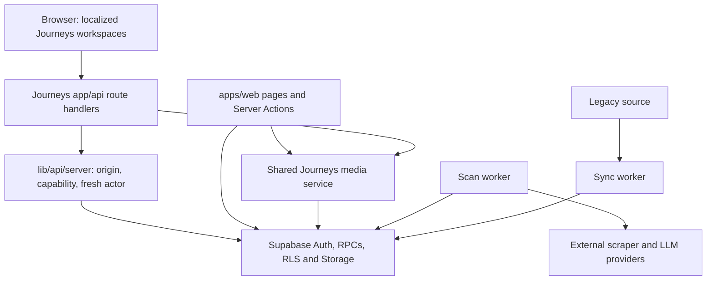

# KinnsoOS architecture

This is a pnpm/Turborepo monorepo with two Next.js 16 applications, two Hono workers and one ordered Supabase migration history. Start with [development and deployment commands](docs/DEVELOPMENT.md); release decisions and historical evidence live in [release operations](docs/implementation/RELEASE_OPERATIONS.md).

## Code map

| Boundary | Entry points and ownership |
| --- | --- |
| Journeys (`apps/journeys`) | Traveller catalog, bookmarks, trips, adoption, private media and shares; also native creator, merchant, Ops, inbox and agent workspaces. Localized entries live in `app/[locale]`; `/demo` uses a separate browser-local model. |
| Mature site (`apps/web`) | Existing publishing, merchant and operations flows, Server Actions, original-site pages and service adapters. Shares code with Journeys, including the private media implementation. |
| Scan (`apps/scan`, `packages/scan`) | Hono bootstrap in `src/server.ts`; authenticated scan/verification orchestration, bounded jobs, external fetch/LLM ports and normalization. Fixture mode uses fake providers; it still needs an isolated database. |
| Sync (`apps/sync`, `packages/sync`) | Hono `src/app.ts` receives webhook/admin requests; `src/server.ts` boots the legacy reader, transformations, upserts, redirects and revalidation. Starting the worker instantiates real dependencies. |
| Shared packages | `db` exposes ignored generated database types; `honesty` checks claims/URLs; `parity` compares legacy and replacement content with an offline test engine. |
| Database (`supabase/migrations`) | Tables, RLS, grants, role/session checks, revisioned mutations and idempotency receipts. The migration directory is source history, not proof of any hosted schema's state. |
| Tooling (`scripts`, `tooling-tests`) | Target identity guards, type generation, isolated migration rehearsal, source/deployment evidence and workflow contracts. |

## Core flows and invariants

**Catalog → bookmark.** Public catalog reads select bounded published content. The browser bookmark adapter calls `/api/bookmarks`; the route obtains the current actor before constructing an owner-filtered `guide_saves` query. Pages use descending `created_at` plus ascending `guide_id`; 101 rows provide 100 visible results and one lookahead. Both timestamp and guide UUID are required for continuation. Writes send an explicit desired state and a stable request UUID to `kinnso_bookmark`. An RPC transport exception is an unknown outcome (`503 UNAVAILABLE`), so a retry must retain that UUID and payload.

**Create → edit → adopt a trip.** `lib/trips/repository.ts` transports commands; `app/api/trips` validates them and calls revisioned database functions. `create_trip_v2` and its creation-receipt lookup support lost-acknowledgement recovery. `apply_trip_command` receives an expected revision and request UUID; adoption also binds the guide version. Concurrent or reused-but-different commands return conflicts. Publication/withdrawal and structured-versus-summary rules remain authoritative in database functions. See `tests/trip-creation-api.test.mjs`, `tests/integration/trips.test.mjs` and `tests/integration/guide-contract.test.mjs` in Journeys.

**Device recovery.** `lib/trips/local-drafts.ts` stores finite snapshots, private drafts and opaque unresolved receipts in IndexedDB. Operations bind to the locally current account. Logout/account changes clear private cached content; selected opaque receipts survive so the original account can reconcile an unknown command. A device receipt grants no backend permission. Offline snapshots do not include offline maps or photos.

**Media → share → revoke.** Capability checks distinguish existing-media access from new uploads. Unified media uses `lib/media/service.ts` with server-only authority; an approved external service is also supported. Upload finalization validates ownership and bytes. Revocable sharing and encrypted durable share receipts have separate readiness gates. Cleanup acknowledges queued paths only after Storage removal succeeds. See [media operations](apps/journeys/docs/media-operations.md) and the [share-recovery operator packet](docs/implementation/PD06_SHARE_RECEIPT_OPERATOR_PACKET_2026-10-23.md).

**Creator → merchant → Ops.** Native Journeys workspaces call their own BFF routes. The mature site's Server Actions retain their own cookie/session boundary. Directory links do not create cross-origin APIs or SSO. Database role/membership and state-transition checks remain authoritative; demo personas grant no connected permissions.

## Trust, configuration and failures

`apps/journeys/lib/contracts/capabilities.ts` binds the backend URL to both approved origins and rejects privileged keys in the publishable-key slot. Capabilities default unavailable; booking/payment stay unavailable even when listed. Media uploads and share recovery require additional server configuration. Configuration enables a route; it does not prove provider readiness or acceptance.

`lib/api/server.ts` checks write origin, capability, `auth.getUser()`, any supplied intent-actor header, then the `kinnso_actor` RPC. Database functions also verify session and role authority. Private JSON uses `Cache-Control: private, no-store` and `Vary: Cookie`. Failures use `{ok:false, code, retryable, requestId}`; internal error text is not a product message. The shared browser request helper returns explicit backend denials and maps transport/invalid-JSON failures to retryable unavailable, without automatic mutation retries.

Server credentials belong only to server media/telemetry/worker contexts. Optional telemetry requires consent and must not redefine durable success. Never infer persistence from a toast, a demo state change, a green build or anonymous production reads.

## Short risk map

| Risk | Existing protection and remaining exposure |
| --- | --- |
| High: schema or deployment mismatch | Guarded target identity, migration rehearsal and generated types exist. Release still needs exact deployed source/schema binding and a tested restore including Storage/Auth configuration. |
| High: cross-account access or uncertain writes | Fresh actor checks, RLS/RPC authority, revisions and request receipts exist. Offline ports cannot prove actual database isolation or replay semantics; connected role/concurrency tests remain required. |
| High: provider and commercial readiness | Capabilities fail closed and booking/payment remain disabled. Media cleanup schedules, notifications, content rights and actual-cost/provider acceptance require explicit release evidence. |
| Medium: two applications and duplicated contracts | One lockfile/migration history and shared media reduce drift. Server Actions, BFFs, environment names and independent-host authentication still differ. |
| Medium: evidence and test drift | Source allowlists, workflow contracts and offline tests catch many changes. Source-string tests and historical reports alone cannot prove current persisted behavior or device accessibility. |

## Next three engineering investments

1. **A reproducible isolated release lab.** Produce one candidate-SHA-bound result for migration upgrade/clean rebuild, generated types, role/concurrency browser tests and restore. Done when a fresh runner can reproduce the result and retain redacted artifacts without local workstation state.
2. **Broader executable boundary coverage.** Apply the bookmark route's real-context/fake-port pattern to remaining mutation routes, especially unknown outcomes, account changes and pagination. Keep a small real-database suite for RLS, receipts and concurrent replay. Done when each critical write has a demonstrated lost-acknowledgement recovery case, not only a source assertion.
3. **Consolidate shared service contracts.** Inventory duplicated auth, capability, API error and environment adapters across both apps; move stable framework-independent contracts behind shared packages incrementally. Done when both applications pass the same contract fixtures and deployment docs identify one owner for each service boundary.
