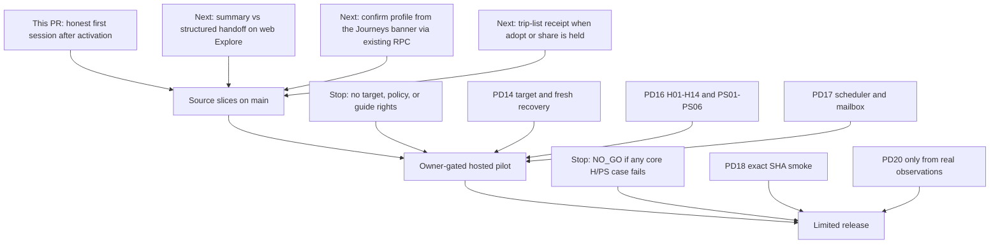
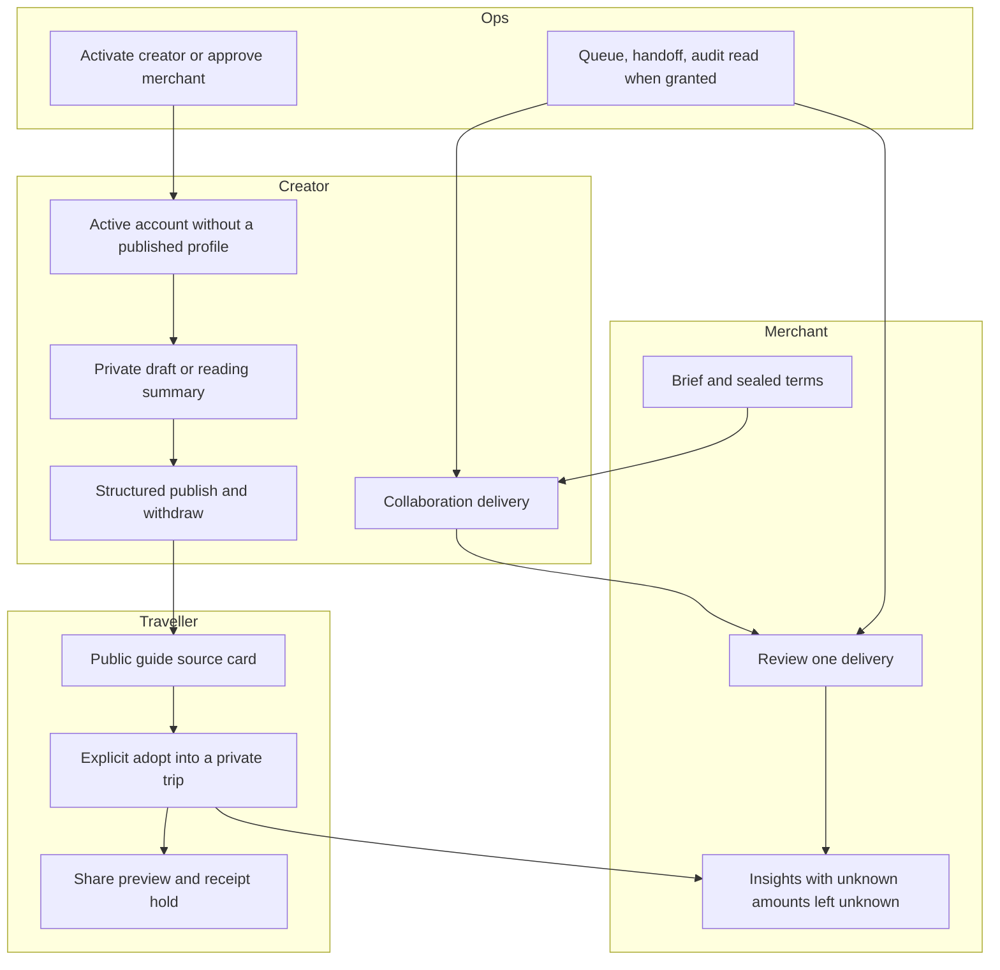

# KinnsoOS product development plan — 2026-10-25

Overlay on the 2026-10-22 product phase. It does not rewrite `KINNSO_PRODUCT_TASKS_2026-10-22.csv`, `KINNSO_PRODUCT_PREPARATION_TASKS_2026-10-23.csv`, `NEXT_PHASE_LEDGER.json`, or `NEXT_PHASE_TRACEABILITY.csv`. Historical COMPLETE / PARTIAL / NOT_RUN rows stay historical. Statuses below are an observation of main `de5408d52783552d2301388d53cd0076364aa8a9` plus the source increment in this plan’s PR. They are not hosted, pilot, or release results.

Companion ledger: `KINNSO_PRODUCT_TASKS_2026-10-25.csv`.

## 1. Current product state on this main

Two user-facing apps share one Supabase contract. There is no separate workers package. Scheduled work is Journeys cron routes under `apps/journeys/app/api/cron/` (`collaboration-reminders`, `media-cleanup`, `telemetry-retention`). Those routes existing is not evidence that a scheduler, mailbox, or provider has run.

| Surface | What main actually does | What it does not prove |
|---|---|---|
| Traveller (`apps/journeys`) | Public guide page with `describeGuideSource` (`lib/guides/source-summary.ts`, `lib/seo/PublicGuideContent.tsx`): structured vs reading summary, author / version / published time, original language and place-check date stay “Not recorded”. Adoption is explicit (`GuideWorkspace.tsx`, `trips.adopt` request id / revision). Summary guides tell the traveller to build their own days. Share preview keeps private notes out, holds unknown creates, and lists receipt metadata only when `shareRecovery` is connected (`SharePreview.tsx`). | New session, second device, real guide rights, and hosted H/PS cases. PD06 keyring / 403 / admin schema remain BLOCKED. |
| Creator, Journeys | Sign-in for anonymous `studio`, `merchant`, `ops`, and `admin` routes stays on this origin and preserves `next` (`app/[locale]/[[...route]]/page.tsx`, `lib/auth/return-path.ts`). Connected studio loads `GET /api/creator/profile`, then either the existing onboarding confirm flow or the guide editor (`CreatorWorkspace.tsx`). Publish / withdraw keep revision, request id, and “approval is not payment”. | Hosted creator role, real authored guides, or that an active row has a published profile. |
| Creator / merchant / ops, Web (`apps/web`) | Studio, guide summary form, structured editor on the edit page, merchant dashboards, and ops creator admin. `getAuthedCreator` and guide reads require `creators.status = 'active'` and `guides.creator_id = auth user` (`lib/guides/actions.ts`, `app/[locale]/studio/guides/[id]/edit/page.tsx`). Ops status changes go through `admin_set_creator_status`. Studio home (`app/[locale]/studio/page.tsx`) renders only when `DnaSchema` accepts `creator_dna.final`; otherwise it redirects to `/creator`. | That activation produced a profile, a directory listing, or a hosted audit-log read. The new SELECT grant is source SQL, not a live migration. |
| Data | `supabase/migrations` is the source history, including `20261025140000_grant_ops_audit_log_select.sql`. Booking and payment stay source-unavailable in `CAPABILITY_READINESS.csv`. | Hosted schema is still `not_checked`. This plan does not run SQL. |

`capabilities(env)` remains configuration, not an account permission. `schema: 'not_checked'` is unchanged.

## 2. What #96 and #97 changed, and what that unblocks

| PR | Main commit | Source change | Unblocked | Still closed |
|---|---|---|---|---|
| #96 | `7291f1127ff56c8b9efce1da79d24ca9121e89d0` | Ops `SELECT` on the audit log. Guide editor and `updateGuideAction` filter `creator_id`. Guide writes require an active creator and send anyone else to `/creator`. | An operator can activate a creator in source, and a guide edit cannot be loaded from a public id alone. | Applying the migration, reading a live audit log, and any claim that activation finished onboarding. |
| #97 | `de5408d52783552d2301388d53cd0076364aa8a9` | Anonymous creator / merchant / ops entry redirects to local sign-in with the full task. Password sign-in returns to that local path and refuses a foreign Remix origin. Invitation landing stays anonymous. | A signed-in creator can enter the Journeys studio on this origin instead of being sent away. | A session is not an active creator profile. Merchant and ops entry still depend on connected capability and server role checks. |

The gap those two PRs leave in source: `resumeStep` (`apps/journeys/lib/creators/progress.ts`, re-exported by `apps/web/lib/onboarding/resumeRoute.ts`) returns `done` for every `active` row. Web studio home then redirects a missing or invalid `final` back to `/creator`. The wizard’s done state rendered `ReadBack` (“Your profile is live”) whose forward link was `/studio`. An operator-activated creator with no published DNA bounced between those two routes and was told the profile was already live. Journeys showed the same authoring list as a creator who had confirmed a profile.

This plan’s code slice closes that source loop. It does not mark PD16, PD17, or PD18 done.

## 3. Gap analysis

Historical task status is the 2026-10-23 preparation ledger unless a cell below says the 2026-10-25 overlay observed something newer. “Source present” is not acceptance.

| ID | Historical status (unchanged) | On this main | Gap that still blocks the phase |
|---|---|---|---|
| PD01 | COMPLETE | Baseline documents remain. Main has moved many commits past `0e9fd55`. | None for source reading. Do not treat this plan as a new integrity ZIP. |
| PD02 | BLOCKED_CI | PR82-era CI notes are historical. Later merges exist. Exact-head CI for a release candidate is still a separate receipt. | GitHub spend / runner eligibility is owner-owned (T03). Do not lower gates. |
| PD03 | IMPLEMENTED_REVIEWED_PR84 | 46 public entries and unknown-404 behavior remain in Journeys. | Hosted click-through is NOT_RUN. |
| PD04 | DIRECTIONS_SELECTED_CONTENT_APPROVAL_BLOCKED | Draft copy exists. Notice is not an approved channel. | Owner channel, staffing, retention facts. |
| PD05 | REUSED_LOCAL_VERIFIED_OWNED_BLOCKED | Task selectors still group creator and merchant work. Loaded-page copy is not a company-wide count. | Owned DB acceptance. |
| PD06 | REUSED_LOCAL_VERIFIED_OWNED_BLOCKED | Explicit adopt, summary refusal, pending adoption recovery, share hold / receipt list. | Real content, second device, share-receipt keyring, hosted readback. |
| PD07 | SOURCE_IMPLEMENTED_BLOCKED_REAL_CONTENT | Source card does not invent language or verification time. | Author consent and image rights. No synthetic public substitute. |
| PD08–PD13 | Source implemented or reused; owned/hosted blocked | Campaign summary, evidence timeline, merchant review scope, insights/CSV, ops handoff copy, reminder runbook. | Same contracts. No new task engine, payout, or scheduler. |
| PD14 | DIRECTIONS_SELECTED_OPERATIONAL_INPUTS_BLOCKED | Packets exist. RPO/RTO null. | Exact target, actors, fresh recovery. No new Supabase project. |
| PD15 | LOCAL_PASS_REQUIRED_GATES_BLOCKED | Local suites have passed on older heads. | This main needs its own CI receipt. Prior PASS does not transfer. |
| PD16 | BLOCKED_TARGET_POLICY_CONTENT | H01–H14 and PS01–PS06 remain NOT_RUN in `PD16_PD17_MAIN_REVIEW_REQUIREMENTS_2026-10-25.json`. | Target, policy, three consented guides, named roles. |
| PD17 | BLOCKED_OWNER_TARGET | Cron routes and runbook only. | Real dispatch, recipient, dedupe, handoff. |
| PD18 | NO_GO | Release packet language exists. | GO is not available. T08 / N16 stay open. |
| PD19 | DEFERRED | Four existing AI tasks only. | No new provider call. |
| PD20 | NOT_RUN_PILOT_BLOCKED | No pilot observations in this plan. | Do not invent adoption, timing, or ROI. |

PS01–PS06 are still scenarios, not passed tests. The source slice below only makes the creator’s first active session tell the truth (PS03 entry, not completion).

| Scenario | Source on main before this PR | After this source slice | Still required for the scenario |
|---|---|---|---|
| PS01 traveller adopts a real guide | Summary vs itinerary is explicit. Adopt confirms version. | Unchanged. A web summary publish is now labeled as a summary. | Consented structured guide, new session. |
| PS02 prepare and share | Share preview and receipt states are presentation-complete. | Unchanged. | Connected recovery key, hosted revoke, second reader. |
| PS03 creator publishes a usable guide | Journeys editor has readiness checks. Web activation could claim a live profile with no DNA. | Active-without-`final` no longer says the profile is live and no longer links only to studio home. | Real structured content and hosted publish/withdraw. |
| PS04 creator delivers a collaboration | Timeline and revision handlers exist. | Unchanged. | Named merchant, hosted CAS. |
| PS05 merchant brief to review | Publication summary and role guards exist. | Unchanged. | Hosted company scope. |
| PS06 ops handoff | Runbook and queue copy exist. Audit-log SELECT is source-only. | Unchanged. | Named ops, real job, hosted read. |

H01–H14 stay `ORIGINAL_HOSTED_OR_SHARED_REHEARSAL_NOT_RUN`. This PR does not add a hosted client.

## 4. Roadmap

### Phase A — near-term source slices

Allowed without owner inputs, production deploy, new Supabase projects, booking/payment activation, or lower CI gates. Each slice keeps BFF → RPC, CAS / request id, and EN / zh-HK copy. Exit gate: unit or component tests on the branch, no hosted PASS, manifests updated only when a new Journeys source file is added.

| Order | Slice | Depends on | Scope | Exit | Stop |
|---|---|---|---|---|---|
| A0 (this PR) | Honest creator first session after activation | #96 active-creator gate, #97 local sign-in | Web wizard, guide summary copy, Journeys `profilePublished` banner | Tests show no live-profile claim and no studio-home loop when `final` is missing | Do not auto-publish DNA or guides |
| A1 | Web public guide uses the same summary/itinerary distinction as Journeys | A0 copy, existing `describeGuideSource` or the web guide DTO | One reader path | Summary page has no adopt control and does not invent stops | Do not seed guides |
| A2 | Journeys unpublished-profile banner opens the existing confirm form | A0 `profilePublished === false`, `confirm_kinnso_creator_profile` | `CreatorWorkspace` only | Confirm still requires the checkbox and request id | Do not add a second profile table |
| A3 | Trip list states a held adopt or share without opening the guide | Existing `PendingAdoptionRecovery` and share hold | Presentation on the trips index | Unknown stays unknown; retry uses the original request id | No keyring or hosted share recovery |

### Phase B — owner-gated hosted pilot

Do not start from source green. Entry needs PD04 approved bilingual contact and retention facts, PD07 three guides with author consent and image rights, and PD14 an existing target with purpose, cohort, actor refs, and a fresh recovery gate. Exit is H01–H14 and PS01–PS06 on that same source, schema, and config, with cleanup. PD17 is a separate exit for dispatch and recipient readback.

Stop points: missing target, shared backend that cannot isolate fixtures, refused endpoint, schema `not_checked`, null RPO/RTO, unpaid CI, or any core permission / lost-write failure. No new Supabase project. No booking or payment provider. No production deploy.

### Phase C — limited release

PD18 stays NO_GO until Phase B exits. A release needs an owner decision, exact SHA, schema evidence, read-only smoke, and a source archive. Field CWV stays insufficient until `summarizeSamples` has its existing minimum. PD20 may name at most three next items, and only from recorded pilot use. This plan names none.

## 5. This PR’s increment

**Choice.** Creator first-session honesty after admin activation. Share-receipt UI and the public Journeys source card were already specific. The activation loop was a false “ready” claim on the path #96 and #97 just opened.

**Behavior.**

- `classifyActivatedProfile` accepts only schema-valid `creator_dna.final` as published. A draft is not published.
- `/creator` at step `done` without that `final` renders `ActivatedCreatorSession`: the account is active, studio home stays closed, and the forward link is `/{locale}/studio/guides/new`. An unpublished draft can be reviewed; otherwise profile setup continues. A profile confirmed in the same session still shows the existing readback.
- The web guide form states that it saves a reading summary, not structured days, and that Explore is not the creator directory.
- Journeys `GET /api/creator/profile` adds `profilePublished` from `final` only. `profileReady` is unchanged, so review polling still treats a draft as something to show. The studio list says authoring is available and the profile is not on file.

**Not claimed.** Hosted activation, audit-log reads, directory listing, structured publication, PD16/PD17/PD18, or CI for this head.

## 6. Recommended next three build slices

1. **Web guide reader parity (PS01).** When Explore or `/g` renders a row published from `GuideForm`, show the same summary boundary Journeys already shows in `PublicGuideContent`. Do not add an adopt button for a summary.
2. **Confirm the existing profile from the Journeys banner (PS03).** If `profilePublished === false`, link into `CreatorOnboarding` and keep `confirm_kinnso_creator_profile`. Do not mark the account done because status is `active`.
3. **Held adopt/share on the trip index (PD06 presentation).** Surface the existing pending adoption and unconfirmed share on the trips list with the original request id. Do not implement keyring recovery or call it hosted.

## 7. Traveller, creator, merchant, and ops loop

Merchant insights read authorized business records only. A traveller private note is not a merchant metric. Ops activation does not publish a guide or a profile.
