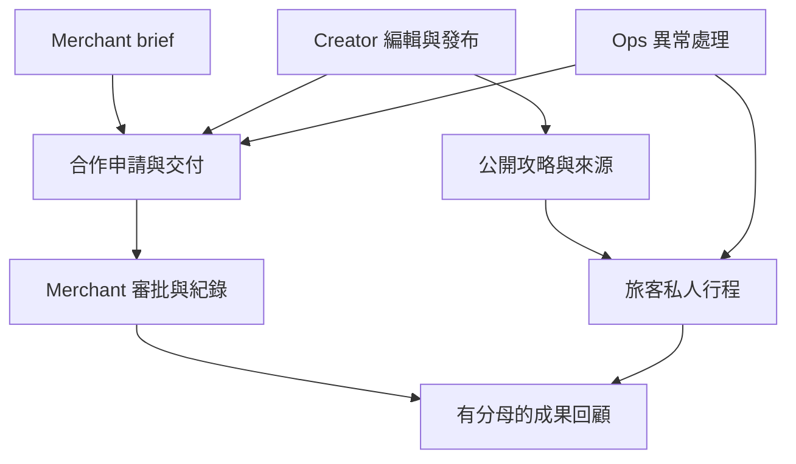
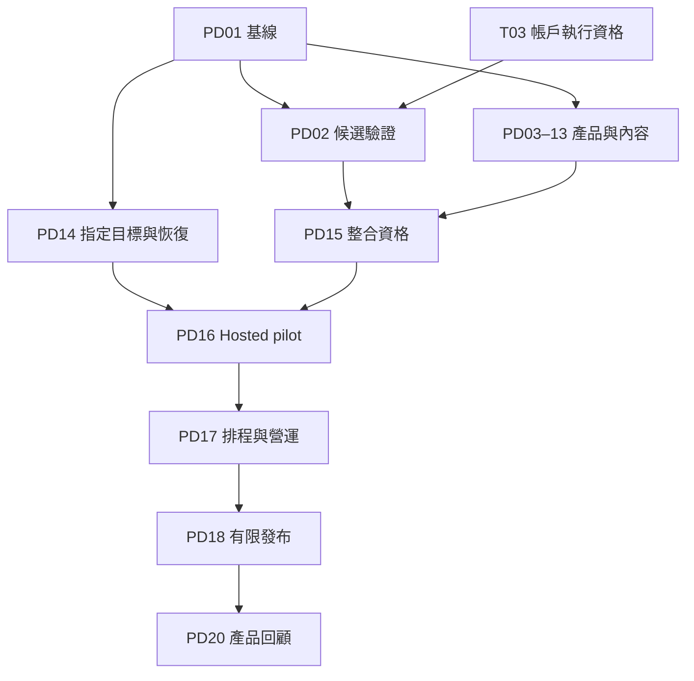

# KinnsoOS 下一階段產品開發計劃

**對象：Codex GPT‑6.1 Sol、產品負責人、QA、內容及營運團隊**  
**版本：2026-10-22；證據主來源：KinnsoOS_Audit_Evidence_2026-10-22.zip**  
**建議階段：完成可試營運的旅客、Creator、Merchant 合作流程。**

本計劃的重點是讓現有功能真正形成完整服務：旅客找到有來源的攻略並建立可保存的行程；Creator 發布可採用的內容並完成合作交付；Merchant 發起合作、審批成果並看懂可核實的紀錄；Ops 能處理失敗及交接。採用現有 KinnsoOS 架構及 Kinnso Journeys 視覺方向，保留已驗證的領域邏輯。

這次交付是產品設計與執行計劃，沒有新增產品程式、合併 PR、改動資料庫或部署。新功能及數值目標均是建議；下文明確區分它們與已取得的證據。

## 1. 先確定目前在哪裏

### 1.1 已核實的基線

| 項目 | 證據及目前含義 |
|---|---|
| 輸入 ZIP | 16 個檔案；SHA‑256 `3d4a976e66245c798891c56d64d9e5d29d29af85bb98ef8baabb1d70827f43ea`；15 個有列入 `evidence-hashes.json` 的內容檔案全部吻合 |
| GitHub main | 本次於 2026-10-22 13:57 UTC 重新讀取，仍是 `0e9fd552f6e6270da23c8ebc25ec7487524850d6` |
| PR #82 | 本次重新讀取：open、draft、未 merged；head `4b42fdebaf97cd11b91a7b6ca0d4366c92072e8d`，16 個變更檔案 |
| 正式站 | ZIP 記錄其 source baseline 為 main `0e9fd55`；這次編寫計劃沒有重新進行 live runtime 稽核，不能將 PR 修正稱為已正式上線 |
| 已有修正 | 商戶初始拒絕／舊 ACK 時序；四個公共資訊入口；工作區與 demo 分流；Creator 未接通狀態；320px 頁頭重疊 |
| 本機驗證 | ZIP：675 unit/component/contract passed；build、typecheck passed；10 source-package tests；10 HTTP cases |
| 未完成的驗證 | ZIP：Playwright u18 有 12 個 browser-launch failures、0 assertions；u20 未跑；hosted 角色／真 DB／實機／讀屏未驗收 |
| CI 阻礙 | ZIP 的最終 head 有 14 個 failed jobs 在執行前停止，另 2 個依賴 e2e skipped；job 註記為 GitHub 付款／支出資格。這是歷史觀察，執行前須重讀，不能冒充應用斷言失敗 |
| 已合併工作 | PR #77–80 已整合；不再執行舊計劃中的「合併 PR77/78」步驟。PR #81 是獨立依賴更新 |
| 需求追蹤 | 原 `A01–A20`、`G01–G18`、`U01–U06` 共 44 列仍為 partial；本次讀 repo 另確認 `LegacyE01–LegacyE09` 9 列，完整追蹤共 53 列，全部保留。`N01–N18` 是另一層任務，不可把「18 個 N」與「18 個 G」混為一談 |

**最重要的判斷：**目前主要缺口是部署與角色驗收、內容真實性、可理解的工作流程和營運承接。既有合作／審批／提醒／收益／AI 基礎不應再建立一套平行系統。

### 1.2 沿用的稽核任務，不改寫完成狀態

| ID | 內容 | 依賴 | 證據包狀態 | 本計劃承接 |
|---|---|---|---|---|
| T01 | Source／production 對齊 | — | COMPLETE，歷史基線 | PD01 更新差異 |
| T02 | 五項修正 | T01 | IMPLEMENTED_DRAFT_PR_82 | PD02 驗收，不重做 |
| T03 | GitHub 執行資格 | — | OWNER_REQUIRED | 帳戶 owner 處理；PD02 記錄實際 runner |
| T04 | 候選版本資格 | T02、T03 | BLOCKED | PD02 先驗 PR82；PD15 再驗最終整合版 |
| T05 | 私隱／支援內容 | T02 | OPEN | PD04 |
| T06 | Hosted Creator／Merchant pilot | T04、T05 | NOT_RUN | PD14 準備目標；PD16 真實驗收 |
| T07 | Provider／提醒營運 | T06 | NOT_RUN | PD13 本機完善；PD17 指定環境驗收 |
| T08 | 發布與 field performance | T04–T07 | NOT_DEPLOYED | PD18 |
| T09 | 其他保留路徑 | T02 | OPEN | PD03 |

T01、T02 的程式證據不會因新計劃而消失；T04–T08 也不會因測試數增加而自動完成。新候選改變後，受影響的驗收必須重新綁定。

## 2. Brainstorm：選擇哪一種下一階段

| 方向 | 可帶來的成果 | 代價／不足 | 決定 |
|---|---|---|---|
| **A. 完整試營運流程** | 將攻略、私人行程、合作交付、商戶審批及 Ops 串起；用真實角色驗證價值 | 需要內容、角色及營運 owner 配合 | **推薦；本計劃主線** |
| B. 只修穩定性及公開入口 | 較快完成 PR82、路由、文案及手機修正 | 仍不能回答 Creator／Merchant 是否能完成工作 | 作為第一批，不能代表整階段完成 |
| C. 一次建成訂位／付款／自動出款 marketplace | 商業功能表面更完整 | 供應、退款、資金、對帳、客服及 provider 條件尚未閉環 | 留待獨立商業階段；本階段不納入 |

選 A 的原因來自現有證據：大量核心程式已存在，但現實使用尚未證明。先完成一個可重複運作的合作循環，比增加更多未接通的入口更能確認產品價值。

**本階段產品假設：**用少量優質、可採用的攻略吸引旅客；Creator 的內容產生可觀察的採用；Merchant 以清楚的 brief 和交付審批合作；平台藉可靠的工作流程留住三方。這是待 pilot 驗證的假設，並非已證明的市場領先結論。

## 3. 使用者要完成的工作

以下 `PS01–PS06` 是本計劃新增的驗收情境，**並非重新定義歷史 U01–U06**。舊故事的原始結案條件繼續保留。

| 情境 | 觸發 → 操作 → 可見結果 | 持久化／失敗驗收 | 主要任務 |
|---|---|---|---|
| PS01 旅客從靈感到自己的行程 | 瀏覽真實 structured guide → 收藏／明確採用 → 修改日期與私人筆記 → 回到行程 | 新 session／第二裝置讀回；重複點擊不重複採用；summary guide 不假裝有站點；來源版本保留 | PD06、PD07、PD16 |
| PS02 旅客出發前準備及分享 | 查看時間／地點資料 → 處理衝突警示 → 記錄／照片 → 預覽分享 → 撤回分享 | 弱網下清楚顯示未確認；未上傳照片不稱完成；私人筆記不公開；撤回後接收者不能再讀相關分享資源 | PD06、PD15、PD16 |
| PS03 Creator 從草稿到可使用攻略 | 完成現有 onboarding → 編輯 structured days/stops → 檢查／預覽 → 發布 | 未保存、缺欄或版本衝突有下一步；公開內容與私人草稿分離；withdraw 不刪除旅客已採用副本 | PD07、PD16 |
| PS04 Creator 完成商戶合作 | 找到／接受合作 → 看清條件和期限 → 交證明 → 收到修訂 → 再提交 → 核准 | 保留同一次未知提交的 payload／requestId；改期限不抹掉通知時期限；審批不冒充付款 | PD09、PD13、PD16 |
| PS05 Merchant 發起並完成合作 | 商戶申請經 Ops 核准並取得 owner 資格 → 發布 brief → 邀請／審申請 → 審交付 → 讀成果報告 | 多公司切換及角色撤銷不串資料；marketing／clerk／finance 按既有範圍；published terms 不被 draft 編輯繞過 | PD08、PD10、PD11、PD16 |
| PS06 Ops 接手異常並交班 | 從 support／審批／job 異常進入 → 核對狀態 → 採取有權限操作 → 交接 | 客戶回覆和 internal reason 分離；不清除別案草稿；失敗／unknown 留痕；原角色重新讀回結果 | PD12、PD13、PD17 |

## 4. 做甚麼、沿用甚麼

| 工作面 | 已存在的來源能力 | 本階段的實際增量 | 完成界線 |
|---|---|---|---|
| 入口與導覽 | `WorkspacePanel`、`PublicInformation`、known routes、明示 demo | 把其餘 retained routes 逐一導向有意義內容；每頁有一個清楚主行動 | 不是所有入口都顯示 hub；未知路徑仍 404 |
| 今日工作 | `creatorTasks`、`campaignTasks`、`merchantSetupTasks`、現有 CollaborationTasks | 整理「我需要做／等別人／已完成」、公司與角色上下文、分頁範圍說明 | 沿用既有 task selectors；不新增任務引擎或第二套狀態 |
| 旅客 | 收藏、GuestPlanner、adoption preview、TripWorkspace、分享／匯入／草稿恢復 | 縮短第一次建立行程的操作迷失；顯示保存／未確認狀態；完整處理來源、時間、弱網及分享的下一步 | 不自動建立或採用；不承諾未實作的離線同步 |
| Creator 內容 | guide editor、publicationReadiness、publish／withdraw、immutable versions | 攻略來源資訊卡：作者、版本、發布時間、structured／summary、已有 place facts 的來源與查核時間；新舊版本差異更易理解 | 未提供原文語言／查核時間維持 unknown；發布時間不冒稱實地查核時間 |
| Merchant brief | onboarding、campaign lifecycle、schedule／published-term guards | 發布前摘要及角色適用 CTA；清楚呈現要求、deliverables、期限、報酬種類與缺項 | 後端仍是發布權威；不重寫現有 validation／terms sealing |
| 合作交付 | 申請、邀請、milestones、proof、revision、review history | 以現有資料整理時間線及單一下一步；待審、修訂及已核准的區別更清楚 | 保留原狀態值與 receipt／CAS；不可由時間線新增副作用 |
| 商戶審核 | creator discovery、campaign lists、filters、owner review | 保留 filter／Back／reload，上下文清楚的審批摘要，處理清單截斷及角色差異 | 本階段每次審一項；批量核准、批量出款不納入 |
| 成果 | MerchantInsights、CSV、CreatorEarnings、tracked／settled／payouts | 解釋時間範圍、as-of、coverage、分母及未知項；支援 campaign 成果回顧 | attribution=null 不顯示 0；核銷／核准次數不是營收或因果 ROI |
| Ops／支援 | support drafts、ops queues、monitoring、readiness CLI | 例外分類、可追查 reference、交接清單；configured／schema／role／runtime 分開 | 沿用現有頁面；不建立展示秘密配置的公開管理面板 |
| 通知 | inbox、reminder context、dedupe、排程 contracts | 驗證真正排程、重試、撤權與收件結果；分清站內送達及 email | Email 未配置便不宣稱寄出；unknown send 不盲目重發 |
| AI | `sourceQA`、`tripSuggestion`、`creatorMaterials`、`merchantBrief` 已有 | 核心 pilot 後再改善「引用→建議→預覽→人手採納」體驗 | 不新增平行聊天系統；不自動改行程、發合作、審批、訂位或付款 |

**內容品質的實際前置：**準備至少三篇獲作者同意、圖片權利清晰、有真實 days/stops 的攻略。內容 owner 保留原文語言、查核來源及日期的 intake 記錄；尚未有可靠 DTO 欄位的資料不能由 client 猜出。新增 authored-locale／sponsorship 的持久化 schema 是後續候選，先確認現有 schema 及 pilot 需要，並不在本批憑空建立資料表。

## 5. 架構與介面決定

延續 `apps/journeys` 的 Next.js、React、TypeScript、BFF API 及 Supabase RPC／RLS。保留 `ApiResult<T>`、後端 actor、company scope、revision/CAS、request receipt 及 scope invalidation。先修改現有功能的呈現及恢復流程；只有證據顯示現有 contract 無法支援驗收時才提出最小 additive 變更。

此圖表示使用者與資料關係，不代表可以把旅客私人資料直接交給 Merchant。Merchant 報表仍只使用其授權的業務資料；跨角色使用分析須符合現有 consent／aggregation contract。

**必須維持的介面及約束：**

1. `capabilities(env)` 只代表配置能力；不推導帳戶／公司權限。`diagnoseReadiness()` 的 `schema: 'not_checked'` 不得改稱 schema 已就緒。
2. `creatorTasks`／`campaignTasks` 只吃已授權、有界的資料。分頁列表顯示「目前載入」範圍；不能把第一頁項目數稱為全公司待辦總數。
3. 所有 command 仍走既有 repository → BFF → RPC；UI 不直接寫資料表。撤權後立即清除已拒絕的私人資料；晚到回應不能重新顯示。
4. `AUTH_REQUIRED`、`FORBIDDEN`、`NOT_FOUND`、`CONFLICT`、`INVALID`、`UNAVAILABLE` 分別處理。unknown-write 與 read-failure 不是同一種重試。
5. `trips.adopt(guideId, version, tripId, expectedRevision, requestId)` 保留明確確認及來源版本；既有私人筆記不被作者新版本覆蓋。
6. Creator `publish(id, expectedRevision, requestId)` 與 merchant commands 保留 optimistic concurrency；發布前 UI checklist 不取代 server validation。
7. 收益逐幣別呈現。未知金額、未接通 provider、tracked、settled、歷史 payout 分開；不新增自動結算副作用。
8. 新元件保持按角色拆分及 dynamic boundary；避免將 private tools 拉入公共路由 bundle。只有量測證明需要才改 loading 或 cache。
9. Interface copy 使用 EN／zh-HK；作者內容不自動翻譯；時區來自資料及既有 schedule contract，不能直接用裝置時區冒充活動時區。
10. 新檔案進入對應 source manifest，release source archive 必須包含實際所需內容；受保護 preview 的 HTML redirect 不是 ZIP 損壞證據。

## 6. 里程碑與依賴

每個 PD 任務的精確檔案、介面、步驟及測試入口見同行的 Implementation Plan；CSV 是可排序的執行 ledger。

| 里程碑 | 包含任務 | 可展示成果 | Exit gate |
|---|---|---|---|
| M0 基線與可信入口 | PD01–PD04；同步準備 PD14 | PR82 驗證紀錄、完整 retained-route 決策、可用公共入口、可審查政策內容 | PD02 具真實執行結果；PD03 路由驗收；政策未核准仍標 blocked |
| M1 三方工作流程 | PD05–PD13 | 旅客採用、Creator 內容與交付、Merchant brief／review／insights、Ops 接手 | 各 slice 的 code＋必要本機／owned tests 通過；未把 fixture 當 hosted 成功 |
| M2 指定環境試營運 | PD14–PD17 | 同候選版本 H01–H14、三篇攻略、PS01–PS06、提醒故障恢復 | 同 source／schema／config 的完整驗收，無未解核心權限、丟稿或重複寫入缺陷 |
| M3 有限發布與學習 | PD18、PD20 | 可審查發布包、獲授權發布後 smoke、實際使用與回顧 | 獨立 release 決定及結果；下一輪最多三項優先改進 |
| 可選後續 AI | PD19 | 在既有四類任務上改善引用和採納 | 先有 pilot 痛點、來源／成本／品質證據；不阻塞核心 pilot |

圖是工作流摘要；精確依賴在 CSV。依賴有兩種：**source-ready** 允許分支開發，**acceptance-ready** 才允許進入 hosted／release。PR82 未合併時可在其已核實 remote head 上開隔離 stacked branch；不能把 source-ready 說成已達發布資格。

### 首批直接執行第 1–3 步

1. **PD01：核對證據與工作分支。**重新讀 ZIP、main、PR82、最新 diff／checks；保留 44 列 A/G/U、9 列 LegacyE，以及 N/P/NEXT 歷史紀錄。輸出本次 candidate／scope ledger。不要重做整個網站稽核。
2. **PD02：完成 PR82 尚缺的驗證。**有可用 runner／browser 時跑 exact candidate 的 gates；若 T03 仍受阻，寫明原因及恢復所需條件，保留原 failure，完成可做的 public/local 檢查。不要更改帳戶付款或降低測試門檻。
3. **PD03：完成 retained public routes 的產品增量。**先列出每個路徑的意圖、內容及 CTA，再建立 typed registry 與雙語頁面，補真實路由及鍵盤測試。這項只依賴 source，不必等待 T03 解決；交付一個小而完整、可審查的 PR。

首批完成後按依賴繼續 M1；不因每個 commit 要求重複確認。遇到未授權環境動作或缺 owner 輸入，只停受影響的任務。

## 7. 量度價值，而非只量測試數

以下是**建議 pilot 目標，尚未量得、亦非服務承諾**。第一批由產品 owner 固定 cohort、分母及觀測方法；不可在失敗後移動門檻。

| 指標 | 定義與建議目標 | 取得方式／限制 |
|---|---|---|
| 主要可用性 | 至少 5 位經同意的旅客；其中至少 4 位不用口頭指導，5 分鐘內完成已選攻略→明確採用→保存筆記→重開 | 小樣本任務測試；不是市場轉化率 |
| Creator 首次成果 | 至少 2 位 Creator 各完成一個完整交付循環；發布／交付後新 session 讀回一致 | 記實際耗時及求助次數；內容準備時間另列 |
| Merchant 首次成果 | 至少 2 間公司完成 brief→接納→審批→成果回顧；每間至少一位 owner | 不用 synthetic seed 代替真角色；付款不在指標內 |
| 恢復與資料正確 | 指定 lost-ACK、conflict、撤權、公司切換 cases：零跨 scope 資料、零重複副作用、零已確認保存資料遺失 | 安全／正確性是 release gate，不以平均值抵銷失敗 |
| 主流程完成率 | success／attempts，按角色、版本、任務列示；未觀測時為 unknown | 既有 telemetry 僅記同意範圍；不能冒稱全體用戶或 unique people |
| 商業成果 | accepted→submitted→approved 的數量／耗時、修訂輪次、recorded redemptions、支援恢復 | `attribution:null` 保持 unknown；不計算無證據的營收、ROI 或 creator payout |
| Field CWV | mobile／desktop 各自 p75：LCP ≤2.5s、INP ≤200ms、CLS ≤0.1 | 採用 Web Vitals 建議值；樣本不足仍顯示 insufficient，不能用 lab 替代 field |
| 首個可操作欄位 | 沿用既有 first-usable 測量與其 committed protocol；此計劃不另定較寬門檻 | 同機、同資料、同 actor/company、cold/warm 比較；保留原始失敗及數值 |
| API 可靠性 | 初步候選：核心成功讀取 p95 ≤1.5s、command ACK p95 ≤2s；排除外部 provider 時需明示 | PD15 先記基線、條件與樣本，再由 owner 固定門檻；不是目前測得結果 |

Field 指標使用既有 `summarizeSamples(minimum=20)` 時，不降低最低樣本門檻；這個最低值只是內部摘要條件，並不代表足以宣稱市場表現。低流量 pilot 以任務逐案證據及受控 lab 為主，field acceptance 繼續保留待觀測狀態。

無障礙以 WCAG 2.2 AA 作設計目標，具體測 320px、200% 文字、鍵盤、focus、錯誤說明、VoiceOver、NVDA 及真實 iOS／Android。自動檢查或 viewport 模擬不等於整站符合性認證。

## 8. 角色、測試及發布的完成定義

每個任務分別保留 `code_status`、`test_status`、`deployment_status`、`runtime_status`。只有需要的層級全部有證據才完成該任務，不能只寫「Done」。

| 檢查層 | 必須證明 | 不能拿來替代 |
|---|---|---|
| Source | 新功能實際接到 route／component／API；權限與狀態流程合理 | 漂亮 demo 或死碼 |
| Unit／component | 主要分支、真實競爭順序、unknown retry、語言／空狀態 | Hosted database 或實機 |
| Owned integration | 合法 actor 成功；其他 actor／company 拒絕；CAS／receipt／quota | 共用 staging reset／seed |
| Native browser | 真路由、登入返回、保存、reload、focus、分頁、弱網及手機 viewport | 純截圖或測試設定檔存在 |
| Hosted roles | H01–H14 的真角色成功與拒絕控制；同候選 saved state／approval／usage | Vercel READY、舊 CI 或配置檢查 |
| Operations | 排程執行、送達、故障、恢復、清理及下一班 owner | 僅有 cron route 或 inbox 樣本 |
| Release | exact SHA／tree、schema、配置、能力範圍、source archive、回退及 owner 決定 | merge 按鈕可點、main 未受保護或 preview 能開 |

維持原 H01–H14：申請批准、campaign／creator申請、交付修訂、收益真實性、雙 Creator 隔離、雙公司隔離、marketing 範圍、clerk／finance 範圍、ops 審批衝突、撤權、lost ACK、保存／重登入、實際測試 mailbox、雙語／小屏／鍵盤。新 PS 情境與 H 矩陣一起驗；相同測試可交叉引用，不能把舊紀錄改成新 head 通過。

**整個階段的 GO 條件：**M1 功能切片完成、同候選必要 CI 真正執行、核准政策／支援入口、指定目標恢復紀錄、H01–H14、三篇真內容、PS01–PS06、實機／AT 及提醒營運結果均達標。缺任何核心項目維持 NO_GO；可交付 source，不可宣布正式模組完成。

## 9. 容易遺漏、但本階段應處理的事情

| 遺漏風險 | 明確決定 |
|---|---|
| 有入口但沒有下一步 | 每個 public／empty／unavailable state 都有可用 CTA；不要求登入來啟用未接通能力 |
| 有帳戶卻沒有角色 | 服務已啟用、沒有 membership、角色被撤銷三種狀態分開 |
| 作者內容看似即時資料 | 顯示已知來源／日期；unknown 不能補猜；價格與營業時間有不同 freshness |
| 只看當前清單 | 標明 pagination／coverage；不要漏掉 truncated milestones 或把第一頁當全部 |
| 隱藏發布權限邊界 | UI checklist 只是解釋；直接 API／RPC 仍要拒絕非法發布和修改 published terms |
| 私人證明／聯絡方式外洩 | 公開攻略、搜尋、SEO、CSV 都使用明確投影；不沿用整個 private DTO |
| 非預期發送／重複邀請 | team invitation 與 creator collaboration invitation 分別驗證；外部訊息需指定收件及既有授權 |
| 有金額就當付款成功 | tracked、settled、歷史 payout 分開，逐幣別；未批准 business rules 不自動補齊 |
| 客服不能接手 | reference、客戶回覆／internal reason、case-specific draft、handoff owner 同時驗 |
| 沒有內容／營運 owner | 三篇真攻略、私隱聯絡、job owner、支援輪值是明確交付物 |
| 有備份檔就當可恢復 | 指定環境需要 fresh recovery rehearsal；DB、Auth、Storage、provider 配置各自說明涵蓋範圍 |
| 沿用歷史計劃的過期步驟 | 先做差異對照；PR77–80 和既有 checklist／task lists 不重建 |

## 10. 角色分工與執行邊界

Codex 負責來源差異、設計／實作、必要測試、可審查 PR 及證據；內容 owner 提供真實內容與權利；產品／政策 owner 核准對外說明；Platform／DB owner 指定環境、Auth、備份及必要權限；QA 與真角色完成 hosted／實機觀測；Release owner 作最終發布決定。

這份計劃不建立新的外部授權。後續執行應沿用當時已明確允許的 repo、push／PR、staging 及測試範圍；不重問已有授權。若付款設定、正式 SQL、權限指派、對外訊息、付費 provider 或 production merge/deploy 超出既有授權，先完成 exact target、差異、測試、回退及可審查操作包，再一次處理所缺決定。只阻擋依賴該動作的任務。

初步規劃可按 **6–8 週的工作窗口** 安排：兩位工程／Codex 工作流加兼任 QA、內容及營運 owner。這是容量假設，外部等待及新發現缺陷另計；先完成 PD01 的差異清單再估工，不以此日期承諾上線。

## 11. 下一階段候選：有證據才擴張

| 候選 | 啟動條件 | 目前決定 |
|---|---|---|
| 攻略 authored-locale／sponsorship 結構欄位 | 真內容 intake 證明需要，已盤點 writer／version／public projection 與權利流程 | PD20 評估 additive contract；舊資料維持 unknown |
| AI itinerary／brief 建議 | 核心 pilot 有明確反覆痛點；引用、採納、成本與品質可驗 | PD19 可選；沿用現有四種任務及 budgets |
| 更精準的 Creator matching | 有足夠合規且品質可靠的 profile／合作結果 | 先人工 filters／saved creators；不做黑箱分數承諾 |
| PWA／完整離線同步 | 真旅程證明弱網是主要阻礙，具 conflict／storage／privacy 設計 | 現階段保留既有草稿恢復；不稱完整離線能力 |
| 多人共同編排行程 | 單人保存、分享撤銷及跨帳戶隔離已穩定，且使用研究有需求 | 後續獨立 RFC |
| Booking／payment／automatic payout | 供應合約、取消／退款、對帳、責任、provider、Finance/Ops 驗收齊備 | 不納入本階段；不因舊 repo 有程式便宣稱新站支援 |

**PD20 的輸出只選最多三項。**以實際影響、出現頻率、恢復難度與開發成本排序；沒有樣本的想法繼續標為假設。

## 12. 隨行檔案與來源

- `KinnsoOS_Codex_Implementation_Plan_2026-10-22.md`：20 個 PD 任務的實作交接與首批步驟。
- `KinnsoOS_Implementation_Tasks_2026-10-22.csv`：9 個原 T 任務＋20 個 PD 任務，含依賴、owner、狀態、驗收及證據要求。
- `KinnsoOS_Traceability_2026-10-22.csv`：完整 53 列，包括 44 列 A/G/U 及 9 列 LegacyE 的 ID、N 映射及 partial 狀態；新增 PD 關聯明示為規劃關聯，不是結案證據。
- `KinnsoOS_Codex_GPT61_Prompt_2026-10-22.md`：可直接交給 Codex GPT‑6.1 Sol 的指令。
- 計劃包包含原 ZIP 的未修改副本及 checksums；沒有新增帳戶秘密或私人 UAT 身份。

主要專案來源：[PR82](https://github.com/YNWAforever/KinnsoOS/pull/82)、[精確候選 audit doc](https://github.com/YNWAforever/KinnsoOS/blob/4b42fdebaf97cd11b91a7b6ca0d4366c92072e8d/docs/implementation/AUDIT_CONTINUATION_2026-10-22.md)、[原需求追蹤](https://github.com/YNWAforever/KinnsoOS/blob/0e9fd552f6e6270da23c8ebc25ec7487524850d6/docs/implementation/NEXT_PHASE_TRACEABILITY.csv)、[Hosted UAT](https://github.com/YNWAforever/KinnsoOS/blob/0e9fd552f6e6270da23c8ebc25ec7487524850d6/docs/implementation/CREATOR_MERCHANT_HOSTED_UAT.md)、[10月13日計劃](https://github.com/YNWAforever/KinnsoOS/blob/0e9fd552f6e6270da23c8ebc25ec7487524850d6/docs/superpowers/plans/2026-10-13-kinnsoos-pilot-readiness.md)。舊計劃中的分支／整合步驟只作歷史，不覆蓋 10月22日基線。

性能參考：[Web Vitals 官方建議](https://web.dev/articles/vitals)；無障礙參考：[WCAG 2.2](https://www.w3.org/TR/WCAG22/)。兩者用於目標設定，不代表 KinnsoOS 已達標。
