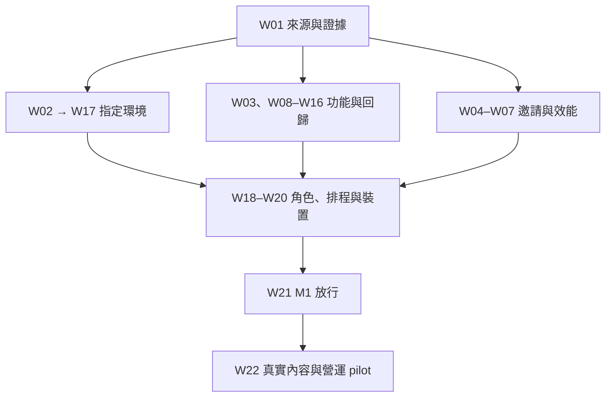

# KinnsoOS Creator／Merchant 下一階段 Implementation Plan

> **For agentic workers:** REQUIRED SUB-SKILL: Use `superpowers:executing-plans` to implement this plan task-by-task. Read the applicable repository `AGENTS.md` and installed-version framework documentation first. Update evidence after each work unit; do not mark unrun work as complete.

**Goal:** 在保留現有 Journeys 版面、EN／zh-HK 及資料安全合同的前提下，完成可驗證的 creator／merchant 合作流程，並接通旅人內容採用、營運客服及發布回退。成功標準是具名角色能完成真實任務和安全恢復，不是頁面數量或「市場最佳」宣稱。

**Architecture:** 沿用 KinnsoOS 現有 Next app、BFF、領域服務、Supabase RPC／RLS、request receipts、CAS 及 local drafts；採最小差異修復。保留 PR #77 的三项已驗證增量；#76 的效能差異先核對 ancestry 再選擇移植。配置、schema、UI、hosted UAT 與 release 分層驗收。

**Tech Stack:** 目前來源鎖定 Next 16.3.8、React 19.2.4、TypeScript 5.9.3、Supabase JS 2.108.1／SSR 0.12.0、Playwright 1.58.2；package 要求 Node ≥22.13.0，效能手冊要求 Node 22.19+。執行時用 lockfile／既有 CI 的 Node 22 與 locked browser；這個階段不順帶升級依賴。

**Spec:** 使用者指定的 `KinnsoOS_Audit_Evidence_2026-10-12.zip` v1；SHA256 `930652277aaabc3ca1e85e69e88f1aabcea54317ea1217ede3ac58445b31ab87`。54,819 bytes、27 個檔案，ZIP 與包內 checksum 已核對。原包的 `tasks.csv`、`requirements_crosswalk.csv`、`user_stories.csv`、`findings.csv` 及 8 個 user cases 都保留。舊 10 月 7 日編號依 10 月 12 日包承接；本次沒有重新讀取 10 月 7 日 ZIP 原件。

**計劃日期及界線:** 2026-10-12，香港時間。最新來源／部署唯讀核對約 23:25–23:30；匿名 API 核對為 23:29:18。這是開發續行計劃，本次沒有改動產品程式、重新跑 CI、登入角色 UAT、DB mutation、合併或部署。下述 CI 與 DB 發現來自指定 ZIP，不冒稱是本次重跑。

## Global Constraints

- 保留 Journeys 現有布局、語言及已入 main 的 onboarding、campaign、申請／邀請、proof／revision、insights 和收益功能。先找缺口及回歸，不重寫整個 creator／merchant 模組。
- 保留 actor／tenant／role、RLS、owner-only private proof、same-origin、private/no-store、quota、CAS、同 payload／requestId receipt。一般 GET 重試與未知寫入的恢复必須分開。
- 不刪未確認 request 或使用者草稿；客服 draft v2 回退須可相容讀取或先提供匯出。帳戶／公司切換後不能復用前一人的資料、cursor 或 late response。
- 所有本地 DB fixture／seed／reset／cleanup 與 performance runner 只用其 guard 驗證的 owned isolated local target；不可改 URL 直接指向 hosted。Host 角色驗收另用 bounded 程序和核准 fixture。
- 已發布 migration 不改寫；先核對 target、catalog、signature、grants／RLS，再做 additive delta。Production 綁定未確認前不能由另一個 DB 推論根因。
- 保留首次失敗、原始 run／attempt、資料規模和量測條件。不得 skip、加 timeout、反覆重填或挑選較快／較綠一輪作結案。
- 這份計劃不授予新的 production、付款、外部訊息或 provider 啟用權限。執行時沿用已有明確授權；需要發布批准時先完成精確候選、驗收及回退包，再要求批准該具體動作。
- Booking／payment／withdrawal 不在本階段啟用；AI A14／G16 保留原 N17 来源和 accepted-output 回歸，不新增 AI 功能或準確率宣稱。

## Review Focus

| 必須重新檢查的風險 | 最小可失敗情境 | 對應工作 |
| --- | --- | --- |
| 晚回應令表單值或角色錯配 | 同事邀請填入名稱後 profile／directory 晚回應；再切公司／actor | W04–W05 |
| 未知寫入、local disk 失敗造成丟稿或重複 | command 已完成但確認遺失、後續 GET 503、reload；A/B case 草稿 | W13 |
| 期限／版本／排程造成錯提醒 | 同 campaign 兩 milestone、時區邊界、改期、重跑、partial job | W08、W10、W19 |
| 成果與金錢被錯算或越權 | 兩幣別、unknown event、跨頁 aggregate、owner 撤權後 CSV | W15–W16 |
| 不可用服務被當未登入／空結果 | anonymous × capability、weak network、safe return、鍵盤／AT | W03、W20 |

## 1. 已知基線與真正未完成事項

| 來源 | 本次確認的狀態 | 對執行的影響 |
| --- | --- | --- |
| [main](https://github.com/YNWAforever/KinnsoOS) | `58d72e9f76e99a5c527d0f88efe37c65912bac31` | #55–75 的相關功能已陸續進入，不重做 |
| [PR #77](https://github.com/YNWAforever/KinnsoOS/pull/77) | Open、draft、未合併；head `bfdcdc22858f7b925375bbeee724609b3700a603`；tree `83ccb51ae54a11a875543d6c8378dbe6d2978c34` | D01–D03 有增量證據，但分支仍不可放行 |
| [PR #76](https://github.com/YNWAforever/KinnsoOS/pull/76) | head `773f91c12fc49ac43e413313c4fc3dff0a433eb4`；只合併至 #74 開發分支，未入 main | W06 核對逐檔差異；不能當已發布或整分支盲目 merge |
| [Production](https://kinnso-os.vercel.app/) | `dpl_7DJFouZs9q6hWaxyA4dSaSFsnLrB`、READY、main 同 SHA | READY 不是功能／角色驗收 |
| 本次匿名 HTTP | `/api/creator/missions`、`/api/merchant/campaigns`、`/api/inbox`：503 `UNAVAILABLE`；`/api/session`：200、data:null；均 private,no-store | 現象仍在，根因仍未證實；需要 W02／W17 |

原包所讀 DB 缺少 `query_kinnso_creator_missions`、`query_kinnso_merchant_campaigns`、`apply_kinnso_merchant_campaign_command`，但正式站點的 backend binding 未確認；migration ledger 舊而部分新 RPC 已存在。這是需要核對的差异，不是「重放所有 migration」的依據。原 env metadata 存取 403、指定 staging／角色／郵箱／內容／scheduler 及實機缺口仍未有新證據可關閉。

### 原始 CI 證據，不能合併成一個綠燈

| 檢查 | [原 push 38191045463](https://github.com/YNWAforever/KinnsoOS/actions/runs/38191045463) | [原 PR 38191048689](https://github.com/YNWAforever/KinnsoOS/actions/runs/38191048689) |
| --- | --- | --- |
| Unit／source 解壓重驗 | 568 PASS；同套另跑 568 PASS | 568 PASS；同套另跑 568 PASS |
| DB integration／快速 native／mailbox | 94／56／4 PASS | 94／56／4 PASS |
| 完整 connected browser | **182 PASS／1 FAIL** | 183 PASS |
| Build／typecheck／source／root CI | PASS | PASS |
| Performance collector job | SUCCESS | SUCCESS |
| Report assessment | PASS | **FAIL** |

兩者都是 attempt 1；沒有重跑挑綠。568 的重建來源重驗不是額外 568 個獨立測試，56 快速 fixture 與完整 connected 有重疊。原 root runs 為 [38191045561](https://github.com/YNWAforever/KinnsoOS/actions/runs/38191045561)／[38191048691](https://github.com/YNWAforever/KinnsoOS/actions/runs/38191048691)。新測試數量可因新增行為增加，不能刪測試來符合舊數字。

**N12-13 同事邀請：** 原 U04 Create 等待 10 秒失敗；快照只有私人邀請名稱空白，電郵／原因／branch 選擇有值，沒有 POST。8 個 merchant GET 均 200；相同 tree 的 PR run 通過。不能由此證明 hydration、lock 或 race 是根因，也不能用「邀請創作者合作」通過代替這條「邀請公司同事」流程。W04 先定因，W05 才修。

**N12-06 效能：** 原同 tree 兩輪 merchant campaigns 冷 LCP 中位為 2482.691／2581.581ms，review 為 2479.349／2572.689ms；門檻 2500ms。两輪各 48 個 verified navigation、8 interactions、24 等價 backend reads、0 audit errors、cleanup PASS；各 960 個 latency samples，但 `MEASURED_BUDGET_NOT_SET`。門檻跨線仍是 OPEN，collector 成功不能當 release PASS。

## 2. 交付範圍與批次

本計劃是一次完整產品階段，分成可獨立審查的小 PR／工作單元。**M1** 是核心合作與恢復可在指定環境放行；**M2 pilot** 再證明真實內容、提醒實際運作及三方每日工作。未接通的能力不得以文案假稱已可用；M1 不自動代表 production 已發布或 M2 全部完成。

| 批次 | 工作 | 本批輸出／結束條件 |
| --- | --- | --- |
| B0，第一批直接對應原第 1–3 步 | W01 → W02；W03 可在 W02 存取受阻時開始 | 刷新 provenance；定位 503 或精確記錄 blocked 層；補 service-before-auth 及可恢復狀態 |
| B1，解除候選阻擋 | W04 → W05；W06 可獨立分析；W07 等 W05／W06 | 同事邀請已定因並通過原故事；選擇性接回 #76；效能評估門檻明確且達標 |
| B2，完成三方工作流程 | W08–W16，按下表依賴執行 | 補 milestone 提醒上下文；驗收待辦、排期、兩種邀請、分頁、客服、內容、成果與對帳 |
| B3，指定環境與真實使用 | W17–W20 | 最小 schema/config delta、H01–H14、scheduler 補跑、實機及 AT；同 candidate 證據 |
| B4，放行與 pilot | W21 → W22 | 精確 release／rollback packet、角色故事、真實內容與每日營運；逐能力 GO／NO_GO |

原 `tasks.csv` 的依賴與狀態原封不動保存在 `KinnsoOS_Original_Task_Status_2026-10-12.csv`。新的 W 依賴表示「這個工作單元何時可開始」，不取消原產品驗收依賴：W03 不用等 W02 存取才能改已確認的 UI；W06 可先量測，不用等三篇內容；W08 可先在隔離環境實作，正式排程仍等 W10／W11／W17／W19。這樣外部權限／素材受阻不會令所有工程停工。



圖是批次關係；**下表與 CSV 的逐項依賴才是執行依據**。W17 可先建立 staging，但任何後續 candidate 變動須更新部署，不能沿用舊 SHA 的完整 UAT。M1 可對未驗收的排程能力維持不啟用，M2 必須完成 W19。日數是有足夠輸入時的工程估算，並非固定日程；存取、內容與設備等待另計。

### 任務總表

| ID | 原任務 | 工作 | 必要前置 | 當前狀態 | 估算 |
| --- | --- | --- | --- | --- | --- |
| W01 | P01 | 刷新來源、PR ancestry 與證據台帳 | 無 | 本次快照完成；開工須刷新 | 0.5日 |
| W02 | P02 | 確認503發生在哪一層 | W01 | 受阻 | 0.5–1日＋存取等待 |
| W03 | P03 | 先說清服務狀態，再引導登入與恢復 | W01 | 已確認缺口，待實作 | 0.5–1日 |
| W04 | P17 | 重現同事邀請名稱未保留 | W01 | 待開始 | 0.5–1日；根因不確定 |
| W05 | P17 | 修復已證實的邀請輸入原因 | W04 | 待W04證實原因 | 0.5–1日；須先W04 |
| W06 | P16 | 核對#76並定位效能瓶頸 | W01 | 待開始 | 0.5–1日 |
| W07 | P16 | 實作有依據的效能改善與發布評估門檻 | W05、W06 | 待開始 | 1–2日 |
| W08 | P11 | 讓提醒指明哪個里程碑及期限 | W01 | 已確認缺口，待實作 | 1–2日 |
| W09 | P07、D03 | 以本人下一步整理工作台 | W03 | 既有功能待驗收；有重現才修改 | 0.5–1日 |
| W10 | P08 | 驗收排期與已接受合作的延續 | W01 | 既有功能待驗收；有重現才修改 | 0.5–1日 |
| W11 | P09 | 驗收找創作者、收藏及合作邀請 | W10 | 既有功能待驗收；有重現才修改 | 0.5–1日 |
| W12 | P10 | 讓搜尋、篩選和分頁保持上下文 | W09 | 既有功能待驗收；有重現才修改 | 0.5–1日 |
| W13 | P12、D01 | 完成客服接手及草稿安全回歸 | W03、W09 | 既有功能待驗收；有重現才修改 | 0.5–1日 |
| W14 | P13、D02 | 完成三篇真實攻略到旅人採用 | W01 | 受阻 | 1–3日＋作者/內容等待 |
| W15 | P14 | 核對商戶成果數字與CSV | W11、W12 | 既有功能待驗收；有重現才修改 | 0.5–1日 |
| W16 | P15 | 讓創作者收益與營運對帳可追查 | W13 | 既有功能待驗收；有重現才修改 | 0.5–1日 |
| W17 | P04 | 以最小delta接通指定staging | W02 | 受阻 | 1–2日＋目標等待 |
| W18 | P05 | 完成creator↔merchant↔ops具名角色UAT | W17、W03、W05、W07、W08、W09、W10、W11、W12、W13、W15、W16 | 受阻 | 1–2日＋角色/郵箱等待 |
| W19 | P11 | 驗收排程與營運每日處理 | W08、W10、W11、W17 | 受阻 | 0.5–1日＋排程等待 |
| W20 | P17 | 完成手機、無障礙與私人資料回歸 | W03、W05、W07、W08、W09、W10、W11、W12、W13、W15、W16 | 待開始 | 1–2日＋設備等待 |
| W21 | P06 | 組合可放行M1與回退包 | W07、W17、W18、W20 | 受阻 | 0.5–1日＋發布授權 |
| W22 | P18 | 完成真實內容與雙公司creator/merchant試點 | W14、W15、W16、W19、W21 | 受阻 | 2–5日試點觀察；不含工程等待 |

## 3. 可執行工作單元

路徑規則：repo 根目錄是 `YNWAforever/KinnsoOS`。`app/`、`lib/`、`tests/`、`scripts/` 與單獨 component 名稱預設在 `apps/journeys/`；component 在 `apps/journeys/app/travel/`。明寫 `docs/`、`.github/`、`supabase/` 或「repo根目錄」的路徑以根目錄為準；同組省略前綴的檔案沿用前一個目錄。新檔標「新」；開始修改前用 `rg --files` 核對，不因路徑改名而建立重複模組。測試命令以 `apps/journeys` 為工作目錄，除非另行註明。

每項先讀相依程式與既有測試，新增／修復行為時建立能證明缺口的用例，再做最小變更。純核對、文件與已通過功能不需為了形式新增鏡像測試。每個有程式改動的工作單元完成針對性驗證後保存可審查 commit；整合候選只在差異需要時重跑相應 gates，最終依 W21 跑完整 required checks。

### W01｜刷新來源、PR ancestry 與證據台帳

**階段／原任務：** B0；P01。**前置：** 無。**負責：** Tech lead。**估算：** 0.5日。

**現況：** 本次快照完成；開工須刷新。

**位置：** AGENTS.md；apps/journeys/AGENTS.md；docs/implementation/CREATOR_MERCHANT_OPERATIONS_LEDGER.json；docs/superpowers/plans/2026-10-11-creator-merchant-operations.md；本計劃與原ZIP

**介面／合同：** 輸入原ZIP v1及當前GitHub/Vercel唯讀metadata；輸出 sourceSha/tree/mainSha/PR base/merge parents/deploymentId/schemaFingerprint-or-unknown 與證據時間。

- [ ] 校驗原ZIP SHA256及包內SHA256SUMS；讀README、candidate-ci、performance-evidence、invitation-failure、tasks、requirements_crosswalk、user_stories與user_cases。
- [ ] 讀repo規則及installed Next文件；確認工作目錄無未處理修改，再取得最新main/PR77/PR76與部署metadata，記錄原始run及attempt。
- [ ] 將原21項任務、38項需求、6故事連到本22項工作；原證據不可覆寫成新PASS；新版本有diff才更新相應範圍。
- [ ] 記錄PR77可續用的精確head；若已被他人推進或合併，以最新合法分支接手，保留對照，不force push、不重建相同功能。

**完成條件：** 所有新證據能回答哪個SHA、tree、環境、角色、時間、操作；38個原需求ID與6故事無遺失；#76不是main已發布功能。

**驗證：** git status --short；git rev-parse HEAD HEAD^{tree}；git log/merge-base與GitHub PR metadata交叉核對；驗證CSV依賴無循環。

**Hosted 前提：** 指定環境驗收另由 W17/W18 承接

**回退：** 只新增來源對照，保留所有原始證據。

### W02｜確認503發生在哪一層

**階段／原任務：** B0；P02。**前置：** W01。**負責：** Platform/DB engineer。**估算：** 0.5–1日＋存取等待。

**現況：** 受阻。 阻擋：部署配置讀取權及production DB binding尚未確認。

**位置：** apps/journeys/lib/contracts/readiness.ts；lib/contracts/capabilities.ts；lib/api/server.ts；scripts/check-readiness.mjs；tests/readiness.test.mjs；docs/implementation/CREATOR_MERCHANT_STAGING_CHECKLIST.md

**介面／合同：** 沿用 diagnoseReadiness(env: Environment): ReadinessReport；schema固定not_checked，不能拿configuration檢查冒充DB驗收。public API保留一般錯誤；內部報告不含env值、key、cookie或JWT。

- [ ] 取得唯一指定deployment/environment→backend project/origin→Auth origin的綁定證據；不能以apps/scan舊設定代替Journeys正式綁定。
- [ ] 在獲准環境以現有診斷核對target/origin/publishable key類型/capability；再分開驗證session→canonical actor→RPC signature→grants/RLS及實際讀取。
- [ ] 只讀比對migration history與installed function definitions；特別核對3個缺失疑點RPC，不整批重放歷史migration。
- [ ] 輸出每層pass/fail/unknown、證據、唯一下一步；有確證才把修復delta交W17。403存取受阻時保留BLOCKED_CONFIG_INSPECTION並繼續W03/W04/W06。

**完成條件：** 503有可核對根因或精確blocked層；不推定缺migration；不以打開flags或移除origin/auth guard使結果變綠。

**驗證：** node --experimental-strip-types --test tests/readiness.test.mjs；node scripts/check-readiness.mjs --require=creator,merchant,notifications（在指定環境執行；exit 0仍不等於schema/session通過）。

**Hosted 前提：** 指定環境驗收另由 W17/W18 承接

**回退：** read-only；診斷改動可revert，不能改公開回應暴露內部配置。

### W03｜先說清服務狀態，再引導登入與恢復

**階段／原任務：** B0；P03。**前置：** W01。**負責：** Frontend engineer。**估算：** 0.5–1日。

**現況：** 已確認缺口，待實作。

**位置：** apps/journeys/app/travel/CreatorWorkspace.tsx；MerchantWorkspace.tsx；WorkspaceServiceState.tsx；useWorkspaceRecovery.ts（僅有重現必要時改）；tests/e2e/u06-workspace-service-state.spec.ts；u16-workspace-loading-layout.spec.ts

**介面／合同：** 消費現有enabled/actorId/valid與ApiResult錯誤碼；已知enabled=false呈現unavailable，enabled=true且無actor才引導安全登入。運行時503、401、403、空資料不可合併成同一狀態。

- [ ] 在actual component/native fixture加入anonymous×capability unavailable/connected的狀態矩陣，先證明目前錯誤引導。
- [ ] 對已知未接通能力顯示EN/zh-HK原因及可行下一步；保留公開探索入口。僅在可用能力下以safe next返回原任務；不新增公開配置探測API。
- [ ] 對首次讀503、重新讀503、403撤權、unknown command分別驗證可恢復UI；一般read可重試，unknown write只查receipt/重試同requestId。
- [ ] 跑相關fixture，更新對應source manifest及隔離測試boundary（只有新增export/file時）；小commit保存。

**完成條件：** 服務不可用不被說成未登入或0筆；重試不丟草稿；403不顯示舊私人資料；登入return與語言一致。

**驗證：** npm exec playwright test -- --config=playwright.service-state.config.ts；相關unit；npm run build；npm run typecheck。

**Hosted 前提：** 指定環境驗收另由 W17/W18 承接

**回退：** 只回退展示；保留pending與v2 draft讀取，不清裝置資料。

### W04｜重現同事邀請名稱未保留

**階段／原任務：** B1；P17。**前置：** W01。**負責：** Frontend + QA。**估算：** 0.5–1日；根因不確定。

**現況：** 待開始。

**位置：** apps/journeys/tests/e2e/u04-merchant-invitations.spec.ts；tests/merchant-invitation-ui.test.mjs；新tests/e2e/u18-merchant-invitation-retention.spec.ts；MerchantInvitations.tsx/MerchantWorkspace.tsx/MerchantProfile.tsx只讀追蹤

**介面／合同：** 輸入原push失敗artifact11721871361及同tree PR通過紀錄；輸出事件時間線、可重現RED、確定原因或OPEN_REPRODUCTION_REQUIRED。調查與W05修復分開。

- [ ] 保留原完整U04；每次fill後及Create前斷言所有欄位值，不使用retry-fill。
- [ ] 在owned fixture記錄presence/length、focus、disabled、mount以及actor/company代號；不用電郵、私人link/token、cookie或payload做診斷輸出。
- [ ] 以可控制promise安排profile/campaign/directory晚回應、同company重render與actor/company切換，找出首次state或DOM值不一致的時間點；不用任意sleep。
- [ ] 確認是產品state、focus/disabled變化或automation同步原因；若無法重現，交付診斷及未知範圍、保持阻擋，轉做獨立任務，不無限重跑。

**完成條件：** 有最小可重現及具體事件順序才進W05；不能從label空白直接推論lock或hydration根因；不能把創作者合作邀請通過當同事邀請通過。

**驗證：** 保留首次失敗；執行新native fixture及原U04（owned connected config）；本機browser不可用可用既有owned CI，NOT_RUN不算PASS。

**Hosted 前提：** 指定環境驗收另由 W17/W18 承接

**回退：** 診斷限測試環境；不加入正式記錄私人表單內容。

### W05｜修復已證實的邀請輸入原因

**階段／原任務：** B1；P17。**前置：** W04。**負責：** Frontend + QA。**估算：** 0.5–1日；須先W04。

**現況：** 待W04證實原因。

**位置：** W04證實有錯的MerchantInvitations.tsx／MerchantWorkspace.tsx／MerchantProfile.tsx或測試同步位置；tests/e2e/u18-merchant-invitation-retention.spec.ts；u04-merchant-invitations.spec.ts

**介面／合同：** 保持merchantInvitations.command(merchantId, command, requestId)與token生命週期；同payload/同requestId重試。只修被RED證實的路徑，不預先拆鎖或停用權限fence。

- [ ] 先用W04 RED證明修前失敗；若根因是測試同步，以可觀察語義同步修正，不能掩蓋真實資料丟失。
- [ ] 最小修正後，輸入在晚讀取/重render保留；真正換actor/company時按既有政策清私資料；不能把所有disabled移除。
- [ ] 保留lost acknowledgement→same request重試、外人預覽拒絕、私密link不持久化、一次accept、同session撤權全部既有斷言。
- [ ] 執行完整U04及D01–D03回歸；記錄新head/tree與原始push/PR結果；有殘留失敗不關N12-13。

**完成條件：** 可重現RED變GREEN；受控時序矩陣皆保留正確輸入；1次邀請/accept副作用；未放寬auth、scope、RLS或私人link規則。

**驗證：** node --experimental-strip-types --test tests/merchant-invitation-ui.test.mjs；native retention fixture；owned完整U04；最終完整CI。

**Hosted 前提：** 指定環境驗收另由 W17/W18 承接

**回退：** revert最小patch，保留回歸及原失敗證據；不刪邀請receipt。

### W06｜核對#76並定位效能瓶頸

**階段／原任務：** B1；P16。**前置：** W01。**負責：** Performance engineer。**估算：** 0.5–1日。

**現況：** 待開始。

**位置：** PR76十個變更檔；MerchantWorkspace.tsx；候選loadMerchantTool.tsx；scripts/performance/README.md、run.mjs、run-latency.mjs；新docs/implementation/KINNSO_PERFORMANCE_PORT_DECISION.md

**介面／合同：** 輸入原兩輪同tree完整artifact；輸出採用/修改/不採用的逐檔決策、role bundle及critical path證據。#76 merged不代表存在main。

- [ ] 比較#76 head773f91c與其真正base，再與W05後候選對照；只考慮尚未存在且有用途的diff，不整個merge舊分支。
- [ ] 追蹤初次JS、已授權公司read、各panel API、LCP元素與首次操作；檢查延後載入是否只是把等待推到首個操作。
- [ ] 比較原始push/PR條件及48 samples；引擎warning不自動當無效樣本，也不挑較快一輪代表穩定改善。
- [ ] 寫下可測假設、預計改動及不採用理由；沒有可重現瓶頸時只交baseline，不為交差重構。

**完成條件：** 有因果可檢驗的瓶頸假設與小diff；role授權、首次可用操作時間及loaded data規模可比較。

**驗證：** git diff/ancestry；鎖定工具與同dataset lab；必要時讀Next已安裝版lazy-loading文件。

**Hosted 前提：** 指定環境驗收另由 W17/W18 承接

**回退：** 保留原reports；分析不修改產品資料。

### W07｜實作有依據的效能改善與發布評估門檻

**階段／原任務：** B1；P16。**前置：** W05;W06。**負責：** Performance + frontend。**估算：** 1–2日。

**現況：** 待開始。

**位置：** MerchantWorkspace.tsx；按W06採用PR76 loadMerchantTool.tsx及u06-role-bundle/u16-merchant-*-bundle tests；playwright.service-state.config.ts；scripts/source-manifest.json；新scripts/performance/assert-operations-assessment.mjs及tests/performance-release-gate.test.mjs

**介面／合同：** 沿用現有loadMerchantTool設計時保留fresh公司授權、loading/error/retry、actor invalidation；發布checker接受明確report path與expected measured source SHA，退出0只限完整PASS及cleanup成功。PR merge SHA須以已核對parents/tree對照候選head，不盲目要求兩SHA相等；不接受未核對tree或dirty source。

- [ ] 對loading、chunk失敗重試、role loss、換公司late load及新gate的slow/missing/unverified/cleanup fail樣本寫可失敗測試。
- [ ] 移植經W06確認的最小差異；company tools只在fresh authorized公司read後載入。不要讓fallback變成永久spinner或恢復舊公司資料。
- [ ] 發布評估讀report.assessment.status、expected source/tree、48/8/24分母及cleanup；保留collector本身「量測成功但未達標」語義，release gate必須拒絕FAIL。沿用現有聚合gate優先，沒有才新增checker並接入release流程。
- [ ] 以同條件完整operations lab及原始push/PR驗證；功能不退步；列冷/暖、JS bytes、首個任務耗時。按原README的source-bound budget規則設定latency budget；沒有budget保留MEASURED_BUDGET_NOT_SET。

**完成條件：** 完整48 navigation每page/cache中位LCP≤2500ms且CLS≤0.1；8interaction與24reads成功、cleanup成功；同候選兩輪原始評估均核對。不能以job success替代assessment；不把本地p95當雲端SLO。

**驗證：** node --experimental-strip-types --test tests/performance-release-gate.test.mjs；node scripts/performance/run.mjs --operations；node scripts/performance/run-latency.mjs --operations（只在owned local）；角色bundle與完整connected回歸。

**Hosted 前提：** 指定環境驗收另由 W17/W18 承接

**回退：** 按單一perf commit回退；保留原schema、授權及失敗報告；v2 drafts需向後可讀。

### W08｜讓提醒指明哪個里程碑及期限

**階段／原任務：** B2；P11。**前置：** W01。**負責：** Backend + frontend。**估算：** 1–2日。

**現況：** 已確認缺口，待實作。

**位置：** apps/journeys/lib/notifications/repository.ts；lib/collaboration/reminders.ts；InboxWorkspace.tsx；CreatorMissionsWorkspace.tsx；新supabase/migrations/20261012160000_kinnso_reminder_context.sql（若編號已被使用，按最新head取下一空編號）；tests/collaboration-reminders.test.mjs；tests/integration/collaboration-reminders.test.mjs；tests/e2e/u08-collaboration-reminders.spec.ts

**介面／合同：** InboxItem.payload向後相容新增optional milestoneId、milestoneTitle、dueAt、deadlineVersion；全部來自授權且重新驗證的DB欄位。ReminderCandidate的四個keys與dedupe key(eventKind,milestoneId,recipientId,deadlineVersion)不變；runCollaborationReminders介面不變。entityLink保持(locale en/zh-HK)→local path|null。

- [ ] 寫同campaign兩個不同milestone期限、legacy payload缺欄、重複job、逾期/已批准/撤權與通知insert失敗回滾測試。
- [ ] 新增additive migration補emit的事件上下文及安全inbox projection；不改已發布migration，不回填編造舊通知上下文，不把整個JSON或private proof投影到客戶端。
- [ ] 新增提醒顯示milestoneTitle及帶時區期限；dueAt為該事件的deadline快照。legacy通知降級至既有mission文案；不把createdAt當dueAt。
- [ ] 驗證合法mission/milestone UUID後才生成#milestone-<id>本地anchor；在已授權CreatorMissionsWorkspace加入相符定位。不存在/失權時走現有安全提示，不暴露資料。
- [ ] 驗證同deadline重跑不重複、准許的deadlineVersion變更可產生新事件、notification失敗與dedupe fact同transaction回滾；保存unit/DB/native證據。

**完成條件：** 用戶可分辨同campaign的兩項工作及截止；所有新欄位有來源與權限；已有pending receipts、去重及補跑正確；站內通知不冒稱email已送達。

**驗證：** node --experimental-strip-types --test tests/collaboration-reminders.test.mjs；owned integration runner；owned u08 native。

**Hosted 前提：** 指定環境驗收另由 W17/W18 承接

**回退：** UI可忽略新optional欄位；保留notification/dedupe歷史；需要停止排程時僅停future dispatch。

### W09｜以本人下一步整理工作台

**階段／原任務：** B2；P07;D03。**前置：** W03。**負責：** Product + frontend。**估算：** 0.5–1日。

**現況：** 既有功能待驗收；有重現才修改。

**位置：** CollaborationTasks.tsx；CreatorCollaborationTasks.tsx；CreatorMissionsWorkspace.tsx；MerchantWorkspace.tsx；OpsWorkspace.tsx；lib/collaboration/tasks.ts；GuideWorkspace.tsx

**介面／合同：** 重用既有next-action投影及safe deep links；server counts與當頁records分清，不新建平行dashboard模型。

- [ ] 跑本人待辦/等對方/已完成/空資料/503/撤權矩陣；記錄找不到下一步的真實步驟。
- [ ] 只補缺口：顯示工作名稱、期限、下一個人與單一主要動作；篩選條件與回上一頁保留；不能要求使用者輸入UUID。
- [ ] 保留摘要guide→trips的D03中英CTA；owner、marketing、clerk、finance及ops可見動作按既有權限分開。
- [ ] 跑小屏/鍵盤與late role read回歸，保存每角色代表任務證據。

**完成條件：** 使用者從入口找到本人可處理工作；read failure不呈現全部做完；導覽變動不觸發資料寫入。

**驗證：** 既有collaboration task unit、u06-collaboration-tasks-layout、u16-workspace-loading-layout；D03兩語native。

**Hosted 前提：** 指定環境驗收另由 W17/W18 承接

**回退：** 回退導覽及投影；資料与server權限不變。

### W10｜驗收排期與已接受合作的延續

**階段／原任務：** B2；P08。**前置：** W01。**負責：** Backend + QA。**估算：** 0.5–1日。

**現況：** 既有功能待驗收；有重現才修改。

**位置：** lib/merchants/campaigns.ts；campaign-repository.ts；lib/merchants/campaign-schedule.ts；20261010213700_kinnso_campaign_schedule_terms.sql只讀；tests/merchant-campaigns.test.mjs及integration/merchant-campaigns.test.mjs

**介面／合同：** 重用既有published terms及server time guards；原native和legacy writer都在驗收範圍；不按本機時鐘授權。

- [ ] 驗證申請開始/截止前後、UTC與顯示時區、無效時區及允許的空日期；變更本機時鐘不能繞過。
- [ ] owner關閉招募後，已接受creator仍可提交/修改；published條款不得被其他寫入路徑改寫。
- [ ] 只對重現缺口做最小修正與additive SQL；已通過項只保留新head證據，不重做功能。

**完成條件：** creator及merchant日期語意一致；截止與合作存續不衝突；所有現存writer受同規則約束。

**驗證：** merchant campaign unit/owned DB；u03-u04-collaboration關閉後重提交故事；hosted W18再驗。

**Hosted 前提：** 指定環境驗收另由 W17/W18 承接

**回退：** 保留已接受條款及歷史；不得回退已寫資料來隱藏差異。

### W11｜驗收找創作者、收藏及合作邀請

**階段／原任務：** B2；P09。**前置：** W10。**負責：** Full-stack + QA。**估算：** 0.5–1日。

**現況：** 既有功能待驗收；有重現才修改。

**位置：** MerchantCreatorDiscovery.tsx；lib/merchants/creator-discovery.ts；tests/creator-discovery.test.mjs；tests/integration/creator-discovery.test.mjs；tests/e2e/u06-creator-discovery.spec.ts

**介面／合同：** 本項為creator collaboration invitation，不是W04公司同事邀請；沿用owner-only、tier及月度quota/RPC receipts。

- [ ] 以owner搜尋公開creator→收藏/取消→選published campaign→邀請→creator接受。
- [ ] 同月最後一個quota兩請求競態，只一個成功；lost ack重試不重扣，外人無法查看私人notes或invitation。
- [ ] 驗證無結果、50+記錄後頁、campaign關閉與role撤销；只修實際缺口。

**完成條件：** 無需UUID、可完成找人到接受；quota與權限不放寬；私人資料不出現在公開搜尋。

**驗證：** creator-discovery unit、owned integration、u06 native；W18具名角色再驗。

**Hosted 前提：** 指定環境驗收另由 W17/W18 承接

**回退：** 保留quota facts/receipts；不刪邀請或自動退還已使用配額。

### W12｜讓搜尋、篩選和分頁保持上下文

**階段／原任務：** B2；P10。**前置：** W09。**負責：** Backend + frontend。**估算：** 0.5–1日。

**現況：** 既有功能待驗收；有重現才修改。

**位置：** lib/collaboration/list-query.ts；creator/merchant list API與query RPC；CollaborationListFilters.tsx；CreatorMissionsWorkspace.tsx；MerchantCampaigns.tsx

**介面／合同：** 沿用既有filter/cursor/query合同與每次server授權；51+rows的頁面是活躍資料snapshot，不宣稱永不變動的全程快照。

- [ ] 在owned fixture使用至少51筆，多頁搜尋→開detail→Back/reload→續頁，核對filter/company/sort與顯示列。
- [ ] 跨company、actor、filter或被撤權的cursor須按合同拒絕；切換filter從首頁開始。
- [ ] 確認結果及統計有界；API失敗不顯示0筆，資料變更提示refresh；只修重現問題。

**完成條件：** 靜態fixture无重複/遺漏；動態集合語意明確；不下載全資料到client篩選，不跨tenant復用游標。

**驗證：** 現有list-query unit、owned query RPC integration及list native；至少51列資料明記。

**Hosted 前提：** 指定環境驗收另由 W17/W18 承接

**回退：** 保留cursor版本相容性；回退需同版本query RPC，不繞過fresh role。

### W13｜完成客服接手及草稿安全回歸

**階段／原任務：** B2；P12;D01。**前置：** W03;W09。**負責：** Full-stack + QA。**估算：** 0.5–1日。

**現況：** 既有功能待驗收；有重現才修改。

**位置：** InboxWorkspace.tsx；lib/collaboration/support-drafts.ts；lib/trips/local-drafts.ts；useWorkspaceRecovery.ts；tests/support-draft-isolation.test.mjs；tests/e2e/inbox-support-workspace.spec.ts；u17-support-form-labels.spec.ts

**介面／合同：** 保留SupportDraft v2按case UUID；completeLocalWorkspaceRecovery的actor+exact pending ID原子交易；success確認前不能unlock；舊無歸屬文字只供手動複製。

- [ ] 沿用D01已通過案例，不重寫recovery；新head上驗A/B/new-case隔離、local storage失敗、command成功後GET503/reload及同request receipt。
- [ ] 跑creator/merchant發起阻塞→ops指派自己/內部原因/公開回覆→客戶看到結果；內部reason不能流出。
- [ ] 檢查取消、重新編輯、conflict/失權與舊草稿讀取；已有內容需要人為選案，不能自動填到另一case。

**完成條件：** A已送文字不復原為新稿，B仍可編輯；同一次command只一個副作用；內部原因與其他actor資料不外洩。

**驗證：** support-draft unit、實際IndexedDB native、owned DB support；EN/zh-HK labels、ops/customer各一。

**Hosted 前提：** 指定環境驗收另由 W17/W18 承接

**回退：** 降級前提供v2相容讀取或匯出；不可清空IndexedDB/pending。

### W14｜完成三篇真實攻略到旅人採用

**階段／原任務：** B2；P13;D02。**前置：** W01。**負責：** Content owner + QA。**估算：** 1–3日＋作者/內容等待。

**現況：** 受阻。 阻擋：三篇授权內容與作者尚未提供。

**位置：** CreatorWorkspace.tsx；lib/creators/editor-operations.ts；GuideWorkspace.tsx；lib/seo/public-guide.ts、guide-publication.ts；app/sitemap.ts；docs/implementation/CREATOR_CONTENT_PILOT.md；creator-workspace與u01-guide-import native

**介面／合同：** 沿用structured days/stops與server publication；D02只輔助，不取代RPC。content清單須具作者同意、權利、核實日期、locale及封面來源。

- [ ] 先驗D02必填缺漏/定位及Save→Publish；day label、時間、描述選填不誤阻擋。
- [ ] 整理三篇獲授權真實攻略與權利/核實資料；缺內容時交空白收集模板並標blocked，不生成假攻略充數。
- [ ] 指定staging與角色可用後，作者發布→旅人明確採用→私人筆記→reload/新登入或另一裝置讀回。
- [ ] 下架原攻略後保留旅人私有副本；公開分享不含私人筆記；摘要guide不冒稱可一鍵套用。
- [ ] 核對真實封面交付及版權、公開攻略EN/zh-HK canonical/locale/sitemap/分享預覽；草稿與私人資料不能被索引。沿用既有SEO policy，只修可重現缺口。

**完成條件：** 三篇真實structured guides各有完整作者→旅人證據；舊fixture不代替真實內容；D02/D03本身不因此重開重造。

**驗證：** publication-readiness、seo-migration、sitemap-discovery unit；creator-workspace/u01/SEO native；W17 schema及W18角色前置檢查後做具名內容驗收。

**Hosted 前提：** W17完成；沿用W18的指定角色與fixture規範，不需等全部H案例才準備素材

**回退：** 停新採用/下架新公開內容；保留既有旅人副本及作者歷史。

### W15｜核對商戶成果數字與CSV

**階段／原任務：** B2；P14。**前置：** W11;W12。**負責：** Data + QA。**估算：** 0.5–1日。

**現況：** 既有功能待驗收；有重現才修改。

**位置：** MerchantInsights.tsx；lib/merchants/insights.ts；insights API/RPC；tests/merchant-insights.test.mjs；integration/merchant-insights.test.mjs；u10-merchant-insights.spec.ts

**介面／合同：** 相同cohort/date filter、asOf、全範圍aggregate與當頁rows；CSV上限5000；未知不等於0，批准不等於付款/營收/ROI。

- [ ] 準備有已知事件分母/期間、空結果、缺event的fixture，逐欄比對DB→API→UI→CSV。
- [ ] 檢查時間範圍、跨頁總數、未知比例、CSV公式注入/5000上限；輸出只含owner授權aggregate。
- [ ] 撤owner權後，已開頁的刷新和CSV都拒絕；read failure不能沿用舊綠色數字當最新。

**完成條件：** 每個數字有來源、範圍及日期；CSV与畫面applied filter一致；無假ROI/付款。

**驗證：** merchant-insights unit/owned DB/u10 native；hosted以可核对fixture再驗。

**Hosted 前提：** 指定環境驗收另由 W17/W18 承接

**回退：** 回退展示/停export而不重寫events；保留來源與unknown。

### W16｜讓創作者收益與營運對帳可追查

**階段／原任務：** B2；P15。**前置：** W13。**負責：** Finance owner + backend。**估算：** 0.5–1日。

**現況：** 既有功能待驗收；有重現才修改。

**位置：** CreatorEarningsWorkspace.tsx；FinanceWorkspace.tsx；lib/finance/contracts.ts；tests/finance-explanations.test.mjs；finance-reconciliation及finance-membership-retry tests；u12-finance-membership-retry.spec.ts

**介面／合同：** 沿用exact monetary amount及逐幣別ledger；tracked、settled、historical paid分開；已存在合法reconciliation操作仍用CAS及receipt；不增加付款或withdrawal。

- [ ] 用至少兩種幣別、缺來源、已記錄/已結算/歷史已付fixture比對來源與顯示，不做浮點加總或假匯率換算。
- [ ] ops/finance由成果追到來源與爭議/客服；viewer/clerk不能靠URL提升權限。
- [ ] lost ack先查原receipt，CAS衝突保留輸入；撤finance權後同tab與direct request立即失去存取。

**完成條件：** 每筆可解釋且逐幣別正確；核銷、approval、settlement、payment不同事實；未接provider仍清楚不可用。

**驗證：** finance explanations/reconciliation/membership unit及owned DB/native；W18具名finance再驗。

**Hosted 前提：** 指定環境驗收另由 W17/W18 承接

**回退：** 只回退UI；不變造金錢狀態，不刪ledger或receipt。

### W17｜以最小delta接通指定staging

**階段／原任務：** B3；P04。**前置：** W02。**負責：** Platform + DB owner。**估算：** 1–2日＋目標等待。

**現況：** 受阻。 阻擋：唯一staging、DB binding、restore point及owner未定。

**位置：** repo根目錄 scripts/MIGRATION_RELEASE.md、scripts/migration-release.mjs；docs/implementation/CREATOR_MERCHANT_STAGING_CHECKLIST.md、CREATOR_MERCHANT_OPERATIONS_MIGRATIONS.json、NEXT_PHASE_RELEASE_GATE.md

**介面／合同：** 輸入W02已證實target與根因；輸出candidate/source/deployment/schema fingerprint/grants/policies/capabilities相符的staging packet。

- [ ] 備妥唯一project ref、environment、origin、owner、restore point及確切delta；source migration history與catalog不一致逐項解釋。
- [ ] 在disposable local環境演練真正缺少的delta、重入、source rebuild與app/schema相容回退；不修改已發布migration。
- [ ] 只在指定且已授權staging執行該delta與相符app/config；之後按實際RPC/role檢查驗收，不以flag enabled或READY結案。
- [ ] 缺target或授權時保存可審核packet；繼續独立code任務，不向production試錯。

**完成條件：** source/auth/config/schema/role吻合，核心500/503原因已解決；匿名/無權限/合法actor的401/403或404/200遵循原route合同。

**驗證：** disposable migration及相容性演練；staging唯讀catalog+授權角色操作；原CI seed/reset/cleanup絕不改指hosted。

**Hosted 前提：** 指定環境驗收另由 W17/W18 承接

**回退：** 已演練app/capability回退；保留業務資料、dedupe、receipts；需要schema forward-fix時明記。

### W18｜完成creator↔merchant↔ops具名角色UAT

**階段／原任務：** B3；P05。**前置：** W17;W03;W05;W07;W08;W09;W10;W11;W12;W13;W15;W16。**負責：** QA + role owners。**估算：** 1–2日＋角色/郵箱等待。

**現況：** 受阻。 阻擋：具名角色與測試郵箱未定。

**位置：** docs/implementation/CREATOR_MERCHANT_HOSTED_UAT.md H01–H14；新同candidate hosted evidence；既有u03-u04/u04/u04-invitations作情境參考

**介面／合同：** 每個case記sourceSha/deploymentId/schemaFingerprint/actorRole/scenarioId/expected/observed/evidence/status；帳戶與憑證只私下保存。hosted測試不是local CI suite换URL。

- [ ] 指定creator A/B、company owner A/B、marketing、assigned clerk、finance、ops及测试郵箱，建立有owner及清理範圍的最小fixtures。
- [ ] 完成H01–H14：onboarding、發布、申請/邀請、接受、proof→revision→批准、關閉後續交、收益說明、客服接手及郵箱實收。
- [ ] 每個跨tenant/role denial旁跑同角色合法control；撤權覆蓋舊tab、cursor、CSV、API/RPC；保留原403/404隱藏規則。
- [ ] 比對最終持久化與原request side effect；保存所有fail/not-run及只清理owned fixture的結果。

**完成條件：** H01–H14逐項有同candidate證據；不冒充其他角色，不以local94 DB或183browser代替hosted UAT；無重複副作用或越權。

**驗證：** 專用bounded hosted程序及真實瀏覽器；實際確認/復原信送到指定test mailbox；不得向客戶發訊息。

**Hosted 前提：** 指定環境驗收另由 W17/W18 承接

**回退：** 只清理核准fixture；不刪正式帳戶、角色或資料。

### W19｜驗收排程與營運每日處理

**階段／原任務：** B3；P11。**前置：** W08;W10;W11;W17。**負責：** Backend + operations owner。**估算：** 0.5–1日＋排程等待。

**現況：** 受阻。 阻擋：scheduler owner/target/token/last-success未知。

**位置：** app/api/cron/collaboration-reminders/route.ts；lib/telemetry/repository.ts；既有job health展示；lib/collaboration/reminders.ts；OpsWorkspace.tsx及失敗交接文件

**介面／合同：** 沿用cronAccess、trackScheduled；runCollaborationReminders default limit50/maxPages4/budgetMs15000，maxPages≤10/budgetMs≤20000；bounded partial不能報completed success。

- [ ] 確認scheduler owner、指定target、token配置存在與rotation責任、執行頻率；不在報告輸出token。
- [ ] 在隔離環境故障注入：中途時間budget完、emit失敗、重複觸發、下次補跑；驗證去重、不遺漏及最後成功不被失敗覆寫。
- [ ] 用具名ops走今日待辦→查失敗→安全補跑→核對inbox→交接；未知從未成功必須顯示unknown，過舊成功須顯示timestamp及freshness。
- [ ] 僅對已存在支持的批量操作驗多筆預覽、權限、逐筆結果及只重試失敗筆；不新加批量批准/付款作捷徑。

**完成條件：** 排程有實際執行及last success、失敗與復原證據；同事件不重複；使用者看得到是哪個milestone；不是只存在cron code。

**驗證：** collaboration-reminders及telemetry故障unit/owned DB；核准staging排程執行與讀回。

**Hosted 前提：** 指定環境驗收另由 W17/W18 承接

**回退：** 停後續schedule/dispatch，保留dedupe facts及pending通知；不清失敗歷史。

### W20｜完成手機、無障礙與私人資料回歸

**階段／原任務：** B3；P17。**前置：** W03;W05;W07;W08;W09;W10;W11;W12;W13;W15;W16。**負責：** QA + accessibility owner。**估算：** 1–2日＋設備等待。

**現況：** 待開始。

**位置：** tests/e2e全部本階段關鍵路徑；u02-travel-share.spec.ts；lib/media/uploads.ts、service.ts；lib/trips/sharing.ts；app/travel相關components；local-drafts；docs/implementation role/locale/device evidence

**介面／合同：** EN/zh-HK，320/640/1280寬度、200%文字；native Chromium與實體iOS/Android、VoiceOver/NVDA證據分列。原N04/N08旅人草稿與N17 AI accepted-output回歸仍保留。

- [ ] 驗證長中英內容、keyboard順序/labels/focus、錯誤後焦點、載入/空白/503、表單草稿及切帳號。
- [ ] 旅途弱網、離線/reload、新登入/新裝置、分享撤銷和private notes不外洩；不把裝置草稿寫成已同步成功。
- [ ] 驗證照片上傳中斷/prepare或finalize重試、媒體權限與share撤銷後media拒絕；只清owned orphan，保留現有file/type/size政策；不向production試cleanup。
- [ ] 完整套件加actual devices/screen readers；缺設備明列NOT_RUN。既有AI來源/accepted-output只做回歸，不新增無依據AI承諾。
- [ ] 按實際操作inventory回報覆蓋分母與未測清單；不以首頁200或一張截圖結案。

**完成條件：** 零未解跨帳戶、丟稿、重複寫入及關鍵路徑失敗；關鍵內容/操作在指定尺寸及輔助技術可完成；實機未測不算已驗。

**驗證：** 完整unit/build/typecheck/source/DB/native；實體devices/AT checklist；受控網路中斷。

**Hosted 前提：** 隔離回歸可先做；具名role/實機/AT完整驗收需W17指定staging及W18角色preflight；缺項不算PASS

**回退：** revert問題UI並保留draft/receipt相容性。

### W21｜組合可放行M1與回退包

**階段／原任務：** B4；P06。**前置：** W07;W17;W18;W20。**負責：** Release owner + QA。**估算：** 0.5–1日＋發布授權。

**現況：** 受阻。 阻擋：W17/W18/W20及release gates尚未完成。

**位置：** docs/implementation/NEXT_PHASE_RELEASE_GATE.md、CREATOR_MERCHANT_M1_RELEASE.md；.github/workflows/journeys-production.yml；repo根目錄 scripts/verify-journeys-production.py；候選PR/部署manifest

**介面／合同：** 整合候選必須是實際待發布SHA/schema/config；舊branch review只覆蓋其範圍，不能搬到新差異。出站/provider權限與產品release分開。

- [ ] 對最終整合候選跑既有required gates及一次獨立整體差異審查（按執行環境/技能可用流程）；每個重要結果附來源；不新增無限審查循環。
- [ ] 核對source ZIP解壓重建、原始push/PR完整結果、真實performance assessment、hosted H01–H14、相容app/schema/draft回退演練。
- [ ] 備妥release target、precise delta、validation及rollback packet；沿用已有明確授權。尚未授權的merge/正式部署才請使用者批准這個具體候選，不重問一般測試與可回退修改。
- [ ] 放行後只按核准範圍發布並讀回；有503、越權、丟稿、重複副作用或unconfirmed結果維持NO_GO。

**完成條件：** merge/deploy/role驗收是分開狀態；READY不足放行；同candidate所有required功能與效能條件成立且回退可保留資料。

**驗證：** 原required workflows＋exact-source extraction＋staging rollback演練＋發布後授權範圍readback。

**Hosted 前提：** 指定環境驗收另由 W17/W18 承接

**回退：** rehearsed app/capability rollback；保留receipts/drafts/ledger；不能blind rollback DB。

### W22｜完成真實內容與雙公司creator/merchant試點

**階段／原任務：** B4；P18。**前置：** W14;W15;W16;W19;W21。**負責：** Product + operations + release owner。**估算：** 2–5日試點觀察；不含工程等待。

**現況：** 受阻。 阻擋：實際pilot內容/角色與前置放行待完成。

**位置：** docs/implementation/CREATOR_MERCHANT_OPERATIONS_RELEASE.md；pilot operations手冊、任務台帳及具名case evidence

**介面／合同：** 至少兩creator、兩company及ops/finance，三篇授權攻略；先在明確指定且可操作的M1環境pilot，production擴量另需放行。

- [ ] 走六個故事的完整輸入→持久化→角色回讀→問題恢復，不用合成fixture冒充真實客戶/內容。
- [ ] 記錄核心任務attempt/success、time-to-completion、rework、support cases、data freshness、latency及可觀測成本；每項有期間/分母/owner，資料不足標unknown。
- [ ] 輸出營運手冊：每日待辦、審核/客服、失敗job、對帳、權限離職與交接；每個例外能找到處理者及下一步。
- [ ] 逐能力GO/NO_GO；遇到越權/丟稿/重複寫入即停擴量。保留A14/G16 AI及booking/payment的未啟用界線，另案才擴張。

**完成條件：** creator/merchant核心合作和旅人內容價值在指定環境被證明；所有本階段核心故事完成，殘餘內容/設備/provider/production缺口不寫100%完成。

**驗證：** 具名pilot紀錄、角色最終讀回、故障處理、每項指標的實際樣本；發布後持續監察owner已定。

**Hosted 前提：** 指定環境驗收另由 W17/W18 承接

**回退：** 停止擴量或未穩能力，不刪真實內容/私有副本/財務歷史；依W21回退。

## 4. 六個使用者故事的完整驗收

故事 PASS 必須包含輸入、動作、持久化、第二角色／裝置讀回與失敗恢復。合法 control 與禁止案例要成對；被拒絕本身不證明合法使用者能完成。以下沿用原故事 ID 和狀態，不用本階段局部綠燈關閉整個故事。

### U01｜新旅人

**原狀態：** 受阻；公開京都搜尋/摘要閱讀通過；summary CTA在PR；hosted完整故事未重驗。

**角色：** 旅人、creator A。

**素材／環境：** 3篇授權structured guides；摘要guide；獨立旅人帳戶與第二裝置。

**完整路徑：** 安全註冊/登入返回原任務→找攻略→閱讀完整內容→明確採用→私人筆記保存→新登入/新裝置讀回→作者下架後副本仍在。

**必驗恢復／禁止案例：** 未接通顯示服務狀態；摘要攻略只引導手動建立；採用lost ack只查同request；私人筆記不出現在share/SEO。

**要保存的證據：** 真實攻略ID的去識別映射、授權記錄、兩角色持久化讀回、裝置/locale、採用receipt與下架後control。

**故事完成條件：** 3篇各完成作者→旅人閉環；所有資料回讀正確；不能只用fixture或公開首頁200結案。

**工作單元：** W03;W09;W14;W18;W20;W22。

### U02｜旅途中與分享

**原狀態：** 未測；完整實機/弱網/分享故事NOT_RUN；不隨creator/merchant工作關閉。

**角色：** 旅人、分享接收者、另一無權限帳戶。

**素材／環境：** 有照片/私人筆記的旅程；可撤銷share；實體iOS/Android及受控弱網。

**完整路徑：** 旅途中編輯→斷網/恢復→照片prepare/upload/finalize→reload→新登入→建立share→接收者查看→撤销share→media不可再讀。

**必驗恢復／禁止案例：** 未知寫入先receipt；照片重試不重複、不誤刪；guest草稿匯入須明確同意；切帳號不把前人草稿匯入。

**要保存的證據：** 各裝置網路模式、媒體狀態、share及media撤銷control、local/durable來源與實際讀回。

**故事完成條件：** 實機與弱網故事全走完；原N09/N14/N15剩餘範圍有逐項結果；未測仍NOT_RUN。

**工作單元：** W20;W22。

### U03｜新創作者

**原狀態：** 受阻；核心source已入main；production missions503；PR補發布指引/客服恢復。

**角色：** creator A/B、merchant owner、ops、finance。

**素材／環境：** 授權攻略、published campaign、兩milestones不同期限、可要求revision的proof。

**完整路徑：** onboarding→編輯/發布→搜尋/申請或接受合作邀請→accepted→交proof→revision→關閉招募後再交→批准→收益來源→客服/提醒。

**必驗恢復／禁止案例：** 缺必填定位；草稿跨案隔離；deadlineVersion提醒去重；proof只能被授權角色讀；批准不冒稱已付款。

**要保存的證據：** creator/merchant兩端與DB回讀、proof version/receipt、跨creator denial及合法control、收益來源。

**故事完成條件：** H案例加真實內容、reminder job及收益可追查；183 isolated browser不能代替hosted整個故事。

**工作單元：** W02;W03;W06;W07;W08;W09;W10;W11;W12;W13;W14;W16;W17;W18;W19;W20;W22。

### U04｜商戶成果

**原狀態：** 受阻；核心source已入main；production campaigns503；同事邀請單次label丟失待查；hosted角色未驗。

**角色：** company owner A/B、marketing、branch clerk、finance、creator。

**素材／環境：** 兩公司、branch scope、quota最後一格、多頁campaign/creator、獨立同事邀請。

**完整路徑：** 商戶申請→ops批准/公司→邀請同事→發布排期→找creator/收藏/邀請→接受→proof審核/revision→關閉後續交→成果CSV/對帳。

**必驗恢復／禁止案例：** 同事邀請與合作邀請分開；label晚讀取仍保留；quota競態、lost ack、private proof限制、失權後舊tab/CSV失效。

**要保存的證據：** 兩種邀請各有原request及單次副作用、合法/跨公司control、已知數字cohort與CSV對照。

**故事完成條件：** N12-13根因與最小修正有證據；H01–H14相應角色通過；數字有來源且非假ROI。

**工作單元：** W02;W03;W04;W05;W06;W07;W08;W09;W10;W11;W12;W13;W15;W16;W17;W18;W19;W20;W22。

### U05｜營運一天

**原狀態：** 受阻；ops/客服/finance source與isolated覆蓋存在；hosted job/UAT未驗。

**角色：** 具名ops、finance、creator/merchant求助者。

**素材／環境：** 兩客服case、待審proof、可失敗/補跑的隔離reminder job、兩幣別ledger。

**完整路徑：** 今日待辦→判斷→指派→審核/客服→客戶回讀→job失敗查因→安全補跑→對帳→交接。

**必驗恢復／禁止案例：** 内部reason與public response分離；A/B草稿不混；partial job不能標最後成功；批次只重試失敗項且不重複寫入。

**要保存的證據：** 案件/角色對照、last success/failure/recovery timestamp、notification去重、各幣別來源及接手owner。

**故事完成條件：** 一次完整營運班次可交接；排程實際執行及補跑有結果；只有cron檔案不算完成。

**工作單元：** W08;W09;W12;W13;W16;W18;W19;W20;W22。

### U06｜發布切換

**原狀態：** 受阻；main58d；PR77 draft未合併；production NO_GO。

**角色：** release owner、DB owner、QA、具名角色。

**素材／環境：** 精確candidate/source archive、指定staging/schema/config、已演練restore point。

**完整路徑：** 核對head/tree/部署→source重建→完整CI與performance assessment→staging差異→角色UAT→故障/回退演練→逐能力放行→readback。

**必驗恢復／禁止案例：** 保留v2 drafts/receipts/ledger；known config/schema錯配不開flags掩蓋；partial/unknown不能GO；發布後critical失敗依演練回退。

**要保存的證據：** 同candidate manifest、所有原始run/attempt、migration delta、H01–14、performance完整分母、授權及回退結果。

**故事完成條件：** code/CI/staging/release各自有證據；READY與job success均非單獨放行依據。

**工作單元：** W01;W02;W03;W06;W07;W17;W18;W20;W21;W22。

### Hosted H01–H14 不得省略

| ID | 實際驗收 |
| --- | --- |
| H01 | 商戶申請→moderator批准→owner profile；reload／新登入仍保存 |
| H02 | Owner建立草稿／發布→creator A申請→owner接受 |
| H03 | Creator交proof→revision→關閉招募→已接受者再交→owner批准 |
| H04 | 收益tracked／settled／historical payout分開；批准不生成假付款 |
| H05 | Creator B不能讀寫A的participation、proof、earnings |
| H06 | Company owner B不能讀寫A的campaign、application、branch、private proof |
| H07 | Marketing管理合法public brief；private proof讀取／審核仍owner-only |
| H08 | Clerk只可處理assigned branch redemption；finance限財務scope |
| H09 | Moderator reason／history在conflict後可追查；公司membership不等於ops |
| H10 | 同session撤權：舊tab、cursor、CSV、API、RPC失效且清私人展示 |
| H11 | Lost acknowledgement後查receipt、同payload／requestId；只有一次副作用 |
| H12 | 已存資料reload／新登入仍在；未存草稿與CAS衝突可理解、可恢復 |
| H13 | 註冊、確認與recovery實際到指定test mailbox；redirect／cookie正確 |
| H14 | EN／zh-HK、keyboard、320px及200%文字；私人API錯誤不當零筆 |

目前全部仍待指定環境驗收。這個表承接 repo 的 `docs/implementation/CREATOR_MERCHANT_HOSTED_UAT.md`；實際測試前核對最新版，不以本文件固定舊實作。

## 5. 驗證與效能放行方法

### 每次變更的證據

先跑與變更直接相關的 unit／integration／native；source packaging、public export 或測試 boundary 有改才相應更新 manifest 和重建檢查。最終候選須完成既有 required workflow。既有初次失敗保留為歷史；真正修正後的新 head 可重新驗證，記清差異，不能只重跑相同版本直到成功。

以下命令先由 Codex 讀 repo 規則及 runner guard 確認。`npm ci` 在 lockfile 變動或依賴尚未安裝時執行；不要每個小任務重裝一次。

```bash
# cwd: apps/journeys
npm test
npm run build
npm run typecheck
python -m unittest discover -s tests -p source_package_test.py
node --test ../../scripts/journeys-workflow-test.mjs
python ../../scripts/deployment_scope_test.py -v

# 快速 native fixture；browser 必須是 lockfile 對應版本
npm exec playwright test -- --config=playwright.service-state.config.ts

# 只有 guard 證明 owned isolated local target 後才執行
node scripts/ci-evidence.mjs integration
node scripts/ci-evidence.mjs browser
node scripts/performance/run.mjs --operations
node scripts/performance/run-latency.mjs --operations
```

`npm run build` 已先跑 source packaging。CI 的獨立 source 解壓重建仍須保留；不得只重建 checkout 而漏掉下載來源。browser connected config 是 loopback `127.0.0.1:3495`、retries 0／workers 1；若本機沒有 Docker／browser，使用既有 owned CI，將本機缺口明記為 NOT_RUN，不能把 guard 改鬆。

### 效能判定

保持原 Ubuntu 22／Node 22／Chromium 145.0.7632.6／Lighthouse 13.5 条件，390×844、4×CPU、150ms、1600Kbps down／750Kbps up；每條 8 頁路徑冷暖各 3 次。Fixture 是 55 campaigns、55 accepted collaborations、1 submitted proof。冷暖只指 browser HTTP cache，server／DB buffer 仍暖。真實封面、hosted latency、實體裝置、併發和 field CWV 另驗，不能從合成 lab 推算。

| 驗收 | 必須讀的值 | 不足時的狀態 |
| --- | --- | --- |
| Lab 完整性 | 同 source／verified tree、無 dirty diff、48 verified navigations、8 interactions、24 equivalent reads、正確角色／dataset、cleanup PASS | INCOMPLETE／FAIL，不可放行 |
| LCP／CLS | 每 page/cache group 中位 LCP ≤2500ms；CLS ≤0.1；所有必需項完整 | 即使 collector job SUCCESS 仍 FAIL |
| Warm latency | 8 operations × 3 layers ×40 measured＝960；3 warmups 另列；nearest-rank p95 | 未訂 budget＝MEASURED_BUDGET_NOT_SET |
| Latency budget | 同 source unbudgeted baseline、baseline SHA256、owned local project、每層正值 limits，依現有 README 驗證 | 缺任一不可稱「延遲達標」；不等於 cloud SLO |
| 使用性成本 | 初始 JS bytes、首個可執行任務耗時、chunk retry／role loss／late import | 不接受只把等待移到第一次點擊 |

W07 優先沿用既有 assessment gate；若沒有才新增 checker。Checker 必須讀 report，拒絕 missing／unverified／slow／wrong source／cleanup failure；PR synthetic merge SHA 以實際 parents／tree 綁定候選，不能盲比 head 字串。兩輪相同來源亦要保留每輪結果，不能合併樣本挑好數據。trace-engine warning 本身不表示 samples 無效。

## 6. 原 20 項發現＋18 項補充需求的保留對照

下表是原 ID 的承接，並非新增 38 項或宣稱已解決。原 scope、legacy IDs、status、completion rule、evidence IDs 及 source SHA 全在 crosswalk CSV 原樣保留，另加 W 工作單元。A14／G16 的原 task_ids 留空；特別列入 W20 回歸，避免被遺漏或誤寫成新 AI 開發。

| 原 ID | 原需求 | 原 P 任務 | 本階段工作單元 |
| --- | --- | --- | --- |
| A01 | 分支、部署、DB 對齊 | P01、P04、P05、P06、P18 | W01、W17、W18、W21、W22 |
| A02 | 架構／來源披露 | P01、P17 | W01、W04、W05、W20 |
| A03 | Demo 與正式資料 | P03、P05、P13 | W03、W14、W18 |
| A04 | Booking 文案誠實 | P03、P15 | W03、W16 |
| A05 | 主要任務導覽 | P07、P17 | W04、W05、W09、W20 |
| A06 | 結構化攻略 | P13 | W14 |
| A07 | 錯誤不能當空結果 | P03、P10、P14 | W03、W12、W15 |
| A08 | 有界搜尋／分頁 | P09、P10、P16 | W06、W07、W11、W12 |
| A09 | 審核佇列／詳情查詢 | P07、P10、P16 | W06、W07、W09、W12 |
| A10 | 全量金融彙總風險 | P14、P15、P16 | W06、W07、W15、W16 |
| A11 | 待辦、老化、指派 | P07、P11、P12 | W08、W09、W13、W19 |
| A12 | 小屏後台導覽 | P07、P17 | W04、W05、W09、W20 |
| A13 | 登入返回原任務 | P03、P05、P09 | W03、W11、W18 |
| A14 | AI 來源及不實承諾 | 原N17回歸，未分配新P任務 | W20 |
| A15 | Nightly 覆蓋／證據 | P01、P06、P18 | W01、W21、W22 |
| A16 | 無障礙未完 | P17 | W04、W05、W20 |
| A17 | 本機資料／跨裝置 | P05、P13、P17 | W04、W05、W14、W18、W20 |
| A18 | 真實合法封面 | P13 | W14 |
| A19 | UI／領域耦合 | P07、P16 | W06、W07、W09 |
| A20 | Locale 一致 | P03、P13、P17 | W03、W04、W05、W14、W20 |
| G01 | 核心價值與次序 | P01、P18 | W01、W22 |
| G02 | 舊功能去留／完成定義 | P01、P09、P14、P18 | W01、W11、W15、W22 |
| G03 | 身份及資料歸屬 | P04、P05、P17 | W04、W05、W17、W18、W20 |
| G04 | 多角色 onboarding | P05、P07 | W09、W18 |
| G05 | 本機資料正式匯入 | P05、P17 | W04、W05、W18、W20 |
| G06 | 所有權／分享 | P05、P13、P17 | W04、W05、W14、W18、W20 |
| G07 | 真正可出行內容 | P13 | W14 |
| G08 | 手機旅途中使用 | P17 | W04、W05、W20 |
| G09 | 地點／內容品質 | P12、P13 | W13、W14 |
| G10 | 創作者素材到發布 | P07、P13 | W09、W14 |
| G11 | 公司、分店、職員 | P05、P07、P09、P17 | W04、W05、W09、W11、W18、W20 |
| G12 | 收入／對帳／爭議 | P12、P14、P15 | W13、W15、W16 |
| G13 | 通知、提醒、客服 | P03、P11、P12 | W03、W08、W13、W19 |
| G14 | 營運每日工作 | P07、P10、P11、P12 | W08、W09、W12、W13、W19 |
| G15 | 語言、SEO、分享 | P13、P17、P18 | W04、W05、W14、W20、W22 |
| G16 | AI 任務及驗收 | 原N17回歸，未分配新P任務 | W20 |
| G17 | 發布、還原、來源 | P01、P04、P05、P06、P17、P18 | W01、W04、W05、W17、W18、W20、W21、W22 |
| G18 | 增長、留存、成本 | P11、P14、P16、P18 | W06、W07、W08、W15、W19、W22 |

### 本次 13 個發現及 8 個 case

| 發現 | 原狀態 | 接手單元 |
| --- | --- | --- |
| N12-01 | OPEN | W02、W17、W18、W21、W22 |
| N12-02 | BLOCKED_TARGET | W02、W12、W17 |
| N12-03 | FIXED_IN_PR77 | W13、W20 |
| N12-04 | FIXED_IN_PR77 | W14 |
| N12-05 | FIXED_IN_PR77 | W09 |
| N12-06 | OPEN | W06、W07、W21、W22 |
| N12-07 | OPEN_RECONCILIATION | W01、W02、W17 |
| N12-08 | BLOCKED_CONTENT | W14、W22 |
| N12-09 | OPEN | W08、W19、W22 |
| N12-10 | OPEN | W03 |
| N12-11 | FIXED_IN_PR77 | W13、W20 |
| N12-12 | FIXED_IN_PR77 | W13、W20 |
| N12-13 | OPEN_REPRODUCTION_REQUIRED | W04、W05、W20、W21 |

原 `user_cases.csv` 的 UC12-01 至 UC12-08 仍屬證據範圍；UC12-01 公開搜尋／摘要屬 W09／W14／W20，UC12-02／03 屬 W14，UC12-04／05 屬 W13，UC12-06 屬 W18，UC12-07 屬 W08／W19，UC12-08 屬 W04／W05。既有測試只有覆蓋其場景，不能取代 U01–U06 的完整故事。

## 7. 外部輸入、狀態和發布規則

### 最少需要補齊的輸入

| 輸入 | 負責人／需要的內容 | 未取得時仍可做 |
| --- | --- | --- |
| 唯一 staging／production 綁定 | Platform owner：deployment、backend project ref、origin、Auth origin、讀配置權；不要把 secret 放進文件 | W01／W03／W04／W06 及 isolated 工作 |
| Schema delta 與回復 | DB owner：catalog、grants／RLS、migration 差異、restore point、指定修改範圍 | 最小 delta packet、disposable 演練 |
| 具名角色與 test mailbox | 兩 creator、兩 company owner、marketing／branch clerk／finance／ops；專用確認／recovery 郵箱 | fixtures、H01–H14 執行腳本／記錄模板 |
| 真實內容 | Content owner：3 篇作者授權攻略、素材／封面權利、地點核實日期、語言與作者 | D02／D03 回歸與內容收集模板 |
| 排程 | Operations owner：target、頻率、token 存在／rotation 責任、last-success 可觀測方式 | W08、local partial／retry／dedupe 測試 |
| 實機／AT | QA owner：iOS／Android、VoiceOver／NVDA、可用測試時段 | native／keyboard／縮放回歸 |
| 正式發布 | Release owner：具體 candidate、target、時段、回退及已授權範圍 | 完整 reviewable release packet；不把一般開發停下 |

角色名稱是責任分工，不表示已有人或帳戶可用。上表是執行所需輸入清單，本次只交付計劃，沒有要求建立帳戶、發送郵件或執行發布。

### 台帳格式與關閉規則

每個 task／story／case 記錄 `taskId, requirementIds, storyId, sourceSha, sourceTree, deploymentId, schemaFingerprint, environment, actorRole, observedAt, scenario, expected, observed, runId, attempt, evidencePath, status, blocker, rollback`。無值明寫 UNKNOWN／NOT_RUN，不以空欄作 PASS。不得記憑證、私人 invitation links、原始 proof 或私人客戶內容。

`code_status`、`ci_status`、`staging_status`、`release_status` 分欄：IMPLEMENTED ≠ CI_PASS ≠ HOSTED_ACCEPTED ≠ RELEASED。D01–D03 保持「該增量在原兩輪通過」；不能藉本計劃將整個 PR、P12／P13 或 U03／U04 結案。planning pack 的新 CI／hosted 欄為 NOT_RUN／BLOCKED，不重用舊 PASS 當新證據。

進度更新每次包含：完成甚麼、哪個 SHA／角色證據、下一個可做工作、唯一阻擋及其 owner。重新驗證只因 source／schema／config／scope 變動或既有風險仍未解；沒有變更的獨立合格項不無限重跑。既有 KPI 只用實際 task attempt 分母、期間和 owner；小量 pilot 不宣稱市場 benchmark 或可靠 retention 百分比。

### PR 與分支安排

1. 開工先刷新 main／#77／#76，不 force push、不重建同一功能。#77 仍開啟時在合法候選上做 W04／W05 的必要修正；W03 若令原 PR 範圍明顯擴大則另建依賴該候選的小 PR。
2. W06／W07 只接有證據的 #76 效能差異，保存逐檔取捨及角色 bundle 回歸；不要把 #74 舊開發分支再次 merge 到 main。
3. W08 的 additive schema＋projection＋UI＋tests 作一個可審查工作單元；其他 P07–P15 只對驗出的缺口建小 patch，不為「大階段」建立超大重寫 PR。
4. 若多個候選共同構成發布，先建立符合 repo 流程的整合候選；W18／W20／W21 綁定它。source archive、CI merge SHA、app、schema、config 各有對照；舊 head 的完整驗收不自動轉移。
5. 修正與一次完整差異審查完成後，按既有授權推進可回退工作；merge／production 若尚無明確授權，最後才提交具體候選供批准。任何版本處於 503 根因未知、N12-13 未解、必要 assessment FAIL、跨租戶／丟稿／重複寫入或 required UAT 未完成時維持 NO_GO。

## 8. 交給 Codex GPT-6.1 Sol 的啟動指令

完整可貼上文字另附 `KinnsoOS_Codex_Kickoff_2026-10-12.txt`。第一輪輸出應是 W01 的更新基線、W02 的根因／精確阻擋、W03 的最小 patch 及測試；随后 W04／W05 邀請定因修復與 W06／W07 效能。缺外部 target 時继续已授權的 isolated 任務，不停在另一份泛用計劃。

## 9. 檔案與驗證

- `KinnsoOS_Codex_GPT61Sol_Continuation_Plan_2026-10-12.md`：本計劃、22 工作單元、六故事及放行規則。
- `KinnsoOS_Execution_Tasks_2026-10-12.csv`：22 單元，含依賴、steps、介面、驗收、回退、狀態與阻擋。
- `KinnsoOS_Original_Task_Status_2026-10-12.csv`：21 個原任務所有欄位原樣保留，新增接手單元與本次 planning 狀態。
- `KinnsoOS_Requirements_Crosswalk_2026-10-12.csv`：20＋18 原需求及原 legacy mapping，加入 W 對照。
- `KinnsoOS_Story_Acceptance_2026-10-12.csv`：6 故事原狀態與實際角色、素材、路徑、恢復及完成條件。
- `KinnsoOS_Planning_Baseline_2026-10-12.json`：原 ZIP 身分、fresh metadata／匿名 HTTP、歷史 CI 界線。
- `KinnsoOS_Codex_Kickoff_2026-10-12.txt`、`SHA256SUMS.txt`：開工指令及檔案校驗。

本包已檢查 ID 唯一、22 任務依賴無循環、21 原任務／38 原需求／6 故事／13 發現及8 cases全部有承接；原 CSV 欄位未改寫。這是計劃品質檢查，**不是新產品測試或放行結果**。需連同原稽核 ZIP 使用；沒有另附源碼、私人帳戶資料或敏感原始 log。
