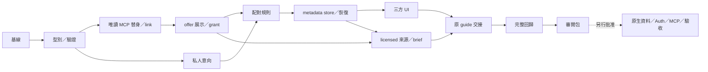

# KinnsoOS Trip–Offer Matching Phase 0–2 Implementation Plan

> **For agentic workers:** REQUIRED SUB-SKILL: Use superpowers:subagent-driven-development or superpowers:executing-plans to implement this plan task-by-task **only after explicit implementation approval**. Steps use checkbox syntax. 2026-11-01 使用者已明確批准 L01–L12 本機實作；N/H 未獲批准。

**Goal:** 在保留所有既有功能及 C／T／M 流程下，完成旅程意向 → 商戶優惠 → 可解釋配對 → 有證據的 brief → 原 guide 編輯／發佈確認。

**Architecture:** Kinnso 保留所有業務成果的權威 writer；SMEAssistant 透過唯讀工具提供受 scope 約束的商戶及優惠來源。新意向、展示同意及配對 metadata 與原 studio 來源／brief 整合。先交付獨立 loopback 記憶體實作 L；真身分、資料庫及遠端整合 N/H 另設批准與驗收 gate。

**Tech Stack:** Kinnso 現有 pnpm 11.6.0／Turborepo、Next 16.3.8、React 19、TypeScript、Node ≥22.13.0、node:test、Playwright；SME 主分支為 pnpm 9.12.0、Next 16.2.6、Neon repositories、Vitest。兩倉庫不強制升級或統一套件版本。L 不安裝 MCP SDK；N 先驗證再固定 SDK／protocol 組合。

**Spec:** [階段 0–2 設計](../specs/2026-10-31-kinnsoos-trip-offer-matching-phase-0-2-design.md)。狀態：L01–L12 已批准本機執行；完整結果見新的本機驗收文件。

## Global Constraints

- 依 2026-11-01 新指示，只執行 L01–L12 本機示例；不套用遷移、不部署、不建立真實連接。
- 第一個可批准執行範圍為 **L01–L12 本機示例**；N01–N04 及 H gate 需要另行明確授權，不由 L 驗收自動啟動。
- 新 metadata 使用 revision＋request UUID；原 trip／guide／campaign／share writers 及其 revision／expectedUpdatedAt／收據合約保持原義。
- 逾時、斷線、ACK 遺失或讀回不一致保持「結果未知」；重試同一不可變意圖沿用同一 UUID。
- 不新增跨站 SSO；不以首頁角色、同名電郵、MCP tool annotation 或 browser actor header 授權。
- capability 預設 unavailable；demo 只注入 loopback；booking/payment 一律關閉。
- 不讀正式憑證或 .env；任何測試均不得默認使用 ambient DB/provider URL。
- 本機示例全部自有文字及圖形；不得將第三方內容／merchant 來源偽標為 creator own。
- 完整保留 C1–C5、T1–T5、M1–M5、原導覽、deep links、原版本／分享撤回、GPL-3.0 與來源封包。
- 兩資料庫不宣稱跨系統原子性；真實 grant／source freshness 見設計 §6，live gate 未完成保持停用。

## Review Focus

1. SME confirmed offer 被誤當可公開／可改寫的內容 → L04、L09 檢查展示與 public_guide grant 分離。
2. 公司切換、晚到回應或 proof 重播把上一個 scope 帶進新公司 → L03、L08 檢查雙方 owner、nonce、generation fencing。
3. 香港／台灣日界、部分優惠日期、異幣和未知價格被錯配 → L05、L06 以固定時鐘及真實日曆邊界驗證。
4. brief 已保存但 guide ACK 遺失，恢復時產生第二份成果 → L10 檢查同 UUID、receipt、跨步驟非原子恢復。
5. 新版僅首頁可走，舊 C/T/M direct URL、分享撤回或來源封包退化 → L01、L11、L12 保留完整基線及回歸。

---

## 1. 執行前提與完成用語

2026-11-01 使用者已明確批准本計劃 L01–L12；此批准不含 N01–N04 或 H。原設計審閱紀錄保留當時狀態；新的本機驗收文件記錄本次結果，不將本機證據當成真實連接或部署驗收。

L 完成時只能說「階段 0–2 的本機示例流程完成」，不能說 MCP 真連接、Auth/RLS、正式儲存／發佈或整個平台完成。既有 studio SQL 未套用是 N 的依賴，不能在 L 測試中默默套用。

使用目前隔離工作樹的完整內容作基線，不只 checkout HEAD。開工前保存既有變更清單與指紋；不得 reset／clean／覆寫先前工作。獨立測試 server 用 3501；3499 留給使用者，只有獲准更新預覽時才在保留／清楚說明示例記憶體狀態的安排下替換。禁止測試重設使用者 3499 session。

## 2. 任務依賴與驗收出口

| 階段 | 任務 | 出口 |
|---|---|---|
| 0 資料與工具邊界 | L01–L04 | 六個唯讀工具、雙方 owner 替身、import／publication／grant 分離及否定測試 |
| 1 旅程與優惠配對 | L05–L08 | 同首頁可填意向、merchant 確認展示、可解釋配對／保存／略過，權限及日期失敗狀態可試 |
| 2 brief 至原發佈 | L09–L12 | 新來源完整 C1→C2→原 editor/publish；所有原 C/T/M 回歸；來源、恢復及手機／桌面證據 |
| 原生提升 N | N01–N04，不能與 L 混算 | 真 DB／Auth／MCP 在指定隔離目標驗收；各項 blocked 保留 |

不以日曆週數承諾完成；用上述出口及 review gate 排序。先完成一條垂直流程，再增加非必要資料源及 UI 微調。

## 3. 程式落點與責任

以下 `Create` 全部是將來實作才新增；本輪不建立程式檔。

| 落點 | 動作／責任 |
|---|---|
| `apps/journeys/lib/discovery/contracts.ts`、`policy.ts` | Create：設計 §5／§9 的型別、嚴格 parser，不能混入 I/O |
| `apps/journeys/lib/discovery/intents.ts`、`offers.ts`、`matching.ts` | Create：意向、展示／grant、matching-v1 純規則 |
| `apps/journeys/lib/discovery/store.ts`、`repository.ts`、`server.ts` | Create：port、HTTP client、原生 route handlers；L 只接 fixture，原生 handlers 留 N |
| `apps/journeys/lib/discovery/brief.ts` | Create：配對來源 → 既有 StudioBrief；不另建成果格式 |
| `apps/journeys/lib/integrations/smeassistant/contracts.ts`、`client.ts`、`policy.ts` | Create：六工具 allowlist、解碼、期限／scope、credential server boundary |
| `contracts/smeassistant/read-v1.schema.json` | Create：跨倉庫同一版契約與 fixtures；無依賴安裝 |
| `apps/journeys/app/workroom/DiscoveryFlow.tsx`、`TripIntentForm.tsx`、`OfferMatchCard.tsx`、`MerchantOfferReview.tsx`、`discovery.css` | Create：角色共用流程、表單、理由卡、公開確認；不重寫整個 workspace |
| `ConversationHome.tsx`、`WorkroomShell.tsx`、`ConnectionsPage.tsx`、`lib/studio/navigation.ts`、`app/travel/routes.ts`、`app/[locale]/[[...route]]/page.tsx` | Modify：加可選 discoveryStore／捷徑／新路由；既有 template/run/report 與原導航不變 |
| `lib/studio/contracts.ts`、`evidence.ts`、`guide-handoff.ts`、`guide-publication.ts`；`app/workroom/DocumentPicker.tsx`、`EvidencePanel.tsx`、`GuideHandoff.tsx` | Modify：保留 own／unknown，新增受 grant 約束的 licensed；引用原 provenance，不直接放行第三方來源 |
| `apps/web/lib/guides/studio-adapter.ts`、`studio-actions.ts`、`versions.ts`、`actions.ts` | N 才 Modify：與同一來源／grant writer 保持一致；L 不改正式 Server Actions |
| `docs/prototypes/conversation-studio-local/discovery-backend.mjs`、`discovery-store.ts`、`sme-mcp-fixture.mjs`、`discovery-data.mjs`、`discovery-flows.mjs` | Create：本機資料、工具、測試，scope 依 session 分離；不使用正式 API |
| 該預覽目錄 `server.mjs`、`entry.tsx`、`mock-backend.mjs` | Modify：只注入新替身；保留 creator/traveller/merchant stores 及原恢復狀態 |
| `apps/journeys/tests/discovery-*.test.mjs`、`tests/helpers/discovery-load.mjs`、`tests/contracts/discovery-route-additions.json` | Create：Node 行為測試、esbuild 純模組載入、只新增 route baseline |
| `apps/journeys/lib/contracts/capabilities.ts`、`scripts/source-manifest.json` | Modify：新能力預設 off；GPL 封包納入新增程式 |
| SME：`lib/mcp/contracts.ts`、`authorize.ts`、`tools.ts`、`server.ts`、`lib/repositories/mcp-read.ts`、`app/api/mcp/route.ts`、`contracts/kinnso/read-v1.schema.json` | **N 才 Create／或接既有 bridge**：用原 repositories／auth 讀取，不建立第二個 merchant writer |

新規則放 discovery，不把所有分支塞進 WorkroomShell。原 C/T/M 元件只透過可選 context 接入。現有 staff／Ops、scan、sync、收益、支付設定不為 L 改寫。

## 4. L 任務：僅在下一次明確批准後執行

每個任務完成後只提交／審閱該任務的檔案，不能 `git add .` 帶入先前工作。若使用者尚未要求 commit，可保留精確 diff 供審閱；本計劃不要求為提交而越過授權限制。以下測試名稱是待新增的行為案例，不是已有測試數字。

### L01 — 鎖定既有功能及可停用入口

**Files:** Test `apps/journeys/tests/discovery-preservation.test.mjs`；Create `apps/journeys/tests/contracts/discovery-route-additions.json`；Read 原 `tests/contracts/studio-route-baseline.json`、`tests/studio-preservation.test.mjs`、`lib/studio/templates.ts`。

**Interfaces:** consumes 原 routes、template IDs、capabilities；produces 可比較的新增 route 集合，原 baseline 不改寫為「新真相」。

- [x] 新增 `old_routes_and_templates_survive`：斷言所有既有 route 仍 resolve、C1–C5/T1–T5/M1–M5 的 id／目的地不變；`discovery_off_preserves_existing_flow` 斷言無新 store 時原流程仍 render。
- [x] 執行 `corepack pnpm --filter @kinnso/journeys exec node --experimental-strip-types --test tests/discovery-preservation.test.mjs`；新增 route 與 capability 預期尚缺而 FAIL，原保留 assertions 不應先退化。
- [x] 實作最少新能力與 route 註冊；新增能力預設 unavailable，booking/payment 仍 off。
- [x] 重跑上述測試，預期 PASS；保留原 `studio-preservation` 結果作比較。對應 A01、A02、A19。

### L02 — 型別、輸入邊界與共用契約

**Files:** Create discovery `contracts.ts`、`policy.ts`、`tests/helpers/discovery-load.mjs`、`tests/discovery-contracts.test.mjs`、`contracts/smeassistant/read-v1.schema.json`；Create integration `contracts.ts`。

**Interfaces:** `parseDiscoveryIntent(value:unknown):DiscoveryIntent`；`parseSmeResult(tool:ToolName,value:unknown):SmeReadResult<unknown>`；型別及欄位依設計 §5、§7、§9，其他任務從此模組 import。

- [x] 新增 `rejects_client_authority_and_unknown_fields`：actor／role／verificationState／任意 tool 均拒絕；`keeps_null_money_and_separate_ids`：null 價錢保持 null，RPC id 不替代 command requestId；`same_uuid_changed_digest_conflicts`：同 id 不同意圖拒絕。
- [x] Run `corepack pnpm --filter @kinnso/journeys exec node --experimental-strip-types --test tests/discovery-contracts.test.mjs`；預期介面缺失 FAIL。
- [x] 完成純 parser、limits、schema 及 loader；沿用現有 esbuild 載入模式，不安裝新工具。
- [x] 重跑 PASS；核對六工具 schema 與文件一一對應。對應 A03–A06、A13。

### L03 — 唯讀工具替身與商戶連結

**Files:** Create integration `client.ts`、`policy.ts`；Create `sme-mcp-fixture.mjs`、`discovery-data.mjs`；Test `tests/discovery-mcp.test.mjs`。

**Interfaces:** `SmeReadClient.call(tool:ToolName,input:unknown,context:VerifiedLinkContext):Promise<SmeReadResult<unknown>>`；`McpAuthVerifier.verify(request):Promise<VerifiedSmePrincipal|AuthFailure>`。fixture principals 明確標示模擬；不得在正式環境 fallback 到 fixture。

- [x] 新增 `requires_both_owner_proofs`、`rejects_nonce_replay_audience_and_expiry`、`denies_cross_location_and_unknown_tool`、`timeout_is_not_empty`、`no_provider_effects`、`refresh_requires_explicit_delegation`；斷言 5 分鐘 nonce、15 秒 deadline、兩個並行上限及禁止外部網路。
- [x] Run `corepack pnpm --filter @kinnso/journeys exec node --experimental-strip-types --test tests/discovery-mcp.test.mjs`；預期 FAIL。
- [x] 完成六工具替身及 read decoder，來源只有自有示例。URL 由 server 固定 loopback，不接受 browser 提供 endpoint；beginLink／confirmLink 單次 proof 消耗。只有 readRefreshAllowed=true 可因新配對等動作自動驗 refs；false 的過期來源停用並要求商戶讀取，絕不傳 intent 正文。
- [x] 重跑 PASS；以 transport spy 證明沒有 OAuth、付費研究、任意 fetch 或寫入工具。對應 A03–A05。

### L04 — 優惠匯入、展示與用途授權

**Files:** Create `lib/discovery/offers.ts`；Create preview `discovery-backend.mjs` 的 offer／link 區段；Test `tests/discovery-offers.test.mjs`。

**Interfaces:** `preparePublication(input:PublicationDraftInput,context:PublicationContext):PreparedPublication`；`validatePublication(input:PublicationConfirmation,context:PublicationContext):PublicationDecision`；`checkContentGrant(grant:ContentUseGrant,source:SourceProvenance,purpose:GrantPurpose,now:Date):GrantDecision`。所有 snapshot／publication／grant 型別由 L02 提供。

- [x] 新增 `confirmed_is_not_published`、`catalog_grant_is_not_public_guide_grant`、`publish_does_not_invalidate_content_grants`、`purpose_revoke_is_independent`、`changed_source_invalidates_preview`、`same_source_revision_different_hash_is_blocked`、`workspace_offer_has_independent_location_publications`、`withdraw_hides_new_reads`、`marketing_cannot_create_new_publication`。
- [x] Run `corepack pnpm --filter @kinnso/journeys exec node --experimental-strip-types --test tests/discovery-offers.test.mjs`；預期 FAIL。
- [x] 實作 import→preparePublication→逐用途 grant→publish 的狀態機。contentVersion 只隨內容增加，revision 隨命令增加；用途各有 grantVersion。import unique key 含 appliedLocationId，原 sourceHash 不含套用 location。city／timezone／priceBasis 為明確補充，不回寫原 profile；本機 grant 只適用自有 fixture。
- [x] 重跑 PASS；測試發佈／撤回／grant 的重試、版本失效及角色拒絕。對應 A07、A11、A12、A18 的本機部分。

### L05 — 本人旅程意向與喜好

**Files:** Create `lib/discovery/intents.ts`；擴充 preview `discovery-backend.mjs`；Test `tests/discovery-intents.test.mjs`。

**Interfaces:** `validateTripIntent(input:TripIntentInput,city:CityDefinition):TripIntentInput`；`validatePreferences(input:DiscoveryPreferencesInput):DiscoveryPreferencesInput`。城市字典初始 fixture 僅 `city:hk:hong-kong`，timezone=Asia/Hong_Kong，支援幣別 HKD；不偷偷把未知城市替換。

- [x] 新增 `favorite_city_is_not_trip_destination`、`date_window_never_exceeds_90_days`、`validates_leap_day_and_order`、`rejects_other_actor_trip_binding`、`guest_cannot_persist`、`does_not_send_intent_to_sme`、`delete_intent_purges_matches_but_preserves_separately_saved_trip`、`clear_preferences_is_owner_only`。
- [x] Run `corepack pnpm --filter @kinnso/journeys exec node --experimental-strip-types --test tests/discovery-intents.test.mjs`；預期 FAIL。
- [x] 實作固定／彈性／未決日期、可選同幣 per-person budget、原 tripId 的本人核對；偏好及意向各自 revision。保存不是預訂確認。
- [x] 重跑 PASS；驗證 20 城市／10 興趣／5 語言與金額上限，拒絕 signed-out actor。對應 A06、A08。

### L06 — matching-v1 與可解釋結果

**Files:** Create `lib/discovery/matching.ts`；Test `tests/discovery-matching.test.mjs`。

**Interfaces:** `evaluateOffer(intent:TripIntent,offer:PublishedOfferContext,now:Date):MatchCandidate`；`rankOffers(intent:TripIntent,offers:PublishedOfferContext[],choices:MatchChoice[],now:Date):MatchResult`。不呼叫網路／模型／資料庫。

- [x] 新增 `excludes_city_date_expiry_and_explicit_over_budget`、`unknown_currency_is_pending_not_zero`、`decimal_price_converts_without_float_rounding`、`last_local_day_is_inclusive`、`display_grant_unknown_never_returns_text`、`undecided_date_is_pending_with_valid_display_grant`、`partial_dates_explain_15_points`、`stable_tie_break_and_bound`、`commission_does_not_change_rank`、`creator_offer_requires_open_campaign`。
- [x] Run `corepack pnpm --filter @kinnso/journeys exec node --experimental-strip-types --test tests/discovery-matching.test.mjs`；預期 FAIL。
- [x] 實作設計 §8 的五因素 30/25/25/10/10、eligible／needs_confirmation 分組、score breakdown、coverage、100 筆上限；排序不可由 client 傳入。
- [x] 重跑 PASS；固定時鐘重播完全相同結果，候選資料改變產生新 fingerprint。對應 A08–A10、A15。

### L07 — 保存、receipt 與未知結果恢復

**Files:** Create `lib/discovery/store.ts`、`repository.ts`、preview `discovery-store.ts`；擴充 `discovery-backend.mjs`；Test `tests/discovery-recovery.test.mjs`。

**Interfaces:** `DiscoveryStore`、`DiscoveryIntent`、`DiscoveryReceipt` 依設計 §9；`verifyDiscoveryCommand(store:DiscoveryStore,intent:DiscoveryIntent):Promise<DiscoveryVerifiedOutcome>`，outcome 只能 complete／deleted／unknown／restricted／conflict。deleted 使用 readback 的 resourceState，不改原 receipt 或重建正文；不能僅憑 toast 成功。

- [x] 新增 `lost_ack_replays_same_receipt`、`never_reuses_uuid_for_edited_payload`、`readback_mismatch_stays_unknown`、`revoked_scope_redacts_receipt_body`、`deleted_intent_uuid_cannot_resurrect_content`、`reset_cannot_claim_durable_save`。
- [x] Run `corepack pnpm --filter @kinnso/journeys exec node --experimental-strip-types --test tests/discovery-recovery.test.mjs`；預期 FAIL。
- [x] 先保留完整 immutable intent 再寫 metadata；兩次讀回核對同 receipt。browser 只持 opaque id，不把私人正文持久化；帳戶失效停止回應套用。
- [x] 重跑 PASS；故障注入分別涵蓋 request 未到、寫入後 ACK 丟失及讀回失敗。對應 A10、A11、A13。

### L08 — 共用首頁、意向表單與商戶公開預覽

**Files:** Create 五個 discovery UI 檔（見 §3）；Modify `ConversationHome.tsx`、`WorkroomShell.tsx`、`ConnectionsPage.tsx`、`lib/studio/navigation.ts`、原 route adapters；Modify preview `entry.tsx`／`server.mjs`；Test `tests/discovery-ui.test.mjs`。

**Interfaces:** `DiscoveryFlow({actorId,store,mode})`，mode=`traveller/creator/merchant` 只控制展示，不授權；WorkroomShell 新增 optional `discoveryStore`，現有三個 store 參數保留。

- [x] 新增 `common_home_retains_three_role_entries`、`confirm_button_binds_exact_preview`、`scope_change_discards_late_response`、`unconnected_never_blocks_manual_intent`；元件測試使用注入 store，無外部 API。
- [x] Run `corepack pnpm --filter @kinnso/journeys exec node --experimental-strip-types --test tests/discovery-ui.test.mjs`；預期 FAIL。
- [x] 完成旅人填意向／理由卡／保存略過及 merchant review／withdraw；新頁只讀當前 scope。未支援城市與未決日期提供可恢復狀態。
- [x] 重跑 PASS；新功能未注入時回原頁；390px 不把長 ID、scope 或技術錯誤暴露成產品文案。對應 A01、A02、A07、A11、A17。

### L09 — 可核對的 licensed 證據與私人 brief

**Files:** Create `lib/discovery/brief.ts`；Modify studio `contracts.ts`、`evidence.ts`、`guide-handoff.ts`；Modify `DocumentPicker.tsx`／`EvidencePanel.tsx`；Test `tests/discovery-evidence.test.mjs`。

**Interfaces:** `resolveMatchedSources(input:MatchedSourceInput,store:DiscoveryStore):Promise<MatchedSourcesResult>`；`buildMatchedBrief(input:MatchedBriefInput,sources:SourceDocument[]):StudioBrief`。MatchedSourceInput={matchRunId,publicationId}，server 解析本人匹配與固定 contentVersion；MatchedBriefInput={id,threadId,title,city,summary,selectedSourceIds}。sources 是經 server／fixture recheck 的來源，不信任 browser grant。既有 `assertSource(ref,sources,purpose)` 保持呼叫相容。

- [x] 新增 `merchant_text_never_becomes_creator_own`、`unknown_rights_stays_private`、`licensed_requires_exact_hash_version_purpose`、`editing_preserves_provenance`、`revoked_source_blocks_reopen_and_handoff`。
- [x] Run `corepack pnpm --filter @kinnso/journeys exec node --experimental-strip-types --test tests/discovery-evidence.test.mjs`；預期 FAIL。
- [x] 新增 licensed source 安全 projection 與逐 purpose 的 grantRefs，保留原 own／unknown；新 brief 仍是原 StudioBrief，沒有不同角色共享的私人 thread。sourceRef 不因編輯或改寫而消失。
- [x] 重跑 PASS；現有 `studio-evidence`／`studio-guide-editor` 對自有內容的行為仍一致。對應 A05、A11、A12、A18 的本機部分。

### L10 — 回原 guide、原合作及原旅人入口

**Files:** Modify `GuideHandoff.tsx`、studio `guide-publication.ts`；必要時只加可選 context 至 `ThreadWorkspace.tsx`；preview `mock-backend.mjs`、`traveller-backend.mjs` 加 grant guards／DerivativeBinding；Create `tests/discovery-handoff.test.mjs`。

**Interfaces:** consumes L09 的 StudioBrief／SourceDocument；produces 原 GuideProjection／GuideHandoff，不新增第二套 guide save。旅人只把已選建議交 T1 預覽；合作只使用原 campaign link／申請，沒有自動 participant approval。

- [x] 新增 `matched_brief_uses_existing_guide_writer`、`guide_ack_loss_retains_original_uuid`、`confirmation_change_requires_new_preview`、`campaign_match_does_not_accept_participant`、`trip_intent_is_not_shared_with_t3`、`public_guide_does_not_grant_adoption_or_share`、`revocation_preserves_traveller_notes_and_own_blocks`、`unseparable_licensed_field_is_restricted`。
- [x] Run `corepack pnpm --filter @kinnso/journeys exec node --experimental-strip-types --test tests/discovery-handoff.test.mjs`；預期 FAIL。
- [x] 對接原 prepare/save/publish 與讀回；保存 brief 成功、guide 未知時停在可核對狀態。原 fixture writer 將來源逐欄綁到 guide version／trip stop／share projection；T2 授權不足整次拒絕、T3 可排除無權來源再確認；撤權只遮蔽來源欄位，不改 travellerNote 或原版本 bytes。舊 editor 可修改，新確認不能繞過 C2 及原 publish checks。
- [x] 重跑 PASS；分別驗證新資料與無新 context 的 C1 路徑。對應 A13–A16。

### L11 — 完整瀏覽器流程與保留回歸

**Files:** Create preview `discovery-flows.mjs`；Modify preview `server.mjs` 只支援新測試場景；不改舊測試的期望來掩蓋退化。

**Interfaces:** 測試接受 port 參數，預設 3501；每組獨立 browser session。新測試另建 fixture session，不碰使用者 3499 的 cookie 或記憶體。

- [x] 新增 desktop/mobile cases：三方首頁→商戶展示→旅人意向→配對→creator C1→證據→brief→原 editor→確認發佈；另測過期、權利拒絕、公司切換、撤回來源、ACK 遺失及 reload。
- [x] 由隱藏的受控背景程序啟動 `node docs/prototypes/conversation-studio-local/server.mjs 3501`，等待健康檢查；執行 `node docs/prototypes/conversation-studio-local/discovery-flows.mjs 3501`。未實作案例應 FAIL；修正後各案例 PASS。
- [x] 依序跑 `node docs/prototypes/conversation-studio-local/creator-flows.mjs 3501`、`node docs/prototypes/conversation-studio-local/traveller-flows.mjs 3501`、`node docs/prototypes/conversation-studio-local/merchant-flows.mjs 3501`；另跑 `corepack pnpm --filter @kinnso/journeys exec playwright test --config playwright.studio.config.ts`，用其既有獨立 3497 fixture 驗證完整 C1，不只 C2–C5。
- [x] 核對 T2 作者／版本／私人筆記、T3 public read→revoke、M3→M4、C4 權限、C5 舊採用副本及收益 unknown；不得只數首頁按鈕。對應 A01、A11、A13–A18。

### L12 — 文件、來源封包及本機審閱交付

**Files:** Modify `apps/journeys/scripts/source-manifest.json`；Create `docs/implementation/TRIP_OFFER_MATCHING_PHASE_0_2_ACCEPTANCE.md`、`TRIP_OFFER_MATCHING_PHASE_0_2_EVIDENCE.json`；更新 preview README 的示例指引，不改歷史驗收結果。

**Interfaces:** evidence 每列含 acceptanceId、question、status、scope、timeUtc、timeHkt、platform、viewport、sourceFingerprint、requestId?、artifact、limitations；scope 固定 `local_fixture`，不能冒充 live。

- [x] 驗證新增來源都進 GPL 封包、舊檔案未消失；跑 `corepack pnpm --filter @kinnso/journeys source:pack` 並核對來源內容，而非只看退出碼。
- [x] 跑 `corepack pnpm --filter @kinnso/journeys typecheck`、`corepack pnpm --filter @kinnso/journeys test`、該 app build；若沒有改 apps/web，不為 L 擴大為整倉部署或真 DB gate。
- [x] 整理 A01–A19 的本機證據，A20 與所有 N/H 欄保留 NOT_RUN／BLOCKED。結果未知／權利未核對必須在畫面及報告一致。
- [x] 人手審閱確認第一條流程及原功能保留，再交使用者。這一步不自動部署、連接或開 N。對應 A19、A20 及 G1。

## 5. N 任務：原生提升的完整落點，現階段停用

下列任務是依賴清單與後續可執行分工；沒有已授權的目標，不提供可直接執行到真環境的命令。

### N01 — 權威 schema、RLS/RPC 與 native metadata

**Requires:** G2 明確批准的隔離測試資料庫及原 studio SQL 相容性；先確認 schema journal。Kinnso 的唯一遷移歷史仍是 `supabase/migrations`。

**Files:** Create `supabase/migrations/20261101090000_discovery_metadata.sql`、`20261101090100_discovery_source_grants.sql`（執行前核對序號空缺，若衝突使用下一 append-only 序號）；Create `apps/journeys/lib/discovery/server.ts`、`app/api/discovery/commands/route.ts`、`requests/[id]/route.ts`、`reads/route.ts`；Test `tests/integration/discovery.test.mjs`。來源／grant 更改同時更新現有 studio helper，不能放寬原 source guard。

**Interfaces:** `apply_kinnso_discovery_command`、`get_kinnso_discovery_request`、`read_kinnso_discovery`，全部由 DB actor 與 scope 驗證；對 browser 只有 bounded allowlist。read mode 不可變成任意 SQL／table 名稱。

- [ ] 在獲准 disposable 目標寫並執行本人隔離、owner、cross-location、同 UUID 競態、grant 撤權與寫入並發、交易 rollback、schema compatibility 的失敗測試。
- [ ] 撰寫 append-only schema／RPC／grants；每表採 RLS＋原專用 RPC 的既有模式，禁止 browser/service-role 旁路。舊 StudioBrief 仍可讀。另在同一 metadata SQL 提供 restricted maintenance function，固定時鐘驗證 30 日 MatchRun／90 日未引用 archived intent 清除及 tombstone；部署排程不在本任務。
- [ ] 以明確目標識別、schema hash 及實際 SQL 結果驗證；產生 DB types，不能用手寫 any 取代真正型別驗收。若 gate 未獲批，只留待審閱 SQL，不 apply。

### N02 — SME 唯讀 MCP 原生邊界

**Requires:** 先證實是否已有獨立 bridge；若有，實作 adapter 達成同契約。若無，G3 先選定可驗證的 OAuth authorization server／issuer／audience／SDK。不得假設 Neon 登入自然提供所需 MCP OAuth。

**Files:** SME `lib/mcp/contracts.ts`、`authorize.ts`、`tools.ts`、`server.ts`；`lib/repositories/mcp-read.ts`；`app/api/mcp/route.ts`；`contracts/kinnso/read-v1.schema.json`；相鄰 `*.test.ts`。依官方 SDK 版本需求才在 SME package/lockfile 增加精確 dependency，並記錄選型證據；不是在本輪安裝。

**Interfaces:** 設計 §7 的六工具與 verifier port。每次工具呼叫先驗 scope，再用原 offer／membership repositories；不引入新的商戶寫入或 paid provider 調用。

- [ ] 以注入 verifier 的測試先證明錯 issuer/audience、缺 scope、撤權、非 owner、越 location、nonce 重播、schema mismatch 與過大回應全部 fail closed。
- [ ] 用既有儲存庫實作原生 read adapter，再以官方工具／SDK 的相容測試證明 discovery、tools/list、tools/call、錯誤封裝及 negotiated protocol；L fixture 成功不能代替這項。
- [ ] 僅在明確獲准的隔離環境驗證真雙方 owner／撤權與 Secret boundary；原 Production conversation gate 保留。未完成者記 BLOCKED。

### N03 — Native bridge、來源失效與所有公開讀取入口

**Requires:** N01、N02、G4 權利證據；明確授權的只讀來源核對方式。沒有來源事件／核對機制不開公開來源功能。

**Files:** Kinnso integration `client.ts`／`policy.ts` 接真 verifier；studio `server.ts`／`evidence.ts`；`apps/web/lib/guides/studio-adapter.ts`、`studio-actions.ts`、`actions.ts`、`versions.ts`。目前已定位的 reader／writer 接點如下，執行時再追蹤其所有 callers，不能只改新頁：

- `apps/journeys/lib/seo/guide-publication.ts`、`lib/seo/public-guide.ts`、`lib/catalog.ts`；`app/api/guides/[id]/route.ts`、`app/api/catalog/route.ts`。
- `apps/journeys/app/api/trips/[id]/route.ts`、`app/api/trips/[id]/adopt/route.ts`、`app/api/shares/route.ts`、`app/api/shares/receipts/route.ts`、`app/share/[token]/page.tsx`；原 RPC `adopt_guide_to_trip`、`create_trip_share_v2` 及 trip／share snapshot helpers 在 append-only migration 擴充。
- `apps/web/lib/guides/queries.ts`、`app/[locale]/g/[slug]/page.tsx`、`app/[locale]/g/[slug]/opengraph-image.tsx`；同步檢查 listing、SEO metadata、圖片及匯出是否含 licensed 文字。

**Interfaces:** `validateOfferRefs` 產生 ≤60 秒的確認時間及 scope version；native writer 再驗 Kinnso grant 並鎖定版本。所有新 source-bound public reads 重驗本地 grant，不能從舊 public cache 直接取 revoked 文本。

- [ ] 建立 reader inventory，覆蓋 Journeys public guide、apps/web canonical guide、catalog、既有分享、私人 adopted trip 的 sourceDescription、匯出及舊版本讀取；缺任一 reader 時不開 native licensed capability。DerivativeBinding 須在原 guide／adopt／share SQL 交易內寫入，不能用另一個 HTTP 呼叫補寫。
- [ ] 故障測試本地 revoke 的序列化與遠端未核對／過時停止；確認不宣稱跨 DB 即時原子撤回。source-bound projection 使用授權後的 no-store 讀取；既有 apps/web 靜態／revalidate 查詢不得繼續快取 licensed 原文。核對 catalog、OG、share 等 cache 邊界後才開 native；無法保護的 reader 保持不接收此來源。
- [ ] 真實 auth/session/member 撤銷後重播原 UUID，只回 minimal receipt／restricted，不回舊私人正文；原 guide 自有內容及分享撤回功能維持。

### N04 — 原生驗收、監控、停用與回退

**Requires:** N01–N03 全部已驗收；另行授權的 Preview 目標與帳戶。這不是正式部署任務。

**Files:** 新 native e2e/integration 配置、`docs/implementation` 證據、`docs/operations` 停用與恢復 runbook；不預設修改部署設定。

- [ ] 重跑 A01–A20，明確區分 native／fixture；兩倉庫分別記錄 SHA、schema、SDK/protocol、Auth issuer/audience 及 private content boundaries。
- [ ] 監控只記 request/run/resource IDs、狀態及延遲；來源正文、完整意向、token 不入 logs。stale source、unknown receipt 進原 Ops／support 路徑，沒有新自動發信。
- [ ] 演練關閉新寫入、讀 minimal receipt、保留原 C/T/M、恢復相容版本，以及 30/90 日資料清除的人工操作與稽核；不 rollback 已套用 SQL，不刪原成果。未有排程時明確記錄人工責任，不宣稱自動清除。
- [ ] G5 經人手審閱才討論有限 rollout；booking/payment 仍不在本批。

## 6. 覆蓋對照與驗收包

| 規格 | 任務 | 證據層次 |
|---|---|---|
| §1–§4 角色、權威與完整流程 | L01/L03/L08/L10 | L；真兩方 owner 是 N02 |
| §5 模型、保留及版本 | L02/L04/L05/L07、N01 | L 驗邏輯；持久化/RLS/清除工作是 N |
| §6 權限與授權 | L03/L04/L09/L10、N01–N03 | L fixture；真 grant／公開讀取為 N |
| §7 MCP 契約 | L02/L03、N02 | L schema／fixture；真 protocol/Auth 為 N |
| §8 配對 | L05/L06/L07 | 固定時鐘純規則＋browser |
| §9 恢復 | L07/L10/L11、N01 | fixture 故障＋原生 SQL 並發分開 |
| §10 C/T/M 與原功能 | L01/L08/L10/L11/L12 | 原 route 基線、逐角色全流程及 source parity |
| §11–§13 gates、驗收 | L12、N04 | 不混用完成等級 |

交付給使用者時列出：可試走 URL、完整示例步驟、已驗證事項、未知／blocked、所需下一步批准範圍。階段 3–6 的收入、曝光、挑戰及交易只列後續方向，不在此計劃暗中實作。

## 7. 本輪文件檢查

本輪應檢查設計與計劃的連結、型別／工具名／任務對照、程式落點是否存在或清楚標為 Create、功能保留是否完整；由獨立 builder review 提出實質問題並處理。**本輪不跑建置、產品測試、server、資料庫或任何 provider。**

審閱記錄見 [TRIP_OFFER_MATCHING_PHASE_0_2_REVIEW.md](../../implementation/TRIP_OFFER_MATCHING_PHASE_0_2_REVIEW.md)。

## 本機執行結果（2026-11-01）

L01–L12 的本機實作、測試及交付完成；該輪 N01–N04／H 未執行。結果與執行取捨見 [本機驗收](../../implementation/TRIP_OFFER_MATCHING_PHASE_0_2_ACCEPTANCE.md)。獨立審閱後補強自由文字 metadata、trip_day 衍生綁定、最後 await 後的 owner 核對與 staging 未知結果恢復；N schema 規劃須納入 trip_day，L 輪未建立或套用遷移。

## N 本機候選（後續授權，2026-11-01）

使用者其後批准 N01–N04 本機程式／測試、遷移草稿與 MCP adapter；不授權套用遷移、部署或真實連接。交付及未完成的原生接線見 [N01–N04 審閱](../../implementation/DISCOVERY_NATIVE_N01_N04_REVIEW.md)。本輪並未勾選需要真 DB/Auth/SDK/權利及 reader 全面驗收的 N 清單；H 保持未執行。
