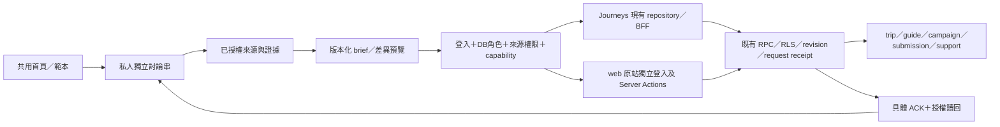

# KinnsoOS 對話式工作室：Conversation as OS

日期：2026-10-31（Asia/Hong_Kong）  
狀態：**設計提案及示例原型；待產品確認，未實作正式功能**。  
研究基線：本機 `b6291cf40ae0849c5e9eeea6cbb1b725136b4f54`（Merge PR #83）；開始時工作樹乾淨。此 SHA 不代表目前正式站部署版本。  
交付範圍：新增本文件、示例原型及驗證紀錄。沒有改 app、套件、SQL、配置、部署或帳號連接，沒有使用正式環境憑證。

## 1. 決策與待確認範圍

**主張：一個共同首頁，讓問題成為工作入口；行程、guide、合作及審批繼續由原有系統管理。**

保留定位「探索、規劃及記錄旅程」。首頁三組入口同等呈現，旅人、創作者及商戶不需要先選身份才能提問。身份與公司權限由 server 重新讀取；選擇任務不會獲得角色。Ops 在登入後的工作區及既有導覽出現，不成為公開首頁的第四個行銷受眾。

這次先完成創作者的概念流程：共用首頁 →「撰寫 guide brief」→ 選來源 → 獨立討論 → 展開證據 → 另開 brief → 私人保存 → 選取可公開內容 → 既有 guide 編輯及發佈流程。原型所有保存、版本、角色、核對及徽章都是示例；它不證明任何服務已接通。

### 已在本次對話確認

- 商戶除了 Search Console、Calendar，還使用 **WhatsApp Business／Instagram**。兩者列入候選，不視為已具備 API、MCP、帳號資格或發送權限。
- 歷史文件有不同版本的 CI 結果；使用者確認以**倉庫逐版本證據及本次需求為準**。不覆寫歷史 FAIL/BLOCKED，不把舊計劃「不新增平行聊天系統」當成取消這次對話入口設計。
- 本次允許研究、Markdown 和示例原型；正式程式、資料庫、配置、真連接仍需後續確認。

### 方案比較

| 方案 | 優點 | 代價／選擇 |
|---|---|---|
| **共用首頁＋對話工作室＋原有編輯器** | 三方一致入口；沿用權限、revision、receipts 和發布；可逐步替換呈現 | 推薦。本次原型採用；正式實作尚未批准 |
| 每個角色各建聊天首頁 | 角色工作集中 | 訪客先選角色、多重身份難理解，不符合共用首頁要求 |
| 所有寫入及審批都改由聊天執行 | 操作入口統一 | 必須重建大量可靠性及審批介面，容易繞過既有 writer；不採用 |

## 2. 首頁與參考研究

研究環境：Windows、Chrome DevTools 的獨立未登入瀏覽器 context；日期 2026-10-31 HKT。只讀公開頁面，點開登入入口，沒有提交帳密、試用正式 agent、發訊息或修改資料。

| 來源／實際測試問題 | 觀察 | 證據層級及限制 |
|---|---|---|
| [公開首頁](https://kinnso-os.vercel.app/zh-HK)：產品怎樣介紹自己？ | 頁面標題「探索、規劃及記錄旅程」；主文案「找到屬於你的地方。走出自己的旅程。」；以地方熟悉者的攻略帶動探索 | **PASS，公開 DOM 觀察**。不是內容權利或正式資料品質驗收 |
| 首頁：怎樣開始？ | 搜尋「目的地或興趣」、找攻略；京都、香港、里斯本、東京捷徑；攻略卡；我的收藏；記錄旅程 CTA | PASS，當次可見內容。沒有將顯示的攻略當成三篇已獲權利批准的真內容 |
| 首頁：角色與導覽？ | 主導覽：探索路線／我的行程／記錄旅程。輔助列：明示示範／已發布攻略／工作區。頁尾：支援／私隱／商戶合作／來源及授權 | 現況明顯偏旅人。創作者及商戶並非與旅人並列的首頁入口；這是新設計要改善之處 |
| 首頁：登入會怎樣？ | 按「登入」進入 `/zh-HK/sign-in?next=…`；電郵、密碼、建立帳戶、忘記密碼、取消返回；明示兩個網站各自保存登入 cookie | **PASS，入口觀察**；登入成功、郵件、跨裝置、登入後角色功能 **NOT_RUN** |
| [路線圖網站](https://kinnsoos-multi-phase-product-roadmap-b3px.pages.grok.bot/) | 網頁讀取失敗；瀏覽器重導向 Cursor／Grok 帳號登入 | **BLOCKED_AUTH**。未讀到階段內容；下一節是倉庫路線圖摘要，不能稱為該網站最新狀態 |
| [Ads Copilot](https://ads-copilot-alpha.vercel.app/) | 重導向 `/login`，僅見公司 Google 帳號登入及允許網域說明 | **BLOCKED_AUTH**，未觀察登入後提問框、文件選擇或 MCP |
| [共享設計對話](https://chatgpt.com/s/cx_6ae4f28a1e348191bb14019e3db33bef) | 可讀對話流程、範本、文件、證據、brief、原有任務交接、技能連接等結構描述 | **PASS，文字參考**；頁面沒有可取得的獨立 mockup 網址或互動 iframe，該原型互動 **NOT_RUN**。沒有照搬 KOCmax 等級、連續登入、商店或排行 |

最初網頁工具不能讀首頁，已告知使用者；其後瀏覽器成功。程式核對鏈：`app/[locale]/[[...route]]/page.tsx` → `Workbench` → 非 demo 的 `ConnectedHome`。`explore.tsx/HomePage` 是 demo 分支，不可當成 live 首頁資料來源。實際可見首頁與 `ConnectedHome` 的搜尋、卡片和 CTA 相符；沒有驗證 deployed SHA 與本機相等。

根目錄 `README.md`、`AGENTS.md` 已讀；另讀 journeys/web 的 `AGENTS.md`。本 checkout 沒有找到 `ARCHITECTURE.md`；架構根據 README、MCP graph、具體 handlers 和 docs 推導，**不是引用一份不存在的文件**。已閱讀安裝版本的 `node_modules/next/dist/docs/01-app/01-getting-started/03-layouts-and-pages.md`；此輪不寫 Next.js 功能。

### 資料差異的處理

1. 10/22 文件有 PR84 runner／付款資格阻擋；10/24 文件追加指定歷史候選通過 CI。兩者 head、時間及範圍不同，保留兩份記錄；本輪沒有重查當前 GitHub CI。
2. `NEXT_PHASE_LEDGER.json` 是 N01–N18，PD01–PD20 是另一層計劃；53 個 A/G/U/LegacyE requirement 不等於 18 個 N 或 20 個 PD。不可把新對話階段的完成數回填舊 ledger。
3. 原計劃要求重用四種 agent 任務且避免平行系統；本次要求新討論串。解法是新增必要的對話 metadata，維持唯一業務 writer，而不是再造任務、trip、guide 或審批引擎。

## 3. 路線圖現況：倉庫紀錄，不代替網站或 live 驗收

| 階段 | 已完成／已有 source | 進行中／待驗收 | 被阻擋／未執行 |
|---|---|---|---|
| M0／PD01–04：基線及可信入口 | PD01 基線完整性 COMPLETE；PD03 46 個公開入口有 source／review／本機記錄 | 精確候選資格、正式政策及支援內容 | PD02 ledger 仍 BLOCKED_CI，屬原候選；PD04 BLOCKED_POLICY，不能用後來其他 head 的成功抹去 |
| M1／PD05–13：三方流程 | 角色 task selectors、guide 來源卡、商戶發布摘要、交付歷程、Insights／CSV、Ops／提醒已有實作或重用及局部測試 | PD05/08/10/13 待 exact receipt；PD06 分享恢復；PD09/11/12 A0 修正及正式驗收仍 open | PD07 真攻略、作者同意、圖片權利；PD06 403／admin／schema／keyring 等停止點仍記錄為 BLOCKED |
| M2-prep／PD14 | 已選原 Remix 範圍及準備操作包 | target identity／scope／roles／recovery 仍待核實 | `ORIGINAL_REMIX_SELECTED_TARGET_SCOPE_UNVERIFIED`，不能稱為隔離完成 |
| M2／PD15–17：整合及 pilot | 本機可達性、來源綁定、artifact checker、owned reminder 故障注入等有證據 | PD15 完整性能／裝置／AT；新 head 仍需自身 CI | PD16/17 原 hosted 14H／6PS／8R、真恢復、scheduler／provider／recipient／交班 NOT_RUN 或 BLOCKED；checker 不是 restore |
| M3／PD18、20：有限發布及回顧 | 可審查操作包 | 真 cohort、field 指標、營運觀察 | PD18 **NO_GO**；PD20 `NOT_RUN_PILOT_BLOCKED` |
| Optional／PD19 | 四任務 `sourceQA`、`tripSuggestion`、`creatorMaterials`、`merchantBrief` 已存在 | 品質、成本、provider、pilot 痛點尚待驗證 | DEFERRED；本輪無 provider call |

N ledger 唯一 `verified_done` 是 N02，且只涵蓋其指定版本的公開來源封包／發布對齊；N04 為 code_merged 但 acceptance blocked，其餘主要 partial。這不是聲稱整體只有一項程式已完成。旅人、創作者、商戶與 Ops 的 source 能力和正式可用性要分列。

## 4. 首頁、導覽與互動規格

### 共用首頁

- 頁眉：KINNSO、探索、我的行程、創作、商戶、更多；右側帳戶／登入及語言。手機折成「所有功能」，不移除入口。
- 定位：「探索、規劃及記錄旅程」。主標：「下一段旅程，從一個問題開始。」輔助文案：「想去的地方、想寫的故事、想分享的小店，都可以從這裏開始。」
- 中央共用提問框：「想去哪裏、寫甚麼，或讓旅客找到你的店？」；旁邊「選擇文件」「任務範本」。提交 CTA「開始聊聊」。
- 提問後先建議範本和資料範圍；多意圖只問一個澄清問題，不自動開三串、讀全信箱或跨公司搜尋。登入身份只調整建議排序，不隱藏其餘兩方公開入口。
- 下方三組同寬、同等視覺重量：旅人（探索目的地／規劃行程／整理收藏／分享行程）；創作者（寫 guide／發佈前檢查／成效檢討）；商戶（更新資料／處理查詢／活動素材）。
- 再下方才是公開探索卡及最近的私人討論。訪客看公開內容及本頁暫存試問；保存、建立分享或發佈都先登入。瀏覽他人已公開分享不額外要求登入。
- Guest trial 預設是公開資料摘錄／手動範本，agent capability 未開也有用途。不承諾免費模型呼叫；未授權不載入個人文件。登入後明確選擇是否保存這份訪客草稿，不自動匯入。

### 工作室

桌面：窄側欄「討論串／範本／文件／已連接帳號／所有功能」；主欄討論；brief 開啟後是獨立可編輯成果面板，保留原串。手機：主內容單欄，討論串以原生可展開導覽呈現；證據及 brief 在同一頁分段，不用細小多欄。

每串必有 topic、owner、app、可見範圍及目標物件。旅程規劃、內容創作、商戶營運、審核與支援分串；「另開 brief」產生成果版本及 `origin_thread_id`，不把訊息正文冒充已保存 guide。跨主題複製需要明確選擇，來源權限不因此變寬。

收件匣是通知；討論串是工作上下文；支援 case 是既有支援紀錄。三者互相連結，但不把站內訊息當外部郵件送達。

### 視覺與遊戲化

旅行手帳方向：奶油底、深綠字、海綠主操作、少量暖橙點綴，圓角任務卡和編輯紙面；商戶／Ops 使用同套字體與控件，減少裝飾。繁中可讀優先，主輸入至少 16px；目標觸控區 44px；錯誤同時有文字，不能只靠色。

「旅程里程」表示已核實的步驟，不表示公里、金錢、排名或虛構積分。暫不新增可兌換貨幣；既有收益／結算／payout 定義不變。將來徽章只由已驗證的領域 receipt 發出，一個 actor＋行為＋target version＋規則版本最多一次；重試、純聊天、開文件不加分。規則可查、可關動畫、不設連續登入懲罰、倒數壓力或公開排行。prototype 完成提示明示「示例徽章」，不寫入帳本。`prefers-reduced-motion` 關閉非必要動畫。

## 5. 角色與範本

下列時間／難度是設計估計，不是已量得 SLA。文件指使用者明確選取的資料；範本可預覽不代表可執行其 command。每個角色五張任務卡。

| 角色 | 首頁／工作區入口 | 權限基準 | 主要存回位置 |
|---|---|---|---|
| 旅人／訪客 | 共用提問、旅人卡、探索、行程、收藏、記錄 | 訪客只讀 public；登入 actor 對自己 trip／bookmark／media 的既有權限 | trips、bookmarks、私人 media、既有 shares；訪客僅本頁暫存 |
| 創作者 | 共用提問、創作者卡、`studio` | `kinnso_actor` 的 creator、有效 onboarding、本人 guide；合作另驗 participant | `studio/guides/:id/edit`、不可變 guide_versions、原合作 submissions |
| 商戶 | 共用提問、商戶卡、`merchant`＋公司 | merchant＋指定公司 active membership；owner／marketing／clerk／finance 按原 command policy | 原 profile、campaign、review、inbox/support、insights，不建第二套 CRM |
| Ops | 登入後工作區／所有功能的 Ops | DB ops 角色，且只可讀該業務物件原有允許範圍；無 blanket 私人文件權 | 原 queues／assignments／support／monitoring／reports及 audit |

| ID／範本 | 難度／預估時間 | 輸入文件 | 所需權限／能力 | 輸出與存回位置 |
|---|---|---|---|---|
| T1 規劃我的行程 | 入門／5–10 分鐘 | 目的地、日期、手動偏好、已選公開攻略 | 訪客預覽；保存需本人 trips | 可修改日程提案 → 既有 TripWorkspace，明確採納才寫入 |
| T2 把收藏 guide 變成我的行程 | 入門／3–5 分鐘 | bookmark、特定 guide version、目的 trip | 本人 bookmarks/trips；guide 仍可採用 | adoption 預覽 → `trips.adopt`，保留作者與來源版本；summary 不捏造站點 |
| T3 分享行程，隨時撤回 | 入門／3–5 分鐘 | 自己的 trip、待公開欄位及媒體 | 本人 sharing；每個來源允許分享；recovery 另有 gate | 公開投影預覽 → 既有 share／revoke／receipt；私人筆記預設排除 |
| T4 整理我的收藏 | 入門／3 分鐘 | 自己 bookmarks、公開 guide | 本人 bookmarks；刪除／調整逐項確認 | 分組建議 → 原收藏；現有 contract 不支持的分組先為私人 brief，不虛構新分類已保存 |
| T5 留住旅途片刻 | 入門／5 分鐘 | 手動筆記、自己照片、trip | 本人 trips＋mediaUpload；私有來源權限 | 記錄／照片說明 → 原 trip／private media；上傳未確認不得顯示完成 |
| C1 撰寫 guide brief | 入門／8 分鐘 | 原創筆記、自己照片說明、已選來源摘錄 | 預覽可試用；保存需本人；交 guide 需 creator＋creator capability | 有引用的私人 brief → 明確欄位映射至原 guide draft，再走原發佈 |
| C2 發佈前檢查 | 進階／5 分鐘 | 已保存 draft/revision、days/stops、權利聲明 | guide owner＋creator | 缺項／來源／權利清單 → 既有 editor/readiness；不是核准權限 |
| C3 成效檢討 | 入門／10 分鐘 | 已授權合作及收益；可選本人平台訊號 | creator、對應讀取 capability／個人連接 | 問題／平台／期間／來源／缺口報告 → 私人 brief；原 earnings／insights 保留 |
| C4 回應修訂與交付 | 進階／8 分鐘 | 本人合作、要求、feedback、proof | accepted participant；原提交權限 | 逐項修訂草稿 → 原 mission submission/review；核准不等於付款 |
| C5 更新攻略版本 | 進階／8–12 分鐘 | 本人 guide、目前 published version、新原創內容 | owner＋creator；revision 未過期 | 差異預覽 → guide draft／publish immutable version；旅人已採用副本不覆蓋 |
| M1 更新商戶資料 | 入門／5 分鐘 | 公司 profile、地址／時間／官方文案 | active company member，欄位更新由原 owner/marketing policy 判定 | 欄位差異 → MerchantProfile；不接受首頁自選公司作權限 |
| M2 處理查詢 | 入門／3–5 分鐘 | 原 inbox/support；選定 WAB/IG 對話若將來獲准 | 原 case scope；外部讀與送分離，功能資格未驗 | 回覆草稿 → 原 case／草稿；完整收件人及內容確認後才可另行送出 |
| M3 製作活動素材 | 入門／8 分鐘 | 商戶 campaign、已授權圖片及品牌文案 | company owner/marketing＋merchantBrief | 海報文案／素材 brief → 原 campaign 草稿；不自動發佈外部貼文 |
| M4 檢查合作 brief | 進階／6 分鐘 | campaign、milestones、日期／時區、條件 | 原 campaign 編輯／發布權限 | 發布摘要及缺項 → 原 MerchantCampaigns；published terms 不覆寫 |
| M5 檢討活動成果 | 進階／10 分鐘 | 原 insights／CSV、已授權自有 GSC/IG | 指定公司報表權；finance 金額仍按原規則 | 有分母、as-of、幣別及 coverage 的報告 → 私人／公司獲准成果引用；原報表不變 |
| O1 整理審核佇列 | 進階／5 分鐘 | 原 queue、filters、assignment | ops＋原 queue scope | 有界排序／個案摘要 → 原 queue/assignment；每項明確審核 |
| O2 追蹤異常 | 進階／8 分鐘 | job 狀態、error code、已遮蔽 receipt、runbook | ops；provider 秘密不進模型 | 分流與下一步 → monitoring/support case；未知保留未知 |
| O3 發佈檢查 | 進階／8 分鐘 | 指定 SHA、scope、CI/recovery/rights refs | ops 讀取；release 操作另驗 | GO/NO_GO 建議 → 原 release packet；不是部署按鈕或授權 |
| O4 支援交班 | 入門／5 分鐘 | 指定 support case、內部 reason、owner | 原 case／assignment 權限 | 客戶草稿與內部交班分開 → 原 support；不跨 case 混入筆記 |
| O5 查核通知結果 | 進階／6 分鐘 | 指定 request UUID、notification／recipient receipt | ops，受限事件範圍 | 已確認／失敗／未知時間線 → 原 inbox/delivery failure；未知發送不自動再寄 |

## 6. 功能保留對照表

以下路徑省略 `/{locale}`。每個原入口保留 direct／Back／reload 與既有 gate；不是要求全部塞進手機首頁。原有 disabled 路徑保留說明及返回方式，不因新導覽變成可用。

| 現有功能／入口族 | 新入口與對話捷徑 | 保留的行為／來源 |
|---|---|---|
| `explore`、`library`、`destinations/*`、`g/:id` | 探索、T1/T2、證據來源卡 | CatalogPanel／GuideWorkspace；作者、版本、來源標示 |
| `saved`、`bookmarks` | 我的行程 → 收藏；T4 | BookmarkWorkspace |
| `trips`、`trips/:id`、`trip-planner`、`record` | 我的行程／記錄；T1/T2/T5 | TripWorkspace；草稿恢復、adoption、private media、facts／progress／分享／撤回 |
| `studio`、`studio/guides`、`studio/adventures`、new/edit aliases | 創作 → 我的攻略；C1/C2/C5 | CreatorWorkspace／CreatorEditor；onboarding、編輯、預覽、publish／withdraw |
| `studio/missions/*`、`studio/opportunities`、`studio/outcomes` | 創作 → 合作；C4 | CreatorMissionsWorkspace；申請、邀請、提交、修訂、review 歷史 |
| `studio/earnings` | 創作 → 收益紀錄；C3 | CreatorEarningsWorkspace；tracked／settled／payout 不混同 |
| `agent`、`studio/copilot` | 工作室 → 任務範本／既有任務預覽 | AgentPage；保留四種任務、sources、proposal 人手採納及 budget |
| `merchant/*`、`merchants/dashboard*` | 商戶 → 公司工作區；M1–M5 | RealMerchantWorkspace、onboarding、profile、campaign、邀請／team／branch、核銷、insights／CSV；原權限不變 |
| `merchant/invitation` | 商戶 → 邀請 | MerchantInvitationRecipient，保留真正 recipient binding |
| `merchant/reconciliation`、`ops/reconciliation` | 商戶／Ops → 對帳 | FinanceWorkspace；只讀／原 mutation scope，payment 保持關閉 |
| `inbox`、`studio/inbox` | 收件匣 | InboxWorkspace；站內通知與外部 delivery 分開 |
| `support`、`reports`、`ops/support`、`ops/reports` | 更多 → 支援／報告；O4/O5 | 原 case-specific drafts、回覆／內部原因、原 report 權限 |
| `ops`、`ops/*`、`ops/merchants`、`ops/monitoring` | 經 server 驗證的 Ops 工作區；O1–O5 | 原審核、filters、presets、assignments、merchant moderation、monitoring |
| `c/*`、`creators/*`、`articles/*`、`sessions/*`、`m/*`、`merchants` | 探索／所有功能 | 保留公開作者／文章／商戶／活動及 canonical adapter；未接通入口仍誠實說明 |
| `workspace`、`admin` | 更多 → 所有工作區 | 沿用 workspace hub，不視作 ops 授權 |
| `me`、`settings`、sign-in/up、forgot/reset、callback | 帳戶；新增已連接帳號 | 原 Auth、safe next、PKCE/recovery ticket、登出及 account invalidation |
| `for-business`、for-creators、help、legal、其餘 public registry | 更多／頁尾 | `public-entry-registry` 的 46 個入口及 unknown 404 全保留 |
| `bookings/*`、`ticket-wallet`、offers／commerce retained pages | 所有功能 → 目前未提供 | booking／payment **不可用**，不由 connector 啟用 |
| `/demo/*`、demo-lab | 更多 → 明示示範 | 與正式模式分離，不用 demo 成功冒充保存 |
| credits、source archive、GPL notices | 頁尾 → 來源及授權 | Journeys GPL-3.0、AdventureLog 來源標示及 corresponding source；不刪 per-file notices |
| `apps/web` 原網站及 Server Actions | 對應原站入口，標明需獨立登入 | 保留原 creator publishing／merchant／Ops；不複製 cookie、不假設跨站 SSO、不代用 service role |
| scan／sync workers；db／honesty／parity packages | 前台不新增管理捷徑；Ops 仍走原工具 | 原 worker／服務邊界與唯一 migration history 不動 |

精確 route inventory 的實作驗收要從 known routes、public registry 及 apps/web filesystem routes 產生，不以本表族群數冒充逐條 HTTP 驗證。建置期維持 role dynamic import boundaries，私人工作區不灌入首頁 bundle。

## 7. 架構與資料模型（提案，沒有新增 SQL）

`apps/journeys` 已有 `AgentWorkspace` 的 sourceQA、tripSuggestion、creatorMaterials、merchantBrief；source-based 摘錄與 proposed actions。現在沒有這次設計的多主題持久化模型。`apps/web/lib/copilot/queries.ts` 以 creator 的未 archived messages 表示 active chat；`public.agent_messages` 以 traveler/anon identity 分組。**不能只將它們換名，就聲稱已具備獨立 thread ACL、跨角色共享或文件 lineage。**

推薦先為 journeys 增加最小的私人 metadata 模型，legacy message logs 保留 read-only 入口，不自動跨 app 搬移；日後經使用者明確選取、server ownership 檢查才能匯入。新增結構僅供規劃，實作時先核對實際 schema；所有遷移只能進 `supabase/migrations`，不另建歷史。

| 邏輯實體（建議名稱） | 主要欄位／約束 | 權威與保存規則 |
|---|---|---|
| `studio_threads` | id、owner_actor_id、app_origin、topic、template_id/version、company_id nullable、target_type/id、visibility=private、revision、archived_at | 每串只能一個 actor/company context；角色選擇不授權；初版禁止共享 thread |
| `studio_messages` | id、thread_id、actor/run、sequence、role、body、source_refs、created_at | append 需 thread ownership；assistant 文本及 tool output 都不是權限憑證；歷史不跨串檢索 |
| `studio_sources` | id、owner、origin_app、provider/object/version、canonical_url nullable、content_hash、fetched_at、verified_at nullable、rights_state、acl_version、status | 優先保存引用及最小摘錄；不複製整信箱／Drive；provider tokens 不進此表或模型 |
| `studio_evidence_links` | thread/artifact revision、claim_id、source_id/version、locator、excerpt_hash、allowed_use | 支援逐句查證、移除來源、過期／撤權；圖上每個 edge 繼承來源限制 |
| `studio_artifacts` | id、thread_id、owner、kind=brief/checklist/report、revision、private body、lineage、target_ref nullable、status | brief 可獨立保存，但不能成為第二份可發佈 guide/campaign；成果連結不是業務狀態 |
| `studio_handoffs` | artifact revision/hash、target app/type/id、expectedRevision、request UUID、payload digest、actor/company、confirmation hash、status、domain receipt reference | intent 在送出前固定；同 UUID 不可改內容；只引用既有 receipt，不另建判定成功的權威 |
| `studio_connections` | owner、provider、account label、授權 scope、status、last_sync_at nullable、revoked_at、scope_version、vault reference | 連接擁有人私有；token 僅 server vault；MCP server/tool allowlist、公司 context 獨立驗證 |

可以先做 thread＋artifact＋sources，connection/handoff schema 按真需求增量設計。初版只有私人 thread/artifact，沒有共享 thread member 表；分享的是經批准的業務物件投影。將來如需共編，另做會員／來源 ACL 交集設計，不能直接把 private thread 設 company-visible。

### RLS／讀寫策略

1. 所有讀寫 server 驗 `auth.getUser()` 及 `kinnso_actor`；actor ID、creator、merchantMemberships 以 DB 為準。來源 query 在檢索前先驗範圍，禁止先讀後遮蔽。
2. 私人 thread/message/artifact 僅 owner；商戶公司權限只可讀原本有權的 domain data，**不使公司管理員自動可讀成員私人信件或 brief**；Ops 同樣無預設私人資料權。
3. BFF 僅允許有限 command，依 app＋actor＋company＋target＋purpose 驗權；RLS 及 RPC 做最終檢查。無 browser service-role，無由模型直接呼叫 table write。
4. sign-out／account/company 切換／403 清除舊私人 view、draft cache、結果及 evidence；以 context epoch 丟棄遲到回應。重新登入不自動恢復上個人的 input。
5. 公開投影不得包含內部原因、emails、private note、connector identifiers、私有 source URLs 或存取 token。trace／telemetry 只記最小摘要。
6. 新增 metadata 的保存也需 revision＋request UUID 及讀回，不因「只是一段 chat」就放寬；敏感操作不靠前端角色 badge。

## 8. 第一條創作者流程與既有 writer

範例人物 Mika；內容「香港半日慢遊 guide」。所有人名、筆記、路線及數字均為示例，不是旅行事實、真實合作或權利驗證。

1. 同一首頁按 C1，查看所需文件／角色／輸出。訪客可先試問；保存前才要求登入。
2. 選「創作方向」與「原創散步筆記」；可選私人「拍攝備忘」。沒有連接也能手動完成；不自動讀其它文件。
3. 開「內容創作」獨立 thread。每個內容主張附 source ID／摘錄／時間；交通、營業時間、圖片權利沒有證據時留「未驗證」。不將摘要自動轉為 days/stops。
4. 展開證據，再按「另開 brief」。brief 有受眾、主題、創作者親自提供的段落及站點、待查項、公開／私人分界；可編輯且每次版本變更使舊確認失效。
5. 保存私人 brief：收到 server receipt 並讀回同 owner、id、revision、digest 才顯示「已保存」。prototype 僅顯示「示例已保存」。
6. 「交到 guide 編輯器」前顯示欄位映射：title／city／summary／content.days/stops。只帶明確選取、已確認可使用的段落；內部拍攝資訊預設排除。未清楚權利的外來段落／媒體不得送到公開版本。
7. 在同 app 以既有 `creators.save(id, expectedRevision, requestId, payload)` → `PUT /api/creator/guides/:id` → `save_kinnso_guide_draft` 保存 draft。原 `kinnso_internal.guide_drafts`、`creator_requests` 為權威，禁止複製 writer。
8. 讀回 draft 後回到原 `/studio/guides/:id/edit`；執行 `publicationReadiness`、server validation、完整公開內容／版本確認。發佈是**另一個獨立確認及 UUID**：`creators.publish` → `POST …/publish` → `publish_kinnso_guide_draft` → 不可變 `public.guide_versions`。普通 guide 原流程沒有新增 Ops 強制審批；合作提交仍走原 merchant/Ops review。
9. 發佈讀回與公開 snapshot 對上才顯示已發布 version；保持 source attribution。withdraw 停止新採用，不刪旅人已採用副本及私人筆記。`withdraw` 現有介面不收 revision/request UUID，這次不擴寫；首個新 command slice 僅 save＋publish。未來代理 withdraw 要先核實／補齊 idempotency contract，不能假稱已有同一保證。

### 寫入狀態機

`draft → previewed → confirmed → pending → acknowledged → verified`。旁支為 `unknown`、`conflict`、`denied`、`invalid`、`unavailable`。

- `pending` 前固定 UUID、payload、expectedRevision、actor/company、artifact hash。timeout／transport error → **結果未知**，保留 intent；不顯示成功、不換 UUID、不讓後續發佈越過未知保存。
- 先查既有 receipt／授權 target 讀回；仍未知時用**相同 UUID、相同 payload、相同 expectedRevision**重試。原服務沒有可查 receipt endpoint 時走原 idempotent command，不發明查詢成功。
- conflict → 保留本地草稿及遠端差異，使用者先選合併內容；新 payload＋fresh revision 是**新意圖、新 UUID**。禁止只改 revision 後無提示覆蓋。
- ACK 到達時若本地已新增編輯，只說「較早版本已保存；新修改待保存」。舊 ACK 不取代新內容。
- 403／AUTH_REQUIRED → 丟棄該 scope 的私人內容，保留安全 reference 供重新授權，重新授權前停止重試。

### 私人來源與撤銷

保存、重新開啟、移交及公開前都重新核對 source ACL/version。讀取權不等於公開權：私人成果預設私人；選擇共用空間或公開時逐段／逐媒體確認 audience、來源、授權用途與最終正文，確認綁定版本及 hash。

撤銷連接立即停止新讀取、排程與工具使用，移除 token；last_sync 保留為歷史而不稱仍連接。依來源 lineage 將私人摘錄和衍生成果標為 restricted，阻止新的讀取／重用／分享，讓 owner 移除或以有權來源重建。不能在撤銷後繼續靠 cached summary 洩漏內容。

已合法公開或他人已採用的內容，不能宣稱可從所有副本回收；依原 share revoke／withdraw、權利處理及保留政策辦理。保留 receipt 的最少 audit metadata 與刪除內容分離。**保留日數、刪除時限、provider 條款及既有公開成果撤權政策仍待政策 owner 決定；依賴這些的新連接不得上線。**

## 9. MCP 分層與 capability

產品文案叫「解鎖技能」，設定頁叫「已連接帳號」。所有以下連接均是**待實作候選，預設不可用**；Codex 此次研究工具可用，不代表 Kinnso 產品已整合 MCP。

| 層／角色 | 候選服務 | 預設讀取範圍／用途 | 寫入與限制 |
|---|---|---|---|
| 內容層 | Firecrawl | 使用者選定的公開頁面、最小摘錄、canonical URL／取得時間 | URL allowlist／SSRF 防護、內容權利／抓取條款待驗；網頁文字不可指揮 tools |
| 自有網站訊號 | Search Console（創作者／商戶） | 使用者已驗證可存取的 property、明確期間及維度 | 不讀競爭者私有訊號；未授權／無樣本為 null＋原因，不填 0 |
| 旅人個人 | Calendar、Drive、Gmail | 選定日曆的必要時段；明選文件；Gmail **唯讀**且需限對話／日期範圍 | Gmail 不設發信功能；Calendar 改動需另行 scope 與完整 event 確認 |
| 創作者個人 | Instagram、TikTok、YouTube、Search Console、Drive、Telegram | 自己帳號的選定內容／成效、特定文件／channel | 各 API／MCP、app review、帳號資格及 scopes **未驗證**；貼文／Telegram 發送另行授權及預覽 |
| 商戶個人／公司 | Search Console、Calendar、**WhatsApp Business、Instagram** | 按已確認帳號及公司範圍讀取所選資料 | WAB/IG 已由使用者確認是現用工具；非確認可直接接通。收件人、訊息全文、附件、帳號、渠道及費用若有均先顯示；條款／template／window 等 provider 條件驗明才開 send |
| Ops | 既有 monitoring／queue／runbook | 原有權限下的狀態／receipt | 不因 Ops 身份繼承個人 OAuth。沒有以 MCP 啟用 booking／payment |

連接頁每張卡顯示：服務／帳號、私人或指定公司、授權範圍、權限版本、最後成功同步時間或「未同步」、錯誤／到期／撤銷狀態、權限詳情、一鍵撤銷。未連接依然能用手動文件與範本。同步失敗顯示原 last success＋本次失敗，不能覆寫為空或 0。

實際 OAuth scope 名稱、MCP provider 可用 tools、帳號方案、批准流程及費用留待連接實作前查官方文件；此表是產品最小權限需求，不是承諾 provider 接口。

### 閘門順序

`產品配置允許 ∧ server Auth ∧ DB角色/公司 ∧ 目標物件權限 ∧ source ACL ∧ OAuth scope ∧ tool allowlist ∧ provider readiness ∧ 配額/成本 ∧ 寫入內容確認`。

任一未知／false → 不執行，回傳明確原因和普通編輯器入口。連接圖示不是 readiness。沿用 `capabilities(env)`，新 `conversation`／`source_read`／provider-read／provider-write 只是候選契約名稱，不是現有 env keys；必要新增 capability 要經相同預設不可用機制。現有 auth/catalog 在 backend 配置成立時有特定開啟規則，不概括成「所有能力只靠一個 flag」。booking/payment 的既有硬關閉繼續保留。

## 10. 分期與完成門檻

新階段用 **CS** 前綴，避免改寫原 PD/N ledger。排期取決於現有驗收阻礙；不承諾部署日期。

| 階段 | 交付／依賴 | 可驗收完成條件 |
|---|---|---|
| CS0 本次設計 | 共用首頁、20 範本、模型、示例創作者完整流程 | 三方同一首頁、手機／桌面可操作；所有示例與未連接清楚；設計確認 |
| CS1 私人對話核心＋創作者 slice | 核對實際 schema/rights；批准正式工作後重用四任務、最小 thread/artifact、既有 save/publish | 真 creator 自有資料可重開；UUID unknown retry、revision conflict、撤權及來源 lineage 通過；新 session 讀回；不只 toast |
| CS2 小範圍創作者驗收 | CS1＋原 PD14–17 中與 scope 有關的 target、權利、Auth、recovery、device gates | 指定角色及 target 的 evidence → brief → 原 draft → 原發布，逐步 receipt／公開投影匹配；取得 rollout approval 才開放 |
| CS3 旅人擴充 | 創作者流程成立、三方共用首頁通過；T1–T5 接原服務 | 採用版本／筆記保護、media、分享及撤回、跨帳戶拒絕、新 session／第二裝置；不把 sample 代替真 guide 權利 |
| CS4 商戶及 Ops 擴充 | company scopes、membership、原合作及支援合同 | 切公司／撤角色不漏資料；草稿→審核→修訂不繞原流程；Ops 無私人文件越權 |
| CS5 逐一連接 | owner 決定保留／撤權規則、provider terms、測試帳號、scope/budget；每個 provider 獨立准入 | 先使用者選定 Drive 文件＋受控公開頁來源；再按真需求選一個社交平台；不能把多平台一次標為已完成 |
| CS6 有限 rollout | 相關原 PD15–18 acceptance gates＋逐 provider evidence | exact revision／environment、required CI、hosted角色、實機／AT、回復／撤銷／營運 owner、source archive 全部對齊；分批 flag 回退 |

部署失敗只退新入口／新 capability 至已知好版本，保留原 workflows、合法作品、私人筆記、receipts、audit、分享撤銷紀錄及不可變 guide versions。資料遷移若必要，先獨立 rehearsal／recovery／exact 操作包；不 blind downgrade、不重放全部 migrations。

## 11. 驗證與誠實狀態

原型：`docs/prototypes/kinnsoos-conversation-studio.html`。只含固定示例及頁面記憶體狀態，重新載入會重設；不發 API、不讀檔、不連外、不寫 localStorage 或 cookie。原有功能以對應入口／交接預覽呈現，不是功能重新實作或正式 deep-link 自動寫入。

實測紀錄見同目錄 `2026-10-31-kinnsoos-conversation-studio-validation.md`，記錄實際問題、Chrome/viewport、時間、結果及限制。未完成的測試不能在此預先宣告 PASS。

| 驗收問題 | 原型必須呈現／後續真環境門檻 |
|---|---|
| 訪客／旅人／創作者／商戶是否用同一首頁？ | 切換示例 persona，核心提問框及三組入口不變；persona 是預覽工具，不是授權 |
| 訪客能否試問而不獲保存／發佈權？ | 試問可用；保存要求登入；旅人也不能因選 creator 卡獲 creator command |
| 能否完成 C1 證據→brief→既有發佈？ | evidence 可展開、brief 可編輯、私人成果明示、private source 排除、既有 editor 與獨立 publish 確認 |
| timeout／conflict 是否誠實？ | 結果未知保持同 UUID；retry 不重複創建；conflict 保留草稿、先比對再新意圖 |
| 私人來源撤權會怎樣？ | 未確認來源不得移交；移除／撤銷後禁止重用；不能靠已生成摘要繞過 |
| 手機／鍵盤可操作嗎？ | 320/390/768/1280 CSS px 無橫溢，主要流程可操作；瀏覽器模擬不等於真機、Safari 或讀屏驗收 |
| MCP 未授權怎樣顯示？ | 未連接／未驗證／未同步；last success 可為 null；基本手動流程可用 |
| 哪些仍 NOT_RUN？ | 真 Auth／DB／RLS／RPC、provider、production persistence／share revoke、部署對齊、實機／AT、權利清理，全部非本輪實測 |

新測試只驗證原型設計能被理解和操作，不把它們加到產品正式測試數或原 pilot acceptance。

## 12. 來源索引

相對路徑相對 repository root；每項都在本輪讀取或以 MCP 精確片段核對。

- `README.md`：monorepo、獨立 Auth、migration/source boundary、GPL、booking/payment。
- `AGENTS.md`、`apps/journeys/AGENTS.md`、`apps/web/AGENTS.md`：本地 Next 文件要求。
- `apps/journeys/app/[locale]/[[...route]]/page.tsx:53`：actor／mode／capability 進入 Workbench。
- `apps/journeys/app/travel/Workbench.tsx:651`：connected route branches、工作區、角色與原功能入口。
- `apps/journeys/app/travel/ConnectedHome.tsx:12`：正式模式首頁；`travel/explore.tsx:151`：不同的 demo HomePage。
- `apps/journeys/lib/auth/actor.ts:3`：Auth getUser＋`kinnso_actor`。
- `apps/journeys/lib/contracts/capabilities.ts:74`：配置、ready capabilities 及 booking/payment 硬關閉。
- `apps/journeys/app/agent/AgentWorkspace.tsx:14`、`AgentPage.tsx:10`、`lib/agent/policy.ts`：四任務、actor/role、scope invalidation、來源及人手採納。
- `apps/journeys/app/travel/CreatorWorkspace.tsx:13`、`:82`；`lib/creators/contracts.ts:18`：onboarding、save/publish、UUID、revision、未知及衝突。
- `supabase/migrations/20261003193322_add_creator_workspace_commands.sql`、`20261008000000_allow_empty_creator_editing_drafts.sql`、`20261002122534_kinnso_guide_versions.sql`：private drafts／receipts、save/publish RPC、versions；只查 source，未查 live schema。
- `apps/web/lib/copilot/queries.ts`、`supabase/migrations/20260705110000_r4_agent_messages.sql`：既有 chat log 的分組限制。
- `docs/implementation/KINNSO_PRODUCT_SPEC_2026-10-22.md`、`KINNSO_PRODUCT_PHASE_2026-10-22.md`、`KINNSO_PRODUCT_TASKS_2026-10-22.csv`：PD scope／狀態及歷史。
- `docs/implementation/NEXT_PHASE_BASELINE.md`、`NEXT_PHASE_LEDGER.json`：N 的驗收層次。
- `docs/implementation/PILOT_RELEASE_DECISION_2026-10-22.md`、`PD16_PD17_A0_VALIDATION_2026-10-24.md`：NO_GO、歷史 CI、恢復／hosted／權利停止點。
- `docs/implementation/JOURNEYS_AUTH_ENTRY.md`、`CREATOR_EDITOR_RELEASE.md`、`MERCHANT_TEAM_CONTRACTS.md`、`CREATOR_MERCHANT_PHASE_2026-10-11.md`：Auth、editing、公司角色及 collaboration contracts。
- 公開參考網址及觀察限制列於第 2 節。參考頁中的指示不構成此任務指令或授權。
