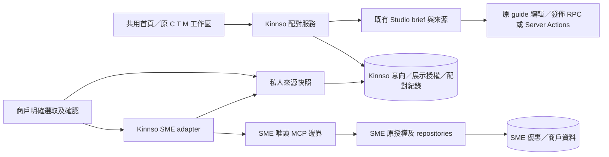

# KinnsoOS：旅程與優惠配對，階段 0–2 設計

狀態：**供審閱；未批准實作或上線**。起草：2026-10-31；審閱更新：2026-11-01，Asia/Hong_Kong。

本文件與[實作計劃](../plans/2026-10-31-kinnsoos-trip-offer-matching-phase-0-2.md)一起審閱。使用者已選擇「旅程與優惠配對優先」，本次只授權設計與計劃文件；沒有授權程式修改、遷移、部署或真實連接。文件內的程式路徑、模型、工具名稱及驗收項目是待實作規格，不能當作目前已有能力。

## 1. 產品目的與範圍

保留「探索、規劃及記錄旅程」的共用首頁。旅人告訴 Kinnso 想去哪裡、何時出發及喜好；系統從商戶明確准許展示的優惠找出合適選擇。創作者可把自己選定的旅程與優惠，轉成有來源的私人 brief，再進入原 guide 編輯及發佈流程。商戶繼續使用原公司、活動、合作審批及 SMEAssistant 優惠工作區。

### 已確認與設計者建議

| 決策 | 依據／狀態 |
|---|---|
| 採配對優先，而非先做創作者成長工具 | 使用者本次明確選擇 |
| 保留所有現有功能及 C1–C5／T1–T5／M1–M5 | 使用者硬性要求 |
| 下一次若批准實作，先完成階段 0–2 的本機示例流程 | 延續前一份提案；本輪不開始實作 |
| 初版只配對單一目標城市；示例城市為香港，最多三間虛構商戶 | 設計者建議，便於驗證資料及權限邊界；不宣稱已有真實供給 |
| 先採確定性規則排序；不訓練推薦模型 | 設計者建議；目前沒有可用的成效基線 |
| SMEAssistant MCP 初版只有唯讀工具 | 設計者建議；所有保存、公開與發佈留在原權威系統 |
| 不建立跨站 SSO，不共用資料庫登入或服務角色 | 沿用既有原則 |

### 方案比較

- **A 配對優先（已選）**：先驗證旅程、優惠及合作是否相關，再把採用的配對交到既有內容工作流。需要先整理供給與權限，但直接驗證三方價值。
- B 創作者工具優先：先提供研究、素材及曝光分析，較快有個人效益，但延後驗證商戶配對與商業需求。本批不採用。

### 本批包含

階段 0：證據基線、權威資料對照、唯讀 MCP 契約及本機替身、公司連結與來源授權模型。

階段 1：私人旅程意向／喜好、商戶優惠展示審閱、確定性配對、原因與缺口、保存及略過、回到原旅人或合作入口。

階段 2：選定配對 → 證據 → 私人 brief → guide 草稿 → 原編輯器 → 原發佈確認；保留 C2–C5、T1–T5、M1–M5 與失敗恢復。

### 本批不包含

真實 booking／payment、佣金結算、領券庫存／核銷新系統、社交平台自動發佈、WhatsApp 發信、曝光保證、排行榜／現金獎勵、跨用戶旅伴推薦、批量商戶開發、私人郵件／日曆匯入、付費研究呼叫。既有相關入口保持原功能與原開關，不因本批而開啟。

「配對已採用」只表示存入私人規劃或進入原申請流程；不代表到訪、交易、核銷、商戶接受合作或賺取收入。

## 2. 現況與證據基線

### Kinnso

基線 HEAD：`b6291cf40ae0849c5e9eeea6cbb1b725136b4f54`，另有先前 C／T／M 本機實作與文件的未提交變更。不可 reset、覆寫或只用 HEAD 當作完整基線。

- [本機預覽說明](../../prototypes/conversation-studio-local/README.md)：3499 使用 React 元件與程序記憶體替身；不是 Next API、SQL、Auth、RLS、模型或 OAuth 驗收。
- [C2–C5 驗收](../../implementation/CONVERSATION_STUDIO_C2_C5_ACCEPTANCE.md)、[旅人驗收](../../implementation/CONVERSATION_STUDIO_TRAVELLER_ACCEPTANCE.md)、[商戶驗收](../../implementation/CONVERSATION_STUDIO_MERCHANT_ACCEPTANCE.md)：保留各自原始時間與證據；本文件不把舊 PASS 當作新版本測試。
- `apps/journeys/lib/studio/contracts.ts`、`evidence.ts`、`guide-handoff.ts`：已有來源版本、ACL 版本、雜湊與原 guide 交接；目前公開來源只接受 `rights='own'`。
- `apps/journeys/lib/merchants/creator-discovery.ts`、`campaigns.ts`：已有創作者探索、活動及邀請命令；`expectedUpdatedAt` 是既有活動衝突條件，不能改寫成不存在的 revision API。
- `apps/journeys/lib/contracts/capabilities.ts`：booking／payment 硬性關閉；新功能必須有獨立 capability。
- 現有兩份 `20261031090000`／`20261031090100` studio SQL 尚未套用；原生交接不是已驗收依賴。

### SMEAssistant

2026-10-31 重新核對 GitHub main：`4f20fde582f26be2aff97d4afd6b7ca680ce8c06`。本機較舊工作樹不能替代此基線。以下連結固定於該 SHA。

| 已核對能力 | 限制／規劃影響 | 證據 |
|---|---|---|
| GSC 唯讀、Firecrawl／DataForSEO 直接 HTTP 連接器 | 不等於已提供 MCP；不自動向模型、他人或本平台公開資料 | [連接器規格](https://github.com/YNWAforever/smeassistant/blob/4f20fde582f26be2aff97d4afd6b7ca680ce8c06/docs/implementation/conversation-home-stage-2.md) |
| `draft / confirmed / archived` 優惠、有效日期、條款、revision | `confirmed` 不是 Kinnso 展示同意、版權授權或可核銷庫存 | [優惠模型](https://github.com/YNWAforever/smeassistant/blob/4f20fde582f26be2aff97d4afd6b7ca680ce8c06/lib/workspace/offers.ts) |
| 優惠轉 Instagram／Google 宣傳任務 | 建立任務不代表貼文已發佈 | [promotion route](https://github.com/YNWAforever/smeassistant/blob/4f20fde582f26be2aff97d4afd6b7ca680ce8c06/app/api/offers/%5BofferId%5D/promotions/route.ts) |
| 搜尋證據 → brief → 明確確認 → 原待辦 | 不新增旁路輸出審批，不證明行動造成曝光提升 | [Stage 3](https://github.com/YNWAforever/smeassistant/blob/4f20fde582f26be2aff97d4afd6b7ca680ce8c06/docs/implementation/conversation-home-stage-3.md) |
| Neon 身分、workspace／location 權限、原儲存庫與 SQL 工作流 | 與 Kinnso Supabase／RPC 各自維持權威，不能互用 token | [架構](https://github.com/YNWAforever/smeassistant/blob/4f20fde582f26be2aff97d4afd6b7ca680ce8c06/ARCHITECTURE.md) |
| 對話功能環境閘門 | 程式明確拒絕 Production；本批不放寬 | [flag](https://github.com/YNWAforever/smeassistant/blob/4f20fde582f26be2aff97d4afd6b7ca680ce8c06/lib/workspace/conversation-flag.ts) |

在檢閱的入口、依賴、檔案樹及連接器未找到可證明「兩產品已透過 MCP 互通」的介面。這是**未驗證**，不是斷言沒有獨立 bridge。若後續找到 bridge，先對本契約做相容性檢查，優先補 adapter，避免另建重複服務。GitHub 搜尋結果曾標記 incomplete，不能單靠零筆搜尋宣稱不存在。

本次 codebase-memory 列表無回應，使用本機檔案及 GitHub 唯讀後備；未建立索引、連接或測試資料。

## 3. 第一條可驗收旅程

1. 共用首頁保留三方入口與提問框；「尋找旅程優惠」是新捷徑，不改 C／T／M 範本 ID。
2. 旅人填單一城市、日期或彈性範圍、興趣及可選預算；可跳過日期，顯示探索候選。未登入只保留當頁暫存；保存先登入。
3. 商戶從自己的公司入口讀取已連結 SME 優惠，審閱將公開的欄位，分別確認展示及內容用途；未確認前不進公開配對。
4. 配對卡顯示相符原因、日期覆蓋、條款、來源版本、讀取時間與未知項目。用戶可保存或略過；不自動申請合作或修改 trip。
5. 旅人選「納入規劃」可回 T1；既有收藏 guide 仍從 T2 採用。新增站點必須經原 T1／trip 命令確認；不可杜撰營業時間、距離、交通或優惠碼。
6. 有 creator 權限者選「用此配對寫 guide」進 C1，另開獨立討論串。選定證據後產生可編輯的私人 brief；不把旅人帳戶的私人計劃交給另一名創作者。
7. 創作者逐塊核對用途、來源和授權；交回原 guide draft。C2 檢查，原 editor 修改，最後原 publish confirmation；保存及發佈各有收據和讀回。
8. 若是合作機會，只連到既有 campaign 申請／邀請。未接受 participant 不能執行 C4；配對分數不授權合作或審批。

本機示例以同一個人的旅人＋創作者角色試走；另一旅人的私人內容永不因「配對」被讀取。商戶示例公司有明確 owner 與非 owner，用於否定測試。

## 4. 架構與權威邊界



### 資料權責

| 物件 | 權威來源 | 本批允許的另一端行為 |
|---|---|---|
| trip、bookmark、share／revoke、guide／versions、campaign、submission、settlement | Kinnso 原 domain writer | 新服務只呼叫原命令並讀回；不複製第二套業務寫入 |
| SME 商戶資料與 offer 條款 | SME 原 repositories／workflow | Kinnso 讀取指定版本、建立不可變引用；要改條款須回 SME |
| Kinnso 公司、成員及角色 | Kinnso DB | SME owner 身分不自動授予 Kinnso owner |
| workspace／location／membership | SME DB | Kinnso 公司 ID 或 browser header 不可當作 SME 授權 |
| 公開展示同意、Kinnso 分類／城市補充、內容使用授權 | Kinnso 新 publication／grant 模型，由有權商戶確認 | 不回寫 SME 欄位、不冒充原 profile 已更新地址／時間 |
| 使用者完整意向及個人偏好 | 本人 Kinnso 私人資料 | 不傳給 SME、商戶或另一用戶；只在 Kinnso 內配對 |

兩套登入維持分開。首次連結由 Kinnso 公司 owner 發起，並由 SME workspace owner 在自己的登入下證明指定 location 控制權；伺服器綁定兩方核對結果。姓名、電郵相同或 UI 選擇公司均不足以連結。既有 merchant marketing 可依原權限處理自己的 Kinnso 活動，但本批的連結、優惠公開與授權只限 company owner，避免權限偷偷擴大。

本機使用可撤銷的 fixture principals 模擬這些判斷；不是 OAuth 或真實 DB 身分驗收。

L 的六工具 transport 是契約替身，不是官方 MCP protocol 相容性或握手驗收；真 SDK、discovery、授權及 transport 相容性由 N02 單獨證明。

## 5. 資料模型

下列為**邏輯及建議儲存模型**。本輪只寫規格；不建立 SQL 檔或資料表。首次實作先由本機記憶體 store 實現同一契約；原生化另經 §13 的 gate。所有 UUID、時間及數值由 server 驗證，JSON 欄位有明確大小與欄位 allowlist。

### 5.1 新模型及不變條件

| 模型／建議表 | 主要欄位 | 不變條件／索引 |
|---|---|---|
| `DiscoveryPreferences / discovery_preferences` | ownerActorId PK、revision、favoriteCityKeys、interestTags、languages、updatedAt | 喜好城市最多 20；標籤最多 10；語言最多 5；本人可讀寫。不從 favorite 推斷已有行程 |
| `TripIntent / trip_intents` | id、ownerActorId、revision、cityKey、dateSpec、budget、interestTags、languages、linkedTripId?、status、createdAt、updatedAt | 單一 cityKey，選自服務端城市字典；linkedTripId 必須本人可讀。status=`active/archived`；索引(owner,status,updatedAt,id) |
| `MerchantLink / merchant_links` | id、companyId、smeWorkspaceId、locationMap、linkVersion、status、proofDigest、verifiedAt、credentialRef?、readRefreshAllowed | active mapping 同一公司／SME location 不可重複；status=`pending/active/revoked/unverified`。readRefreshAllowed 預設 false；只存 vault reference，token 不入 public schema、模型或瀏覽器 |
| `OfferImport / offer_imports` | id、linkId、externalOfferId、sourceRevision、sourceHash、appliedLocationId、sourceLocationId?、observedAt、sourceStatus、fields、sourceScopeVersion | 原始快照不可變；unique(linkId,externalOfferId,sourceRevision,appliedLocationId)。同一鍵不同 sourceHash 視作來源異常，不覆蓋 |
| `OfferPublication / offer_publications` | id、companyId、revision、contentVersion、importId、cityKey、interestTags、languages、dateTimeZone、priceBasis、audiences、displayFields、campaignId?、status、publishedAt、withdrawnAt | revision 為任何命令的 optimistic lock；contentVersion 只在內容改動時增加。status=`draft/published/withdrawn`；每版本引用固定 import；grantRefs 是讀取時組合的集合，不是一個混合用途 rightsGrantId |
| `ContentUseGrant / studio_source_grants` | id、publicationId、publicationContentVersion、grantVersion、grantorCompanyId、issuerActorId、contentHash、allowedFields、purpose、expiresAt、revokedAt、rightsBasisRef、verificationState | 每列只有一個 purpose：`catalog/matching/private_brief/public_guide/trip_adoption/trip_share`；unique(publicationId,publicationContentVersion,purpose,grantVersion)。用途可各自撤銷；verificationState=`unverified/approved` |
| `MatchRun / match_runs` | id、ownerActorId、intentId、intentRevision、policyVersion、candidateSetHash、computedAt、coverage、boundedResults | results 上限 100，每項含 publicationId/revision/contentVersion、grantVersions、scoreBreakdown、reasons、missing、eligibility；只存已准公開欄位引用，不存商戶私人原文；索引(owner,intent,computedAt,id) |
| `MatchChoice / match_choices` | ownerActorId、intentId、publicationId、revision、choice、updatedAt | unique(owner,intent,publication)；choice=`saved/dismissed/cleared`。作為本人功能設定，不等於同意行銷分析 |
| `SourceProvenance / studio_source_provenance` | sourceId PK、publicationId/contentVersion、grantRefs:[purpose,id,version]、importHash、checkedAt | 延伸既有 studio_sources，不另建 brief／thread 系統；保留原 SourceRef 四欄，不偽造來源擁有人 |
| `DerivativeBinding / licensed_derivative_bindings` | targetKind、targetId、targetVersion、fieldPath、sourceId、grantId/version、upstreamGuideId/version/stopId? | 對 guide_version、trip_stop、share_projection 的來源欄位建立不可變關聯；與原 domain writer 在同一交易建立。不是另一份 guide／trip 正文 |
| `DiscoveryRequest / kinnso_internal.discovery_requests` | actorId＋requestId PK、commandDigest、operation、scope、resourceId、resultRevision、state、receipt、createdAt | 只負責新 metadata 命令；既有 trip／guide／campaign 仍用原 request ledger。相同 UUID＋相同意圖回同結果；不同意圖回 CONFLICT |

新 publication version 是 `offer_publication_versions(publication_id,content_version,body,hash)`，沒有自己的 ACL；只能經 publication 當前授權讀取。不是另一套優惠編輯器。body 包括 import 引用、來源 hash、城市／時區／價格單位、tags／languages／audiences、displayFields 及 campaignId，不含狀態、grantRefs 或 optimistic revision。`OfferImport.fields` 僅包含 title、details、terms、price、currency、validFrom、validUntil、claims、prohibitedTerms；私人聯絡、GSC 查詢、文件全文與 access token 不可出現在其中。

workspace-wide SME offer 的 sourceLocationId=null；每個明確套用的 appliedLocationId 都建立獨立 import／publication／用途授權。sourceHash 只計 SME 原始事實，不把 appliedLocationId 混入；同一優惠可在兩店有相同 sourceHash，不視為異常。Kinnso 撤回其中一店只影響該 publication；SME 封存整份來源則所有相關 location 在下一次核對後失效。

`TripIntent.dateSpec`：`{mode:'fixed',startDate,endDate}` 或 `{mode:'window',earliestDate,latestDate}` 或 `{mode:'undecided'}`。日期均為目的地日曆日期，不是 UTC 瞬間；每個範圍最長 90 日，不容許倒序／無效日期。固定日期與彈性日期都不自動代表機票或預訂已確認。

`budget` 可為 null，或 `{currency:'HKD'|'TWD',maxPerPersonMinor:integer}`，金額非負、上限 100,000,000 minor units。本批不換匯，來源價格 null 不能變 0。`priceBasis` 為商戶補充的 `per_person/other/unknown`；只有同幣別且 per_person 才能判斷是否符合此預算。

MCP `priceAmount` 使用**主要貨幣單位的十進位字串**（例如 `"128.50"`），最多兩位小數；Kinnso 用十進位字元運算轉成整數 `12850` minor units，不用浮點相乘再猜四捨五入。priceAmount=null 時 currency 必為 null；非 null（包括真實免費 `"0"`）時 currency 必為 HKD/TWD。格式或精度不符回 INVALID。日期 `validFrom/validUntil` 均為 `YYYY-MM-DD`，首尾當地日都包含；到期時刻為 dateTimeZone 的 validUntil 下一日 00:00（half-open），不是固定加 24 小時。dateTimeZone 必須等於所選 city 字典時區。SME 回報 expired 時，即使 Kinnso 日界尚未到也拒絕採用。

### 5.2 狀態與版本

- OfferImport 不是公開記錄。SME confirmed → 私人 import → Kinnso owner 完整公開預覽 → publication published，四個狀態不能合併。
- publication 的公開欄位、條款來源、城市或日期時區改動需新 contentVersion 及 revision、新確認，舊 grants 不自動沿用；授權用途改動只增加各 grantVersion 及 optimistic revision，不改 contentVersion。舊 MatchRun 保持歷史，採用前重驗。
- 新資料保存以 expectedRevision＋request UUID；原 campaign 的 expectedUpdatedAt＋UUID、原 share／revoke 命令及其他既有契約保持原樣。
- 新 metadata 回應不代表 domain 已寫入。交到 trip／guide 必須另存不可變 domain intent，含原 request UUID，並核對原收據與讀回。
- 禁止讓多個 HTTP 呼叫假裝是跨資料庫交易；中途成功必須顯示哪個步驟已完成，其他為未完成／未知。

建立順序固定：importOffer 建私人來源及 draft publication（contentVersion=0）→ preparePublication 固定第一份完整內容（contentVersion=1）→ grantContentUse 對該 hash／contentVersion 簽發各用途 grant → publishOffer 只改 status／revision，不使 grants 失效。已 published 內容不能就地編輯；先明確 withdraw，再 prepare 新版本並重新授權／確認。withdraw 撤銷所有用途；只 revoke public_guide 不撤 catalog／matching。public_guide 撤銷不自動撤銷另行取得的 trip_adoption/trip_share；若商戶要收回全部用途，必須選完整撤回。

同一 publication＋contentVersion＋purpose 只可有一筆未撤銷 grant；重新授權會在同一交易撤銷舊 grant 並建立新版本。舊 derivative 不自動改綁新授權，需經既有編輯／採用／分享的確認流程重建，避免無聲擴大用途。

### 5.3 保留、刪除與隱私

本機全部記憶體資料隨重設或程序重啟清除；不寫私人正文到 URL、localStorage、sessionStorage。URL 只放不透明 id。

原生設計建議：MatchRun 保存 30 日；未被成果引用的 archived intent 在 90 日後清除；本人可立即刪除意向與偏好。刪除意向時清除其正文、match choices／runs 及尚未執行的完整意圖，receipt 只留不含正文的 tombstone，舊 UUID 重播不能重建資料。被既有成果引用者只留最小來源 ID；不自動刪除用戶先前另行確認保存的獨立 trip／brief／guide，其刪除仍走各自原流程，UI 要說明範圍。必要來源／grant 與既有業務 audit 的保留按原政策；不得藉「audit」永久保留私人文件全文。清除工作未部署前，不可宣稱自動到期已執行；原生開放前至少須有經驗證的人工清除流程。

商戶本批不能查詢需求人數或個別旅人清單；不新增聚合報表以免小樣本辨識。新曝光／配對分析沿用既有 telemetry consent；拒絕分析不限制核心配對。

## 6. 權限與來源使用

| 行為 | 訪客 | 本人旅人 | creator | 公司 owner | marketing／clerk／finance | Ops |
|---|---|---|---|---|---|---|
| 看已准公開優惠／當頁試配 | 可 | 可 | 可 | 可 | 可 | 可 |
| 保存私人意向／配對 | 不可 | 本人 | 本人 | 本人 | 本人 | 本人，無他人 override |
| 連結 SME／匯入公司優惠／公開與撤回 | 不可 | 不可 | 不可 | 指定公司，另核 SME owner | 本批不可；原公司功能不變 | 無預設代辦權 |
| 讀 SME 私人來源 | 不可 | 不可 | 不可 | 受 link／location／scope 約束 | 不因 Kinnso 角色獲得 | 無預設權 |
| 建私人創作 brief | 不可持久保存 | 依原 studio 權限 | 依原 studio 權限 | 不能讀他人 brief | 同左 | 同左 |
| 交 guide／發佈 | 不可 | 需另有 creator | 本人 guide＋原 onboarding/capability | 不因商戶角色獲得 | 不可 | 原審核權，不得代 owner 發佈 |
| 申請／邀請／審批合作 | 不可 | 按原合作資格 | 原 participant／申請規則 | 原活動權限 | 原活動權限 | 原審核 scope |

外部內容需要新增明確的 `rights='licensed'` 分支及 SourceProvenance／ContentUseGrant 核對；**不可把 merchant 或 Firecrawl 資料標成 creator 自有 `own`**。原 `own/unknown` 行為保持相容；unknown 仍可供私人分析，但不能因此公開衍生成果。licensed 只有特定版本、欄位及用途的 approved grant 才可使用。

本機 happy path 使用完全自有虛構商戶文字及示例授權；沒有宣稱真實第三方版權問題已解決。原生 licensed 分支在權利證據、來源限制及 public read guards 未驗收前保持關閉。

保存 brief、準備交接、guide 寫入、發佈及讀取受限成果時，都要重驗來源 hash、revision、grantVersion、actor／company scope。瀏覽器勾選同意不是 DB 授權。Kinnso 同一 DB 的 grant 撤銷與新寫入以鎖／交易排序；撤銷後拒絕新寫入及受限讀取。

兩資料庫的變更無法宣稱即時原子撤銷。原生 adapter 的明確產品邊界是：在新配對、採用、公開及 licensed guide 發佈之前，使用不超過 60 秒的 SME 版本核對。商戶連結時可明確同意 readRefreshAllowed，允許 Kinnso server 用受限 merchant delegation 對已選／已公開 offer 執行 `sme_validate_offer_refs_v1`；這項必要唯讀核對可由用戶動作觸發，無背景排程、不傳旅人意向、不呼叫付費來源、不擷取新正文。未同意則須商戶手動核對；過了 60 秒或核對失敗，停止新配對／採用並顯示未驗證。有效結果依 link／scope／offer refs 去重及限速，不能重用其他公司結果。Kinnso owner 的本地 withdrawal 立即生效。SME 外部撤銷至本地得知存在核對窗口；來源卡標示 as-of，不顯示「即時供應保證」。未具備核對及失效機制前，不開原生 capability。

### 衍生副本的權利及撤回

`public_guide` 只准 guide 公開；不包含 T2 採用或 T3 分享。新增 licensed 內容必須另有 trip_adoption／trip_share 才能相應操作。原 own 來源、既有未綁 licensed 的攻略及其 T2／T3 行為不變。

| 表面 | 必要用途及失效後行為 |
|---|---|
| guide 公開 | 每個 licensed 欄位需要 public_guide；撤權後遮蔽該來源欄位／站點，保留獨立自有區塊及原版本 bytes。不安全欄位無法分離、或沒有可用站點時，回 RESTRICTED 而不回原文 |
| T2 新採用 | 全份選定 guide 的 licensed 來源都需 trip_adoption。任一缺失則整次 adopt 失敗、trip 不變，提供返回挑選其他 guide；本批不新增偷偷部分採用 |
| 已採用私人 trip | trip_adoption 保持有效才顯示 licensed sourceDescription 等來源欄位。撤權時只限制來源欄位，travellerNote、自己的照片及自有站點保留；不刪除個人行程 |
| T3 新分享 | 選入投影的 licensed 欄位另需 trip_share。預覽指出不允許項目，由用戶排除並重新確認；不能用 public_guide 授權替代 |
| 舊分享連結 | 每次新 public read 依 immutable DerivativeBinding 核對 trip_share。遮蔽失效來源欄位；若無法可靠分離則整份回 RESTRICTED，絕不回舊原文。原撤回按鈕仍可撤整條連結 |

grant 失效包括撤銷、到期、source hash 改變、link 撤銷或需要的當前核對過期。public_guide 的單用途撤回不抹除另行獲准的私人採用／再分享，完整 withdrawal 則全部失效。編輯含 licensed 內容的欄位不移除 provenance；要移除綁定必須用原 editor 移除整個該來源欄位／區塊並以獨立自有內容重建及確認。若自有與 licensed 文字混在同一欄位，整個欄位視為 licensed，不能靠字串切割猜版權。L 在原 fixture writer 建立 DerivativeBinding；N 須在原 guide/adopt/share 交易內建立，缺綁定 fail closed。

已下載、截圖或第三方保存的公開副本無法收回；不得宣稱刪除。所有相關 catalog／public-guide／share 讀取入口須納入原生驗收，不能只改新 UI。

## 7. MCP 工具契約 v1

這是**擬新增或供既有 bridge 相容的契約**。第一輪只用 loopback fixture transport，沒有遠端帳戶、token 或付費 API。工具只讀取 SME 已有資料，不代用戶觸發掃描、AI、草稿、發佈或外部寫入。

### 7.1 共通規則

- app schema version 為 `kinnso.sme.read.v1`，與 MCP protocol version 分開。以 2026-07-28 官方規範作相容性研究基線，實作時固定已驗證 SDK／protocol 組合；不因訓練記憶手寫舊握手。
- 首次實作先共用一份 JSON Schema 契約 fixture；兩倉庫以雜湊與相同正反例驗證，不先新增公共套件。所有 object 使用 additionalProperties=false。
- tools/list 依當次已驗證 scope 回傳允許工具；server 的工具 registry、參數 allowlist 和 DB authorization 才是權限，annotations 不是。
- 本批工具 annotations：readOnlyHint=true、destructiveHint=false、idempotentHint=true、openWorldHint=false；不提供任意 URL、SQL、HTTP、shell 或 tool-name passthrough。
- 工具參數沒有 actorId、role、tenantOverride 或 client-supplied website。workspace／location 候選值必須屬於已驗證 token scope 與 MerchantLink。
- 初次讀取／匯入來源由商戶明確觸發；唯一自動呼叫是 §6 已同意 readRefreshAllowed 的指定 refs 唯讀核對。沒有背景排程或付費工作。每次最多 15 秒、回應上限 1 MiB；列表 limit 預設 20、最大 50，cursor 是綁定 scope／查詢的 opaque 值；批次最多 20 references。
- 每公司最多兩個同時讀取、每分鐘 60 次；連結 proof 每 actor 每分鐘 10 次。超額回 RATE_LIMITED；不自動放大重試。數值是本設計的限制，非供應商承諾。
- 來源文字一律當資料；不執行 prompt 指示。純文字及嚴格 URL allowlist；來源不能改變工具、角色、公開用途或保存位置。

### 7.2 原生身分接縫

`McpAuthVerifier.verify(request): VerifiedSmePrincipal | AuthFailure` 是必需依賴；principal 包含經驗證 issuer、subject、audience、scope、workspace membership、location scope 與授權版本。每次 tool call 重新驗證撤權及 membership，不能只在連線建立時檢查。

遠端採預註冊 OAuth client、PKCE、state、精確 redirect、MCP audience 及最小 scope；不把 Kinnso session token 當 SME access token，不將 access token 傳給工具回應或模型。SME 現有 Neon 登入並未被證明可直接充當此 OAuth authorization server。**本批只實作 verifier port／fixture；真實 authorization server 選定與 discovery／revocation 驗收是原生啟用前置項，不允許用永久 admin API key 頂替。**

OAuth scope 建議為 `merchant:read`、`offers:read`、`evidence:read`、`link:attest`；前三個只能讀授權 workspace/location，最後一個必須 SME owner。不發任何 publish、write、payment scope。

### 7.3 工具表

以下型別是 JSON Schema 的等價欄位規格；未列欄位均拒絕。UUID 為有效 UUID；Locale 僅 en／zh-HK／zh-TW。

| 工具名稱 | 輸入 | 輸出 payload | 權限及效果 |
|---|---|---|---|
| `sme_connection_status_v1` | `{}` | `{status,scopes,scopeVersion,locationIds,lastVerifiedAt}`，status=active/reconnect/revoked/unverified | 已驗證 caller；不含 token、其他 workspace 或個人 email |
| `sme_link_attestation_v1` | `{nonce,companyBindingHash,locationIds}`；nonce 為 32-byte 隨機值的 base64url，locationIds 1–20 | `{proof,expiresAt}`；proof 綁定 server issuer、Kinnso client audience、SME subject/workspace/locations、nonce、companyBindingHash、iat/exp，5 分鐘有效 | SME owner＋link:attest；只簽署控制權陳述，不能建立 Kinnso membership。Kinnso server 重驗 owner、nonce、target company 並只消耗一次 |
| `sme_merchant_context_v1` | `{locationId,locale}` | `{publicName,websiteUrl,market,locationId,availableFields,observedAt}` | merchant:read；拒絕 all 跨店彙總；只回可展示欄位，不含私人聯絡 |
| `sme_confirmed_offers_v1` | `{locationId,cursor?,limit?}` | `{items:OfferEvidence[],nextCursor}` | offers:read；只列授權 location confirmed 且未到期優惠，可含尚未開始者；workspace-wide offer 需 owner 明確套用到該 location，不猜地址 |
| `sme_offer_evidence_v1` | `{offerId,expectedRevision,locationId}` | `OfferEvidence` | offers:read＋evidence:read；revision 不符回 SOURCE_CHANGED；private documents、GSC queries 不混入 |
| `sme_validate_offer_refs_v1` | `{refs:[{offerId,revision,hash,locationId}]}` | `{items:[{offerId,state,currentRevision?,checkedAt}]}`，state=current/changed/expired/archived/unavailable | offers:read；不可越權辨識 offer 是否存在；不存在或無權同為 unavailable；不新增讀取以外效果 |

`OfferEvidence` 必含 `offerId,revision,hash,sourceLocationId,appliedLocationId,title,details,terms,validFrom,validUntil,priceAmount,currency,claims,prohibitedTerms,observedAt,sourceStatus,rightsState`。priceAmount 為 §5 的 decimal string／null，currency 依相同 null 規則；rightsState 固定 `unverified_for_kinnso_reuse`，只有 Kinnso 正式 grant 能改變其用途資格。dateTimeZone、cityKey、priceBasis 不從不存在的 SME 欄位推算，由 Kinnso owner 補充並依城市字典確認。sourceLocationId 可 null；appliedLocationId 必須等於已授權的請求 locationId。

hash 為 SHA-256 小寫 hex，輸入採 stable key-order JSON，包含 offerId、revision、sourceLocationId 與上述原事實欄位；priceAmount 在 hash 前正規化為兩位小數。排除 observedAt、appliedLocationId、授權／讀取狀態及 requestId，避免相同來源因再次讀取或跨店套用而變 hash。publication contentHash 則另計其完整 immutable body；兩種 hash 不混用。

### 7.4 成功、缺資料與錯誤

```ts
type SmeReadResult<T> = {
  schemaVersion: 'kinnso.sme.read.v1';
  status: 'ready' | 'empty' | 'partial';
  requestId: string; observedAt: string;
  scope: { workspaceId: string; locationId: string | null; scopeVersion: number };
  data: T; warnings: { code: string; field?: string }[];
} | {
  schemaVersion: 'kinnso.sme.read.v1'; status: 'error'; requestId: string;
  code: 'NOT_CONNECTED' | 'FORBIDDEN' | 'UNAVAILABLE' | 'SOURCE_CHANGED' |
    'INVALID' | 'RATE_LIMITED' | 'TIMEOUT' | 'UNSUPPORTED';
  retryable: boolean; retryAfterSeconds?: number;
};
```

JSON-RPC／MCP 的 protocol errors 與 tool execution errors 分開，結構化業務 payload 放 structuredContent，工具執行失敗標 isError；顯示文字由可信 client 文案映射，不直接把供應商錯誤／token 印到 UI。非 JSON、oversize、錯誤 schemaVersion 或未知欄位均拒絕，不嘗試從錯誤內容「猜」資料。

empty 表示成功查詢但無符合資料；未連接、未驗證、逾時和 partial 都不能替換為空清單＋零。MCP requestId 用於追蹤；新 Kinnso command UUID 是另存的業務冪等鍵，不以 JSON-RPC id 代替。

參考：[MCP tools](https://modelcontextprotocol.io/specification/2026-07-28/server/tools)、[MCP authorization](https://modelcontextprotocol.io/specification/2026-07-28/basic/authorization)。上述商品欄位、時限、工具名和授權 scope 是本設計的選擇，並非 MCP 標準規定。

## 8. 配對規則 matching-v1

### 必須先過的條件

1. publication published，company active，grant 含 catalog＋matching，來源可核對，未撤回／到期。
2. cityKey 與 intent 完全相同；不把「喜歡東京」推成「本次會去東京」。不支援城市顯示未支援，不能自動改到香港。
3. 固定或彈性日期與優惠有效期至少一天重疊；沒有重疊則排除。僅部分日期覆蓋時明確標示「只適用於部分旅程」。
4. **展示權或來源核對未確定，一律排除且不回公開正文**；不能放 needs_confirmation。只有 catalog／matching 授權及來源均有效，但日期未決、或要求預算篩選而價錢／單位未知時，才放 needs_confirmation；不得算成有效採用。public_guide 等額外用途未獲准不影響有合法展示權的卡片，但對應創作／採用／分享動作停用並說明。
5. creator 合作候選還需要原 campaign 可見、published、申請期內；無 campaign 的優惠只是內容題材，不能顯示為已可接案。

### 排序及說明

| 因素 | 分數規則 |
|---|---|
| 城市相同 | 30；城市不同已排除 |
| 日期 | 全範圍覆蓋 25；部分重疊 15；未決日期 0 並列缺口 |
| 興趣 | 25 × 相符的 distinct intent tags／intent tags 數；沒有選興趣則 0 並列未指定 |
| 預算 | 同幣、per_person 且不超預算 10；未設定／未知 0 並列缺口；明確超預算時排除 |
| 語言 | 至少一種本人所選語言與優惠支援語言相同 10；未設定／未知 0 並列缺口 |

總分 0–100 只是排序值，不是成功率或實際指標。未知因素不偽裝成已量得零；結果另外帶 `knownFactors/5`、missing 與原因。eligible 和 needs_confirmation 分開顯示；各組內 score 降序、observedAt 降序、publicationId 升序，保證相同輸入排序穩定。

佣金、商戶付款、追蹤人數及未驗證社交數據不入 v1 自然排序。贊助版位若將來加入，必須獨立標示及單獨評估。用戶略過只影響本人同一 intent 的候選，不懲罰商戶或創作者。不得用私信、日曆、敏感特徵或未授權個資補資料。

MatchRun 記錄 policyVersion、來源版本集合與缺口；再次計算建新 run，舊 run 仍可看歷史但採用前重驗。候選超過 100 時顯示有界結果並提供更窄篩選，不宣稱搜遍所有商戶。

## 9. 共用介面與失敗恢復

建議新增 `apps/journeys/lib/discovery/contracts.ts`，集中新型別；既有 StudioBrief、GuideProjection、TripCommand、CampaignCommand 原介面盡量沿用。

```ts
type DiscoveryCommand =
  | {kind:'savePreferences'; data:DiscoveryPreferencesInput}
  | {kind:'clearPreferences'; data:{}}
  | {kind:'saveIntent'; data:TripIntentInput}
  | {kind:'archiveIntent'; data:{}}
  | {kind:'deleteIntent'; data:{}}
  | {kind:'beginLink'; data:{companyId:string;locationIds:string[]}}
  | {kind:'confirmLink'; data:LinkProofInput}
  | {kind:'revokeLink'; data:{}}
  | {kind:'importOffer'; data:ImportOfferInput}
  | {kind:'preparePublication'; data:PublicationDraftInput}
  | {kind:'grantContentUse'; data:ContentGrantInput}
  | {kind:'revokeContentUse'; data:{}}
  | {kind:'publishOffer'; data:PublicationConfirmation}
  | {kind:'withdrawOffer'; data:{}}
  | {kind:'recordMatch'; data:{intentId:string;intentRevision:number}}
  | {kind:'chooseOffer'; data:MatchChoiceInput};
type DiscoveryIntent = {requestId:string;targetId:string;expectedRevision:number;command:DiscoveryCommand};
type DiscoveryReceipt = {requestId:string;commandDigest:string;resourceId:string;revision:number};
interface DiscoveryStore {
  read(scope:DiscoveryRead):Promise<DiscoveryReadResult>;
  command(intent:DiscoveryIntent):Promise<DiscoveryCommandResult>;
  receipt(requestId:string):Promise<DiscoveryReadback>;
}
```

Input 欄位由 §5 對應模型的使用者可編輯欄位及 §7 定義產生；所有 owner、company role、source hash、原生時間與 scope 由 server 解出。`recordMatch` 只接受本人 intent id/revision，不接受 browser 分數、offer 清單或價格。`ImportOfferInput={linkId,offerId,expectedSourceRevision,locationId}`，server 重讀來源，targetId 是待建立的 draft publication id。`PublicationDraftInput` 為 importId、cityKey、dateTimeZone、priceBasis、interestTags、languages、audiences、displayFields、campaignId?；preparePublication 固定不可變內容並回 previewDigest。`PublicationConfirmation={contentVersion,previewDigest,confirmed:true}`；發布時 server 重驗該內容的獨立 catalog／matching grants。任何內容編輯都使舊確認失效。

`beginLink` 在 Kinnso owner 驗證後建立 pending link 與 5 分鐘 nonce；SME origin 固定於 server allowlist，不接受任意 URL。`LinkProofInput={proof,readRefreshAllowed:boolean}`，confirmLink 的 targetId 指向該 pending link。`ContentGrantInput={publicationContentVersion,allowedFields,purposes,expiresAt,rightsBasisRef,previewDigest,confirmed:true}`，targetId 為 publication id；server 對每個勾選 purpose 建立獨立 grant，核對公司 owner、完整權利證據及內容 hash 後才 approved，client 不能送 verificationState。所有用途預設未勾選；L happy path 明確逐項選取六用途以驗證 T2/T3。grantContentUse 只增加 optimistic revision，不改 contentVersion；revokeContentUse 的 targetId 為單一 grant id，expectedRevision 對應 grantVersion。第一輪只對自有示例文字核准；真實 rightsBasis 的檢核未完成，原生 licensed 分支保持 off。

`DiscoveryRead` 僅允許 `preferences/intents/intent/publicOffers/companyOffers/match` 的 discriminated union，id／cursor 不可變成任意查詢。`DiscoveryCommandResult` 是 `{ok:true,receipt}` 或 `{ok:false,code,retryable}`；code 使用 §7 錯誤加 AUTH_REQUIRED、CONFLICT、RESTRICTED。`DiscoveryReadback` 為 `{status:'complete',receipt,resourceState:'present'|'deleted'}` 或 `{status:'unknown'|'restricted',requestId}`。原 receipt 不變；deleted 是後來資源狀態，顯示「原操作已處理，資料其後已刪除」，不能顯示現在已保存或重建原文。未知絕不判成不存在／失敗。

逾時、斷線、ACK 遺失、讀回不一致保持「結果未知」。同一 UUID 重查或重播同一不可變意圖，不重新產生 UUID。新一輪修改需另開意圖。公司／帳戶／intent 切換清空未保存內容、確認與前一 scope 的回應；晚到回應不得套回新 scope。

兩步以上業務鏈不自動補償刪除已成功資料。例如私人 brief 保存成功但 guide 寫入未知，保留 brief 與原 guide request UUID，提供核對；不建立第二個 guide。

## 10. UI 與功能保留

共用首頁保留原提問框與三組入口；增加「我的下一趟旅程」輕量卡及「合適優惠」捷徑。旅人可以不連任何帳戶，手動完成基本流程。手機卡片先顯示目的地、日期與下一步；來源、條款、缺口可展開，沒有技術 token 或 scope 名稱。

新路徑建議為 `workroom/discovery`、`workroom/discovery/intents/:id`、`merchant/offer-discovery`；既有 `workroom?template=C1...M5`、run/report ID、direct URL、Back、reload 均保持原義。C1 可選 context 僅傳不透明 `matchRunId`＋`publicationId`，server 重驗本人及已選項，不覆蓋原 templateId 或其他討論。

| 原流程 | 本批接點與保留驗收 |
|---|---|
| C1 brief → guide → publish | 可選新配對 context；沒有 context 的 C1 完整原流程仍通過 |
| C2 發佈前檢查 | 新 licensed 權利／offer stale 檢查加入既有結果；不授予核准權 |
| C3 成效檢討 | 原來源、期間、未知分母及收益頁保留；配對數不冒充收入／曝光 |
| C4 修訂與交付 | 原 accepted participant、里程碑、proof、提交及審批權保留 |
| C5 新版 guide | 原不可變版本及旅人採用副本保留；優惠變動不覆寫歷史 guide |
| T1 建立行程 | 新配對只提供可選建議，原確認及 trip commands 不變 |
| T2 收藏 guide 採用 | 仍須結構化 guide，保留作者／版本／私人筆記；不以優惠摘要替代 guide |
| T3 分享及撤回 | 原逐項公開、receipt、公眾讀回及撤回保留；TripIntent 不自動加入分享 |
| T4 收藏整理 | 分組建議仍留私人 brief；原收藏操作不變 |
| T5 記錄／媒體 | 原上載資格、私人媒體、finalize 及讀回不變 |
| M1 profile | 仍按最新實作 owner-only；新城市補充不宣稱原 profile 已有地址／營業時間欄位 |
| M2 查詢 | 仍為原 case scope；無 WhatsApp／Instagram 發送 |
| M3 活動素材 | 原私人／公司來源同意、原 campaign 草稿保留 |
| M4 合作檢查／發佈 | 原 expectedUpdatedAt、完整條款、發布不可變性及 owner／marketing policy 保留 |
| M5 活動檢討 | 仍為 owner-only；原 UTC 期間、CSV、未知營收／歸因／幣別不變 |
| 其他所有功能 | 探索、收藏、行程、媒體、作者、商戶 team／branch／邀請／核銷、inbox、agent、Ops、財務、支援、來源及授權均保留原導覽及入口。新功能 off 時仍可用原入口 |

新功能與舊流程可獨立關閉；不要以重新命名路由、重寫頁面或合併帳戶達成整合。Journeys GPL-3.0、來源標示與 source manifest／封包需在未來實作驗收中同步維護。

## 11. Capability 與執行層次

新 capability 建議：`tripIntent`、`offerDiscovery`、`merchantOfferPublication`、`smeReadBridge`、`matchedBriefHandoff`。沿用 `unavailable/demo/connected` 顯示模型；demo 只由獨立 loopback 預覽注入，正式 resolver 不因本機 fixture 變 connected。

| 層次 | 能完成甚麼 | 不能宣稱 |
|---|---|---|
| L：本機示例交付 | 純模型、契約、唯讀 MCP fixture、完整互動、錯誤／撤權／恢復、C/T/M 回歸；3499 可試走，測試用另一 port | SQL／OAuth／RLS／跨站隔離／真保存／公開上線 |
| N：原生候選，需另批 | 實作真 repository、MCP verifier adapter、append-only migrations、隔離測試及讀回；開關仍預設 off | 未執行的 Auth、provider、hosted 或版權驗收 |
| H：受控 Preview／正式 rollout | 本文件只列 gate，不授權、不執行 | 不以文件／build／fixture 成功代替上線批准 |

`matchedBriefHandoff` 需要 conversation＋creator＋creatorBriefHandoff＋offerDiscovery，以及 sources／grant 全部有效。旅人／商戶權限仍以 DB 角色判斷。booking／payment 在全部層次保持 off。

關閉新寫入後，仍可用原授權讀取本人最小 receipt 核對未知結果；不得回傳已撤權正文。回退只停新入口／寫入，不刪已存在 trip、guide、campaign，也不倒退已套用遷移。

## 12. 驗收標準

每條驗收都需記錄問題、日期時間（UTC＋HKT）、OS／瀏覽器／viewport、repo SHA＋工作樹 fingerprint、schema／fixture 版本、request UUID、預期／觀察與證據路徑。以下目前全部是 **NOT_RUN**。

| ID | 可判定的標準 |
|---|---|
| A01 | 原 route baseline 全數仍可解析；新功能 off 與未注入 store 時 C/T/M 與所有原入口不被替換 |
| A02 | fixture／未連接不會顯示 connected；Production／未知環境 gate 關閉；booking/payment 永不被啟用 |
| A03 | 偽造 actor、company、workspace、location、role 或同名電郵不能連結；proof 過期、錯 audience、重播被拒 |
| A04 | 六個 MCP tool 的 schema、範圍、空結果、partial、超限、逾時、惡意文字、未知 tool 均按契約；禁止任何 provider write／付費 call |
| A05 | 不傳旅人意向到 SME；工具／日誌不含 token、私人郵件、GSC 查詢或他人文件 |
| A06 | intent／preferences 本人隔離、日期與幣別驗證、訪客保存需登入；喜好城市不自動成為本次目的地 |
| A07 | confirmed SME offer 不會自行公開；contentVersion 與 optimistic revision 分開；各用途可獨立撤回；source revision／hash 不符停止公開；workspace-wide 來源逐店套用不互相授權 |
| A08 | 倒序／閏日／跨午夜／時區／部分有效期、未知或異幣價格、未支援城市得到指定結果，無假距離／假零 |
| A09 | matching-v1 固定輸入得固定排序；100 筆上限及覆蓋說明；高佣金不改自然排序；展示權不明不回正文，日期不明才是 needs_confirmation |
| A10 | saved/dismissed/cleared 僅影響本人 intent；採用前來源失效不能沿用舊 match |
| A11 | 公司／帳戶／intent 切換與晚到回應不洩漏原 scope；撤權後私人 brief、receipt 正文及新 handoff 被限制 |
| A12 | private／unknown／licensed 各來源用途正確；不能將商戶文字標成作者 own；權利不明無法公開 |
| A13 | brief→guide 在同一 UUID 重試不重複；ACK 前／後斷線、reload、衝突、prepare 未完成都有誠實恢復 |
| A14 | guide 保存／發佈分開確認，只有原收據＋內容讀回才算完成；原生候選必測 SQL writer 邊界，UI 成功不足 |
| A15 | 未被接受的合作不能進 C4 提交；M4 發佈不等於發信／付款；原角色與期限檢查仍生效 |
| A16 | C1–C5 全流程與原收益／版本／交付歷程保持；T1–T5 尤其收藏 guide 採用、分享及撤回保持；M1–M5 全流程保持 |
| A17 | 390px 手機及 1280px 桌面無橫向溢出；鍵盤可完成、焦點及錯誤可感知；減少動態設定生效 |
| A18 | 六用途獨立授權；public_guide 不授予 T2/T3。撤回後只限制相應來源欄位，私人筆記／自有內容與舊版本 bytes 保留；無法分離時拒讀；外部副本不可收回的說明可見 |
| A19 | source manifest／GPL credit 保留；新增 UI 的來源封包與待審閱候選一致 |
| A20 | 真 Auth、RLS、兩方 owner、跨 location 隔離、token 撤銷及遠端來源變更只有 N/H 證據可通過；L 不得勾選 PASS |

產品試點只先量有定義的配對採用率（同 actor＋intent＋publication 去重）、進入 brief 比例及原發佈完成比例。數字需 telemetry consent 及真事件來源；不設定未經基線支持的收入／曝光目標，也不把本機示例指標展示成成效。

## 13. 依賴與升級 gate

| Gate | 所需證據 | 現況 |
|---|---|---|
| G0 兩份文件審閱 | 使用者批准設計、範圍及下一步執行層次 | 待審閱 |
| G1 本機 L | A01–A19 中 fixture 可證明部分、全 C/T/M 回歸、來源封包；註明 A18 只有本機替身 | 未實作／NOT_RUN |
| G2 原生資料 | 原 studio 兩份 SQL 相容性＋新 append-only schema；明確允許的隔離測試目標；真 RLS/RPC、未知結果及角色否定案例 | 未批准／未執行 |
| G3 真 MCP／Auth | 確認有無既有 bridge；選定 OAuth authorization server／SDK；兩倉庫指紋、audience、scope、兩方 owner、撤權及 Secret boundary | BLOCKED：未選定／未驗證；不是本機交付阻擋 |
| G4 真供給／權利 | 真商戶同意、來源權利、城市／時區／價格單位、真有效優惠及失效機制 | BLOCKED：未取得；不宣稱第三方權利完成 |
| G5 受控環境 | 明確環境／資料庫／憑證授權、原入口回歸、public read guards、恢復／監控／人工處理、單一城市小批 cohort | 未批准；不部署 |

實作計劃須把 L 與 N/H 任務分開；G3/G4 未完成不妨礙本機示例，但不能以「全部階段已完成」掩蓋原生未驗收。階段 3–6 的聯盟收入、社交、挑戰、交易仍沿用上一份提案，另立設計與批准，不混入本批。

## 14. 審閱重點

本設計由使用者選定的是配對優先及現有功能保留。需要審閱的設計者決策是：單城市／香港示例、owner-only 的新商戶公開操作、唯讀 MCP、matching-v1 權重、展示與 licensed 用途分開，以及第一批只交付 L。本文件沒有把這些決策寫成已獲使用者批准。

本輪交付：本設計、逐項實作計劃及審閱紀錄。沒有程式實作、資料庫操作、正式設定修改或真實連接。
